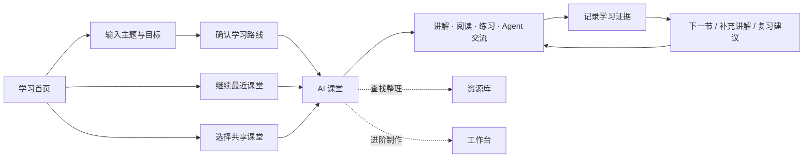

# 文档入口

后续系统开发以以下两份设计为主方向（2026-09-17，用户已确认，新增能力待实施）：

- [课程准备 Agent 主设计](architecture/2026-09-17-course-preparation-agent-design-cn.md)：首页需求和资料上传、背景与配置读取、全自动研究规划、教学资源制作、自检交付、两个 Agent 的交接契约。
- [学习辅导 Agent 主设计](architecture/2026-09-17-learning-agent-design-cn.md)：知识点独立上下文、学习记忆与阅读定位、安静陪学、无需聊天的学习路径、补充资源和修改资料。

开发前同时阅读两份文档，具体实施计划和验收记录须引用相应设计要求。运行现状见[项目总览地图](../项目总览地图.md)与[真实学习流程联调记录](acceptance/2026-09-14-live-learning-integration.md)，既有能力契约见[架构索引](architecture/README.md)和[规格索引](spec/README.md)。

以下保留 9 月 14 日前端原型设计作为历史参考。其中“路线确认后进入”“学生不提供上传”“跨知识点保留同一课堂对话”等要求已被上述两份主设计替代；原型流程与旧描述不代表新的开发基线。

## 9.14 自主学习平台：前端组织与交互设计（历史）

状态：讨论方案与交互原型，尚未接入业务系统。根据 9 月 14 日的新定位编写；本方案取代此前保留班级、布置任务和师生互动的设想。

历史原型文件为 `prototype.html`，当前文档目录未保留该文件。原演示路径为“首页 → 规划路线 → 确认并进入课堂”，右上角可切换示例身份；数据、搜索、生成、Agent 回复与共享发布均为本机演示，不连接后端，刷新可保留本机演示学习位置。

## 1. 产品主线与命名

**首页负责开始与继续学习；AI 课堂负责完整学习过程；资源库负责查找和整理；工作台提供进阶工具。**



一个“AI 课堂”承载一次完整学习需求，例如“Agent 面试准备”，包含学习路线、各节点资源和用户的学习会话。原有单次生成的 OpenMAIC 课件成为节点内的“互动讲解”。“学习路线”表达推荐顺序，“知识点”表达学习内容，“学习资料”表达可阅读或播放的资源，避免课程、课堂、知识点和文件在界面里混指同一对象。

登录后统一进入首页。学生与教师使用同一套导航和学习界面；差异仅体现在教师拥有共享课堂上传与发布权限。个人课堂默认仅本人可见。按本轮要求，学生端不提供文件上传入口，包括首页附件和知识库上传。

## 2. 全局页面结构

```text
学习首页
├── 输入学习需求 → 路线确认 → AI 课堂
├── 继续学习 → 上次节点与学习位置
└── 共享课堂预览 → 开始学习 → AI 课堂

AI 课堂（主要使用场所）
├── 左：学习路线与节点状态
├── 中：当前节点的讲解、阅读、练习
├── 右：常驻学习 Agent
└── 更多：课堂资料、工作台、课堂设置

资源库（次级全局入口）
├── 我的资源：跨课堂查询与整理
├── 已收藏的共享资源
└── 我发布的课堂（仅教师）

工作台（课堂内的次级入口）
├── 生成与编辑：课堂、文档、PPT、视频、习题等
└── 知识来源：检索资料、索引状态、来源与版本

个人中心：个人信息、偏好等
```

全局顶栏建议为“Edu AI / 首页 / 资源库”，右侧保留“生成进度”和个人菜单。共享课堂在首页下方有预览和“查看全部”，不新增常驻的主导航。进入课堂后显示返回首页、课堂名称、AI 课堂和次级资源/工作台入口。

工作台、课程知识、资源管理、学习任务不再作为五个等权重标签横排。学习任务及其布置、提交、催办、教师批阅和班级进度入口彻底退出产品；后台生成作业仍需保留，统一称“生成进度”，避免和学习任务混淆。个人练习与即时反馈继续保留。

## 3. 首页：一个明确起点，两个后续入口

### 首屏

参考图一的中央输入方式与留白，控制输入区高度，让桌面首屏同时露出“继续学习”。

- 主标题：“今天，你想学会什么？”
- 主输入框示例：“我会 Python，希望两周内掌握 Agent，准备开发岗位面试。”
- 可选条件：学习目标、当前基础、每天可投入时间。自然语言已经给出的条件由系统识别，不要求重复填写。
- 唯一主按钮：“规划学习路线”。不把“立即生成”写成按钮，因为下一步还有路线确认。
- 输入框下方提供三条可点击示例需求。

首页不展示模型选择、RAG 开关、知识图谱构建、课件类型等设置。高级选项进入工作台或偏好设置。

### 输入区下方

先显示“继续学习”，再显示“共享课堂”。个人课堂卡片展示名称、学习目标、上次节点、最近学习时间和“继续学习”；路线进度写“已完成学习 3/8 节”，不要把百分比写成知识掌握率。生成中的课堂显示准备状态，失败的课堂显示重试入口。

共享课堂卡片展示名称、教师发布者、适合基础、路线规模和预计时长。所有登录用户可浏览；点击后查看简短介绍和路线摘要，点击“开始学习”直接进入 AI 课堂。已经学习过的共享课堂显示“继续学习”，同时进入个人最近记录。首页不把所有共享课堂无限铺开，通过“查看全部”进入带搜索的列表。

新用户无历史时，用简短引导替代空卡片区；回访用户突出上次课堂，但中央输入框仍保留，方便开始新目标。

## 4. 创建流程：路线确认后直接进入课堂

路线确认是轻量过渡页，沿用首页顶栏和当前输入，不跳到工作台。页面包含目标、基础、预计学习节奏和可编辑的节点列表；每个节点说明“学完能够做什么”。用户可以改名称、调整顺序、增删节点，也可以用一句话要求 Agent 调整。

需求明显不足时先追问必要信息；已有充分信息时直接给草案。时间估算明确为建议，确认按钮为“确认路线，进入课堂”。

确认后立即创建个人学习空间并进入 AI 课堂，路线可见，系统自动检索并准备第一节。建议采用：

1. 先准备当前节点的资料与基本讲解，让用户尽早开始。
2. 在后台准备后续节点，视频等耗时资源按需要生成。
3. 不要求用户先创建知识库、审核图谱，再逐节点击生成。

界面显示“正在查找参考资料 → 整理第一节 → 准备讲解”，每一步反映真实服务状态，不使用没有依据的精确百分比。已完成资料可以先读；某份视频失败不阻止阅读与问答。失败项在原位重试，不重复创建整门课堂；允许离开页面，准备状态在首页和生成进度里继续可见。

## 5. AI 课堂：学习路线、内容、Agent 三者联动

### 布局

沿用图二的三栏框架，但改变默认内容和职责：

| 区域 | 主要内容 | 用户要得到的答案 |
| --- | --- | --- |
| 左侧，约 240–280px | 当前目标、分阶段路线、节点状态、调整路线入口 | 我在何处，下一步是什么？ |
| 中间，自适应宽度 | 当前节点目标、互动讲解/阅读/练习、资料来源、继续按钮 | 我现在学什么，怎么学？ |
| 右侧，约 320–380px | 常驻 Agent、当前上下文、提问与反馈、下一步建议 | 不懂时谁帮助我，是否需要补学？ |

首次进入自动定位第一个推荐节点；再次进入恢复上次节点、所选资源及其阅读/播放位置。中间不再默认显示“从左侧选择一个小节”的大面积空状态。恢复后让用户点一下继续播放，避免突然出声；生成期间 Agent 已可以围绕目标、路线交流，无需先选定一个课件。

左侧显示“待学习 / 学习中 / 待复习 / 已完成学习”，另用小标记说明资源“准备中 / 可用 / 失败”，不混合内容准备与学习状态，也不再显示待审核、已发布数量。“已完成学习”与“已掌握”分开：观看结束只是行为，检查结果另行呈现。允许跳学，必要时给出先修知识建议，不强制锁住整条路线。

### 中间内容

节点顶部明确本节目标和预计时间。下方采用“互动讲解 / 阅读资料 / 练习”的切换；有视频时作为可选资源出现，没有就不显示空白视频入口。来源入口展示出处、检索时间和引用位置。笔记与收藏放在内容工具区。

节点底部只有一个当前推荐行动，例如“做一道检查题”“继续下一节”或“补充学习工具调用”。学习者可以选择继续、复习或暂停，Agent 的建议不是强制控制。

### Agent 的职责与上下文

Agent 从课堂进入时就参与学习，而非只在资源被选中后回答问题。界面显示简短上下文，如“本节：工具调用 · 已阅读示例 · 有一题待复习”，并允许查看学习记录。

它需要读取经用户身份校验的学习目标、路线版本、当前节点与资源版本、播放/阅读事实、练习反馈和之前的困难点；不能仅凭当前页面文本推断历史掌握情况。

建议主动介入四个时机：首次进入、恢复学习、用户完成检查、用户请求帮助。提问时暂停讲解，回答后允许继续；不因每次点击不断发消息。节点切换保留课堂级对话，并给每条讨论标注节点；回答到达时校验原上下文，避免把上一节的答案挂到新一节。

例如：“上次你能说明工具的作用，但还没区分工具调用与完整 Agent 循环。我们先用一个例子比较，再进入 ReAct。”这些话必须有学习记录依据；没有证据就说“我们先做一道题了解一下”。

调整路线时展示增加、删去或移动的节点和原因，让用户确认。保留旧路线版本与既有学习证据，不因重排目录清空进度。一次“我懂了”或视频播放完成不直接写入掌握结论。

## 6. 资源库和工作台的分工

**AI 课堂用于使用资源，资源库用于找回和整理资源，工作台用于制作和调整资源。**

资源库是同一批资源的另一种查看方式，不再另外维护一套课程文件。默认“我的资源”，支持按课堂、节点、类型和关键词筛选；教师额外有“我发布的课堂”。从课堂进入时默认筛选当前课堂，从首页进入时查看跨课堂资源。

每条资源显示名称、所属课堂/节点、类型、来源、版本与更新时间。点击打开预览，提供“回到课堂学习”。用户可整理自己的生成资源、收藏、下载和管理版本。共享资源的收藏只是个人引用，不能改动教师原版。移除个人收藏不删除公共内容。

工作台置于课堂“更多”菜单或弱化的次级入口，自动带上当前课堂与节点。保留问答生成、资源编辑、手动生成 PPT/文档/视频/习题，以及“知识来源”管理。编辑后返回原学习位置。

“课程知识”取消独立主导航。来源管理、索引和图谱相关能力收进工作台，默认自动执行；学习者在课堂看整理后的资料及引用，无需理解知识库构建。教师上传入口独立用于课堂发布；学生不出现任何文件上传按钮。

## 7. 共享课堂与师生权限

| 操作 | 学生 | 教师 |
| --- | --- | --- |
| 输入需求，生成并学习个人课堂 | 支持 | 支持 |
| 使用学习 Agent、练习、管理自己的资源 | 支持 | 支持 |
| 浏览并学习共享课堂 | 支持 | 支持 |
| 上传文件/课程 | 不提供 | 提供课堂上传入口 |
| 将课堂发布到共享空间 | 不支持 | 支持 |
| 修改、更新、下架共享课堂 | 不支持 | 仅本人发布的课堂 |
| 布置作业、管理学生、查看他人学习记录 | 不提供 | 不提供 |

教师发布流程：“共享课堂 → 上传课堂 → 解析与预览 → 补充标题、基础和简介 → 发布”。自己生成的课堂也可从课堂菜单发起发布。上传完成不等于已经公开；原型中的发布仅演示本机状态。

共享内容与个人学习记录分离：所有人看到同一发布版本，但每人有独立的学习位置、练习记录、笔记和 Agent 对话。教师不获得学习者对话或进度查看权限。个人补充资料和个性化路线仅保存到个人学习空间，不改公共原版；初版可先只开放个人副本的路线调整。

共享课堂更新不覆盖用户已学版本，提示用户选择是否迁移；下架时从共享列表移除，保留个人学习记录，内容是否继续可用按资源保留规则明确提示。具体上传文件格式、解析能力和保留规则需要在实施时确定，不在前端承诺“任意文件都可变成互动课堂”。

## 8. 小屏与关键状态

- 1440px 左右采用三栏；较窄桌面可收起路线，让 Agent 与内容保持可读。
- 平板/手机使用“学习 / 路线 / Agent”切换，同一时间只呈现一个主要面板；切换不重建学习会话。
- 资料准备中、生成失败、无可用来源、网络离线都在所在节点解释并给出可执行动作。
- 离线时标注记录待同步，不把尚未提交的练习显示为已验证；刷新与重登恢复依赖服务端存储。
- 共享课堂缺失、下架或资源无权访问时，保留清晰返回入口，不跳到空工作台。
- 表单可用键盘操作，有明确标签；进度和状态除了颜色还用文字说明。

## 9. 与现有前端的衔接

| 现有模块 | 新组织方式 |
| --- | --- |
| `HomeDashboard` / `StudentHome` | 收敛为统一学习首页，身份仅控制共享发布按钮 |
| `teacherRoutes` / `studentRoutes` / `courseNavigation` | 收敛统一学习路由；旧课堂链接做定位兼容 |
| `ClassroomStudio` / `ClassroomWorkspaceLayout` | 复用三栏与播放器，加入路线、自动恢复和课堂级 Agent |
| `CurriculumNodeOverview` | 默认本节学习目标、资料、推荐行动，移除发布审核口径 |
| `ContextualClassroomQaPanel` | 从单份资源问答扩展为目标、路线与学习记录感知 |
| `CourseResources` | 统一资源库；当前课堂只是一个筛选条件 |
| `AIWorkspace` / 生成工具 | 下沉为进阶工作台，保留多种资源生成能力 |
| 课程知识与图谱页面 | 整合到工作台的知识来源管理 |
| 学习任务相关页面、导航、角色跳转 | 删除；个人练习与资源学习事实独立保留 |

建议目标路由为 `/learn`、`/learn/new`、`/classrooms/:id`、`/shared`、`/resources`、`/classrooms/:id/studio`。课堂 URL 携带节点/资源定位，浏览器前进后退和分享定位应有效；鉴权由后端保证，不能只隐藏前端按钮。课堂级 Agent、学习路线实体、共享发布和权限变化需要对应后端改造，本方案和原型不代表这些能力已经上线。

落地顺序：先验证统一首页与三栏学习流程；再接入路线、自动资料准备、个人学习记录和 Agent；接入教师共享发布与资源整理；最后清除旧任务入口、双端重复壳和旧课程知识路由。最终产品不保留学习任务，清理代码时单独处理历史数据，不连带删除个人学习事实。

验收时重点观察：新用户是否知道如何开始、点击课堂能否直接学习、返回是否续上、Agent 是否依据事实引导、资料是否自动出现在相应节点、学生是否无上传入口、教师能否发布且无法查看他人学习记录。

## 原型覆盖范围

可体验：首页示例输入、编辑并确认路线、资料准备状态、三栏课堂、节点切换、讲解/阅读/练习、示例 Agent 交流、学习位置恢复、资源筛选、次级工作台、共享预览、教师身份及上传发布演示、窄屏面板切换。

原型不执行真实检索、LLM 推理、音视频生成、账号鉴权或服务器发布；生成与学习状态仅用于讨论交互。生产环境必须用真实进度与评估证据替换示例数据。

### 已核验的交互（2026-09-14）

- 浏览器实际完成：示例需求 → 修改课堂名称 → 确认路线 → 课堂内资料准备 → 练习检查 → 下一节。
- 刷新后恢复到第二节，并保留第一节的示例检查结果。
- Agent 输入与示例回复、当前课堂的资料筛选、返回课堂和次级工作台均可操作。
- 教师视角展示上传表单；个人课堂发布经过预览，在本机共享列表可见；切换学生后上传按钮数量为零。
- 共享课堂经过介绍预览后直接进入第一节，使用个人学习状态。
- 1440px 桌面检查三栏排版；390px 窄屏检查学习/Agent 面板切换，页面宽度与滚动宽度均为 390px，无横向溢出。
- 内联 JavaScript 通过语法检查；主要操作期间未观察到浏览器脚本错误。以上不代表后端功能或真实学习效果验证。
