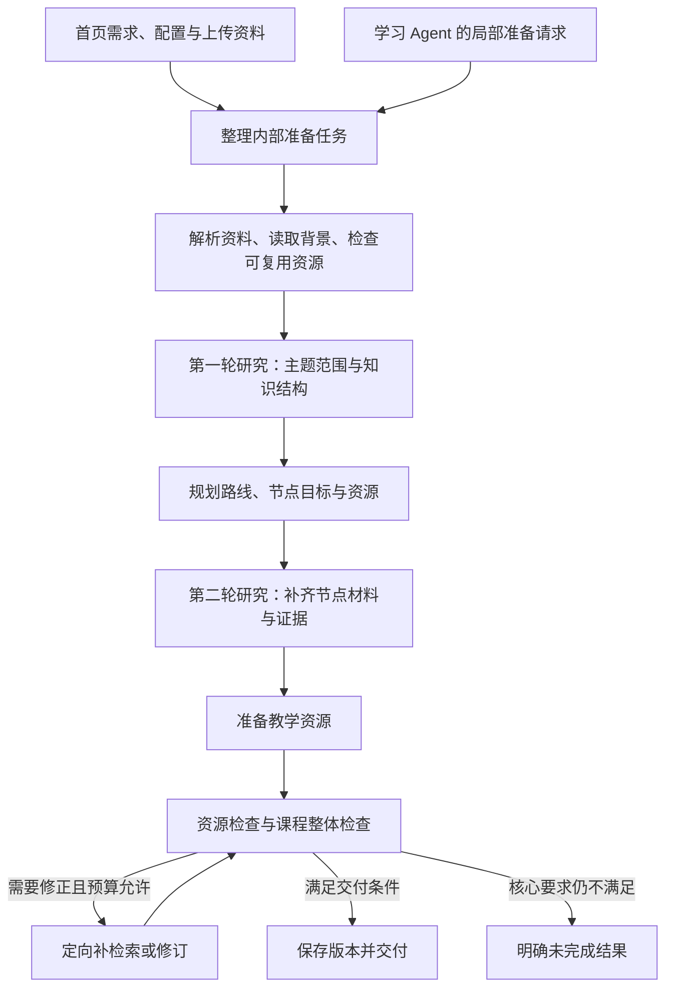

# 课程准备 Agent 主设计

日期：2026-09-17。状态：用户已确认的产品与架构方向，待分阶段实施。本文件与[学习辅导 Agent 主设计](2026-09-17-learning-agent-design-cn.md)共同作为后续系统开发的主基线，不代表所述能力已经上线。

## 1. 定位与设计效力

课程准备 Agent 接收学习需求和相关背景，自主完成资料研究、课程规划、教学资源制作与质量检查，交付可直接学习的课程；也接受学习辅导 Agent 的调用，准备局部补充资源或修订已有资料。

以现有工作台 Agent 的需求理解、检索、生成、修改和任务查询能力为改造基础。其组织中心由“单个生成作品”扩展到“学习目标、课程路线和节点资源”。工作台独立生成作品的能力继续保留。

两种业务 Agent 分别维护职责、上下文、工具范围和执行状态，可以复用模型网关、检索、生成服务、数据库和运行基础设施。初期不要求独立部署，不额外增加总控 Agent，也不把检索、规划、自检各自拆成独立 Agent。

本轮明确取代旧方案中的以下要求：

- 首页课程准备不再以大纲或路线的人工确认为执行前提。点击开始后自主推进，直接交付最终结果。
- 支持用户上传学习资料，包括 DOC/DOCX、Markdown、PDF；不沿用旧自主学习前端方案“学生无上传入口”的限制。上传不等于共享发布。
- 默认达到课程交付标准后提供学习入口，不把“首节完成即进入、其余仍在准备”作为首版默认体验。
- 两个业务 Agent 的分工以这两份主设计为准，旧单教育 Agent 总入口设计作为能力复用参考。

这些变更适用于新的课程准备路径。旧工作台独立报告等流程的确认门槛需在迁移时逐项处理，不能通过全局关闭旧校验实现新流程。认证、资源授权、版本追溯和真实状态查询等既有约束继续有效。

## 2. 主要场景与职责边界

| 场景 | 入口与输入 | 交付 |
| --- | --- | --- |
| 创建个人课程 | 首页需求、可选上传资料、个人配置与相关学习背景 | 路线、节点资源、来源、检查结果和课程版本 |
| 补充教学资源 | 学习 Agent 提交当前知识点的具体准备需求 | 绑定知识点的补充讲义、练习或其他资源 |
| 修改已有资料 | 学习 Agent 或用户明确指定资料及修改目标 | 可追踪的新版本、修改说明与适用范围 |
| 调整课程 | 用户明确提出的课程调整需求，经入口或学习 Agent 整理 | 变更后的路线和相应资源；保留旧版本与学习事实 |

课程准备 Agent 负责“学什么、如何组织内容、需要准备什么”，学习 Agent 负责“用户此刻如何理解和推进学习”。即时解释、举例和对话中的理解检查由学习 Agent 完成；需要保存并挂入课程的资源制作或修订交给准备 Agent。

程序服务负责解析、任务执行、配音、渲染、存储、鉴权、取消、幂等和版本提交。Agent 决定下一步并解释结果，不能仅凭自然语言回复写入任意任务状态或声明完成。

## 3. 输入与配置设计

首页输入框只收集本次需求。个人背景与默认偏好在个人中心维护，首页可通过折叠区域查看或临时覆盖本次设置，不重复要求用户填写。

| 输入来源 | 内容 | 使用原则 |
| --- | --- | --- |
| 本次需求 | 主题、学习目标、基础、时长、特殊要求、排除项 | 本次明确要求优先于历史偏好 |
| 个人学习配置 | 用户填写的已有基础、常用语言、每天可用时间、默认深度 | 可选；缺失不阻塞准备 |
| 学习与表达偏好 | 详略、案例比例、理论与实践比例、偏好的资源形式 | 可更正的偏好，不当作固定能力标签 |
| 相关学习记忆 | 有权限且与目标相关的已学内容、练习证据、困难点 | 保留来源与作用域，不扫描或拼接全部历史 |
| 上传资料 | DOC/DOCX、MD、PDF 等原件及解析结果 | 保留文件版本、章节或页码定位与解析质量 |
| 系统能力配置 | 可用模型、上下文限制、可用工具、检索范围、支持资源类型、任务额度 | 由服务端执行约束；凭据不进入模型上下文 |

用户可选的模型偏好应映射到服务端允许的模型配置，不要求在需求文本中填写型号。具体模型选择界面、默认模型及不同阶段的调用策略后续细化，不在本设计固定厂商。

上传资料的用途分为主要依据、辅助参考和覆盖范围。优先根据用户要求判断；未指定时默认围绕上传资料组织内容，外部资料用于补充和核验，并在最终说明中披露重要假设。用户限定“仅依据上传文件”时，不擅自扩大来源范围。

文件先完成类型、可读性和解析检查；扫描件、复杂表格等不能默认解析成功。可恢复的问题有限重试；核心文件无法使用且无合理替代时进入明确失败结果。上传文本和检索内容都是参考数据，不能改变系统规则或资源权限。

个人偏好支持查看、更正和删除。一次性任务要求不自动成为永久偏好；当前课程学习事实也不自动泛化为跨课程能力结论。具体读取和记忆边界继续遵守[读取与记忆约定](2026-09-08-agent-access-memory-contract-cn.md)。

## 4. 内部准备任务

开始后先将输入整理成一份持续使用的内部任务说明，贯穿研究、规划、制作和自检：

- 用户、入口、请求标识，以及新建或已有课程的范围。
- 学习目标、预期可展示的能力、已有基础和时间约束。
- 内容覆盖范围、排除项、来源约束和上传资料用途。
- 期望交付的课程或局部资源，以及必须满足的条件。
- 使用的背景与配置快照、缺失信息的默认假设。
- 允许的操作范围、基准版本、执行预算和完成条件。

这些是业务信息要求，不是已确定的数据库表或 API 字段名。信息不足时采用合理默认值，不追加需要用户答复的中间澄清关卡。确实无法形成有意义结果时说明未完成原因，不编造需求或无限等待。

## 5. 全自动主流程



### 5.1 资料整理与初步研究

解析用户资料，读取相关背景，检查已有课程与资源能否复用。第一轮研究用于了解主题范围、核心概念、先修关系和可用来源，产出主题结构与证据摘要。搜索结果摘要不等于已读正文，引用必须对应实际取得的内容。

### 5.2 课程规划

将目标拆成有先修关系和建议顺序的知识点，每个节点定义“学完能够做什么”，匹配基础、深度和时间。标明核心内容与可选扩展；规划每个节点所需资源和检查方式，不为凑齐资源类型而生成所有格式。

规划是内部阶段，不展示成需要用户批准的大纲。初步检查目标覆盖、先修缺口、重复、难度跨度和时间可行性，必要时自主修订。

### 5.3 节点定向研究

第二轮研究针对节点缺口，查找解释依据、案例、示例代码、练习素材等，建立节点级材料与来源关系。材料充分时可以直接复用，不机械要求两次外部搜索；来源冲突或关键证据不足时先处理再制作。

### 5.4 资源制作

按节点目标组合文档、互动讲解、练习和必要媒体，调用现有生成服务。彼此独立的资源可以后台并行，但阶段依赖与最终一致性需要保留。Agent 无需亲自执行解析、配音或视频渲染。

补充或修改任务只执行相关步骤，不重新生成整门课程。已有资源符合目标时优先复用，检查版本与权限。

### 5.5 自检与定向修复

| 检查位置 | 检查内容 | 主要执行者 |
| --- | --- | --- |
| 来源检查 | 相关性、可靠性、足够性、冲突、引用定位 | Agent/模型判断与来源服务 |
| 规划检查 | 目标覆盖、先修顺序、难度、重复、时间约束 | Agent/模型判断 |
| 内容检查 | 解释准确性、教学目标、案例、练习答案与解析一致性 | 模型审阅与可执行的业务校验 |
| 资源检查 | 结构可解析、附件可用、引用有效、播放或预览入口可访问 | 确定性程序 |
| 课程检查 | 跨节点术语一致、无核心资源缺失、路线与内容匹配 | Agent/模型判断与结构校验 |

自检不只是在最后让原生成过程说“检查通过”。保存发现的问题、修复记录和所检查的版本；内容变更后，受影响的检查结论需要重新验证。模型审阅存在漏检，不宣传为绝对正确。

研究、重试和修订都有可配置的次数、时间或成本边界。只重做问题部分，达到上限后明确结束。具体数值和审阅实现后续设计，不在此伪定验收成绩或固定模型调用次数。

### 5.6 最终交付

课程交付至少包含：

- 课程目标、适合基础、建议学习投入和重要假设。
- 有序路线、稳定的知识点标识、节点目标及先修关系。
- 每个节点的核心资源、可选补充资源、推荐顺序和检查方式。
- 可访问的资源内容、类型、用途、版本与来源。
- 课程检查结果、仍然存在的非核心限制及可开始学习的入口。

所有规划为核心的节点和资源满足交付要求后，才把课程标记为可学习；不因单个任务返回成功就宣布课程完成。非核心视频等失败，可以在不损害目标和用户明确要求的前提下降级，并说明缺少项。明确要求的视频不能事后擅自改为可选来绕过失败。

## 6. 用户体验与执行状态

首页点击开始即创建可恢复任务。用户可以离开页面，任务通过持久化后台服务继续执行；返回后读取真实状态，重复提交或任务恢复不重复创建课程和资源。

准备期间只显示必要的真实阶段，例如“整理资料、研究与规划、准备教学内容、检查课程”。阶段可以因修订回到前一步，不伪造精确百分比，不把中间产物作为用户必须处理的待办。

业务上区分已接收、执行中、检查中、完成、失败、取消；执行中保留具体阶段与子任务。最终枚举、事件名称和恢复协议另行细化。取消由任务服务执行；失败保留已完成工作和原因，重试从有效检查点继续。

本流程没有等待用户确认的正常状态。自动流程中的权限失效、无法解析的核心来源等问题应明确失败或按已允许范围降级，不能以“等待确认”无限挂起。

个人课程准备完成不等于公开发布。教师共享发布继续作为单独业务操作。

## 7. 交付给学习 Agent 的课程结构

```text
课程：目标、适合基础、路线版本
  └─ 知识点：稳定 ID、学习目标、先修关系、顺序
       ├─ 核心资料：资源 ID、版本、用途、推荐顺序
       ├─ 可选资料：资源 ID、版本、用途
       └─ 检查方式：对应学习目标及可用练习
```

学习 Agent 据此决定从哪里开始、资料学完后到哪里继续、何时适合检查理解。准备 Agent 不写入用户已经学完或掌握的结论。课程可以多人使用，个人学习记录和对话独立保存。

<a id="handoff-contract"></a>

## 8. 两个 Agent 的交接契约

本节是双方交接规则的主定义；[学习 Agent 文档](2026-09-17-learning-agent-design-cn.md)引用本节，不另维护一份不同协议。以下是语义契约，具体 schema 待实施设计。

### 8.1 请求

| 信息组 | 必需内容 |
| --- | --- |
| 身份与关联 | 服务端认证的用户、课程、知识点、来源会话、请求标识 |
| 请求目标 | 补充资源、修订资料或明确范围的课程调整；希望解决的问题 |
| 目标对象 | 如涉及修改，提供资料 ID 与基准版本；涉及路线时提供路线版本 |
| 教学背景 | 必要的基础、偏好、困难摘要及其证据引用 |
| 输出约束 | 资源形式、深度、时间、来源与语言要求 |
| 操作范围 | 追加或修订哪些对象、结果所属个人空间、允许的变更范围 |

原始全量聊天不作为默认请求载荷。身份和权限来自服务端，不能由模型填写的用户或课程标识授予权限。用户直接请求的补充或修订无需再增加中间确认；学习 Agent 自己发现的改进机会不得自动扩大成未请求的整课重排、删除或公共内容修改。

用户只要求解释而未要求保存或改稿时，学习 Agent 直接回答。无需制造后台任务。

### 8.2 执行与返回

准备任务是有明确范围的服务调用，不让两个 Agent 互相递归聊天。接收后返回真实任务引用和状态；完成时返回资源或课程版本引用、用途、绑定知识点、检查结论、修改说明与限制。失败或取消也返回明确终态，不以已有旧资源冒充新结果。

学习 Agent 等待结果期间继续服务当前学习对话。完成事件关联原始请求，重复通知不重复挂载资源。页面收到通知不能擅自改变当前知识点、资料或正在进行的对话。

### 8.3 版本与冲突

- 修改产生可追踪的新版本，保留旧版本与基于旧版的学习证据。
- 提交前核对基准版本；目标已变化时不得静默覆盖。可在原范围内安全重试，否则返回明确冲突结果供后续操作，不设隐含审批等待。
- 共享课程的个人补充或修改进入个人空间，不改教师公共原版。
- 路线变化保持知识点稳定标识；保留历史进度，仅重新评估受影响的学习证据。
- 学习 Agent 按结果版本更新课程摘要，并负责用户侧的教学衔接，不把资源已生成理解为用户已学习。

## 9. 现有基础与改造方向

以下是本次文档整理时的源码观察，不是新功能验收：

| 当前基础 | 后续改造方向 |
| --- | --- |
| [首页创建接口](../../backend/src/app/api/self_learning.py)用模型规划 2～4 个知识点，再以 `source_mode='none'` 提交课件任务 | 接入统一准备 Agent、背景装配、上传解析、两阶段研究和课程检查 |
| [Harness 运行目录](../../backend/src/app/chat/harness/)及资源、报告、知识库相关 Skills | 复用规划、检索、生成和任务能力，增加课程级任务组织 |
| [课堂生成服务](../../backend/src/app/services/classroom_service.py)及持久化生成任务 | 继续承担长任务，补齐课程与节点的聚合交付条件 |
| 既有独立作品和修订能力 | 统一课程内追加、版本与个人空间归属 |

开发顺序建议：先确定课程产物和双方交接契约，再接入输入与任务骨架，随后接通研究、规划、资源准备、自检与最终交付，最后覆盖局部补充和版本修订闭环。具体代码拆分与实施计划另行编写。

## 10. 后续验收场景

1. 只有一句学习需求，也能采用合理默认值完成准备，无中间人工关卡。
2. 本次要求覆盖个人偏好；上传资料的范围约束得到执行。
3. DOC/DOCX、MD、PDF 分别验证解析和定位；核心解析失败显示真实失败，不能当作已读。
4. 第一轮研究支持路线，第二轮研究补节点缺口；充分材料可以复用。
5. 缺少核心节点、无效资源或检查失败时不能交付为完成；可选降级有说明。
6. 刷新、离开、重复请求、重启和局部失败重试不重复生成或丢失任务。
7. 学习 Agent 的补充请求只影响指定范围，结果正确挂到原知识点。
8. 修改保留旧版，版本冲突不覆盖新内容，共享原件不受个人修改影响。
9. 任务未完成、取消或失败时，状态和用户通知准确一致。

## 11. 待细化项

个人配置表单、文件大小与解析能力边界、默认课程规模、资源类型组合、预算与修订上限、审阅工具、具体状态与 API schema、模型选型和性能目标仍需后续设计。这些细节不能反向引入中间确认、强制上传或无界重试。
