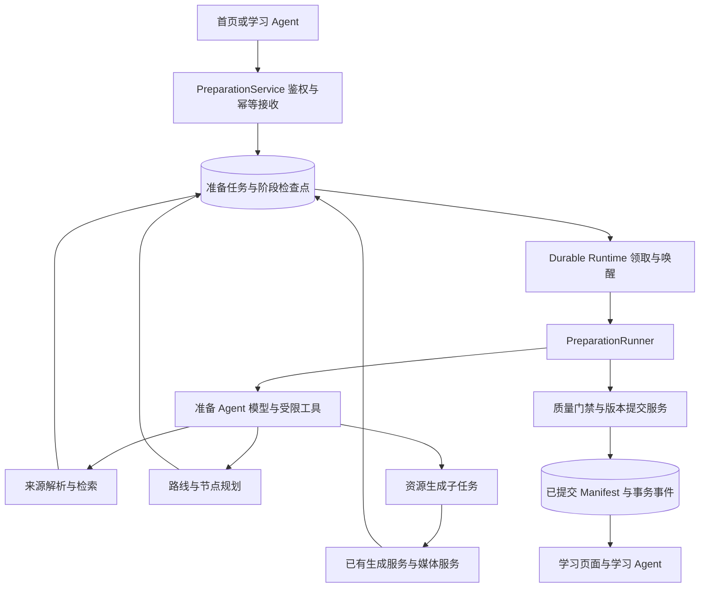

# 课程准备 Agent 具体设计 V1

日期：2026-09-17。状态：分阶段实施中，完整能力尚未上线。本文把[课程准备 Agent 主设计](2026-09-17-course-preparation-agent-design-cn.md)细化为可实施的运行、数据和接口契约，不改写其已确认的产品边界。除 P1 验收明确列出的实现外，本文字段、路径、枚举和预算默认值仍为后续技术方案，不代表已有接口或已验证的性能。

实施跟踪（2026-09-17）：用户已要求按阶段逐步实现，详见[七阶段实施计划](../superpowers/plans/2026-09-17-course-preparation-agent-implementation-cn.md)。P1 契约与原子接收存储已实现并完成本地验证，见[P1 验收](../acceptance/2026-09-17-course-preparation-agent-p1-cn.md)；后台执行、模型研究生成、质量交付及页面仍按后续阶段推进。以下整体架构不代表整套能力已上线。

运行核心补充：[记忆、工具与决策协议 V1](2026-09-17-course-preparation-agent-runtime-design-cn.md)是准备侧角色、记忆生命周期、上下文预算、工具挂载、策略与模型循环的细则。V1 选择原生可恢复 function calling；本文“复用 Harness”具体指可分离的检索/生成/审阅能力和资源规范，不直接复用工作台会话运行器或挂载全部旧 Skills。

相关基线：[学习辅导 Agent 主设计](2026-09-17-learning-agent-design-cn.md)、[读取与记忆约定](2026-09-08-agent-access-memory-contract-cn.md)、[数据库迁移约定](database-migration-spec.md)。双方交接语义仍以主设计的[交接契约](2026-09-17-course-preparation-agent-design-cn.md#handoff-contract)为准，本文提供其 V1 schema。

## 1. 核心决策

1. 准备 Agent 是独立业务运行实例，按 `preparation_id` 隔离上下文；不占用工作台或知识点的聊天会话，不增加总控 Agent。
2. Agent 通过受限工具决定研究、规划、资源组合和定向修复。持久化任务服务控制执行资格、预算、子任务、恢复、取消和课程提交。
3. 课程交付物采用不可变 `CourseManifest`，绑定稳定知识点 ID 和准确的资源版本。准备中的候选版本不进入正式学习目录。
4. 新建、补充、修订、课程调整共用任务骨架；按任务范围缩小执行步骤和写权限。
5. 复用已有生成、解析、检索、审阅和 durable runtime。准备控制循环通过严格模型适配和阶段工具注册表运行，新增课程级数据与编排能力。
6. 首页一次提交后自主完成，无大纲确认、保存审批或正常的 `waiting_for_user` 状态。个人交付与公共发布分别执行。

## 2. 源码现状与改造边界

以下为本次工作区源码观察，不等于部署验收：

| 现有位置 | 观察 | 设计影响 |
| --- | --- | --- |
| [self_learning.py](../../backend/src/app/api/self_learning.py) | HTTP 请求内先调用模型规划 2～4 个节点，再循环提交 `source_mode='none'` 的课堂任务 | 新入口应先持久化任务并返回；节点数和资源类型交给准备规划 |
| [学习服务](../../backend/src/app/self_learning/service.py) | 按叶节点及生成资源组装课堂；资源来源任务成功即可展示，空节点有占位资料 | 新课程改为从已提交 manifest 读取，不能以已有一份资源代替整课门禁 |
| [HarnessRuntime](../../backend/src/app/chat/harness/runtime.py)、[HarnessStore](../../backend/src/app/chat/harness/store.py) | 运行绑定对话，持有会话状态与流式生命周期 | 抽取模型与工具适配，准备任务另用运行存储和后台唤醒 |
| [durable runtime](../../backend/src/app/services/durable_job_runtime.py) | 已有任务执行器、handler 注册、完成处理和启动对账 | 扩展准备阶段 handler、可恢复让出执行及父子任务对账 |
| [job_store](../../backend/src/app/services/job_store.py) | 已有父任务、重试关联和 PostgreSQL 适配 | 复用公共任务查询；增加准备任务种类及聚合状态投影 |
| [资源审阅](../../backend/src/app/chat/harness/reviewed_resource.py) | 已有独立模型审阅、结构校验和内容哈希绑定；不同路径内部有修订循环 | 保留资源审阅，补来源、路线及整课检查；内部重试纳入父任务总预算 |
| [资源任务](../../backend/src/app/chat/harness/resource_jobs.py)、[生成 handler](../../backend/src/app/services/generation_task_handlers.py) | 可复用生成提交、来源解析和产物持久化 | 新适配器传入课程节点规范和证据，不伪造旧大纲人工确认记录 |

数据库新增能力使用 PostgreSQL 仓储和迁移。现有代码中存在兼容存储并不意味着可新增一套 JSON 课程事实源；需要跨表原子性的提交操作使用共享事务，不能拼接多个各自提交的旧方法。

## 3. 运行架构与职责



`PreparationRunner` 每次执行一个有界步骤：加载检查点，装配上下文，执行决策及工具，保存结果，然后安排下一步骤。等待解析、生成或媒体子任务时释放 worker，由完成事件或定时对账唤醒；不在 worker 内持续轮询，也不以保持 SSE 连接作为运行条件。

Runner 约束合法动作集合，模型决定集合内的下一步。例如证据不足时可以补研究，审阅失败时可以修订相关资源；只有提交服务可写 `succeeded`。研究、规划、自检是同一准备 Agent 的工作模式，独立审阅是无写工具的审阅调用，不引入新的业务 Agent。

## 4. 输入任务与操作范围

### 4.1 请求类型

`operation` 固定为：

| 值 | 必要目标 | 允许提交的变化 |
| --- | --- | --- |
| `create_course` | 学习需求 | 新个人课程及首次 manifest |
| `supplement_node` | 课程、稳定节点 ID、基准 manifest | 指定节点的个人补充资源与绑定 |
| `revise_resource` | 课程、节点、资源及基准资源版本、基准 manifest | 指定资源的新版本；共享资源产生个人派生资源 |
| `adjust_course` | 课程、基准 manifest、明确调整目标和范围 | 范围内路线及资源变化；不得扩大为公共原版修改 |

请求者身份由服务端会话生成。学习 Agent 工具参数不能自行授予 `owner`、管理员身份、写入公共空间或跨课程访问权限。提交前无法唯一确定修订对象时，由入口定位对象；有效任务接收后不进入确认等待。

### 4.2 内部 `PreparationBrief`

| 字段 | 含义与来源 |
| --- | --- |
| `schema_version`, `preparation_id`, `operation` | 协议版本、服务端任务 ID、操作类型 |
| `request_ref` | 用户请求 ID、入口、可选来源会话与消息引用 |
| `scope` | 服务端核验的用户、课程、节点、目标资源、个人空间及允许变更的对象集合 |
| `base_refs` | 基准 manifest、路线及资源版本；新建时为空 |
| `goal`, `outcomes`, `prior_knowledge` | 原始需求、可展示能力、已知基础；推定基础标为假设 |
| `constraints` | 语言、总时间、深度、必须资源类型、覆盖和排除项 |
| `source_policy` | 允许的上传版本、检索集合和外部网络范围；上传用途 |
| `context_refs` | 偏好版本、相关学习摘要和证据引用，不默认包含完整聊天 |
| `assumptions` | 缺失信息的默认值及其原因 |
| `requirements` | 带稳定 ID 的交付条件及来源，区分用户明确要求和规划产生的要求 |
| `execution_policy_ref` | 非敏感能力、预算与模型角色配置快照 |

接收时冻结原始输入、来源范围及权限上限。需求整理产生 brief 新修订；模型可补假设，不能改写原始请求或放宽来源、额度和权限。当前明确要求覆盖个人偏好，偏好不覆盖服务端约束。

默认输入不足时假定入门基础、跟随需求语言、紧凑课程；明确无法实现的要求以原因终止。模型不把一次课程中的困难写成永久能力标签。偏好被删除或访问权撤销后，后续步骤重新检查相关引用，使派生上下文失效；审计保留必要引用和删除标记，不能通过任务快照重新注入已删除偏好正文。

## 5. 课程交付与版本模型

### 5.1 `CourseManifest`

manifest 是学习端读取路线和资源的权威交付清单。每次提交不可变，课程持有活动 manifest 指针；标题和顺序变化不改变节点 ID。

```json
{
  "schema_version": 1,
  "manifest_id": "cm_01",
  "course_id": "course_01",
  "version": 1,
  "route_version": 1,
  "space": "personal",
  "goal": "能够编写并解释简单递归函数",
  "audience": "具备基本函数知识",
  "estimated_minutes": 60,
  "assumptions": ["已了解条件判断"],
  "nodes": [{
    "node_id": "node_01",
    "title": "递归终止条件",
    "order": 1,
    "required": true,
    "objectives": [{"objective_id": "obj_01", "text": "能辨认缺少终止条件的递归"}],
    "prerequisite_node_ids": [],
    "estimated_minutes": 20,
    "resources": [{
      "resource_id": "res_01",
      "resource_type": "report",
      "version": 1,
      "content_sha256": "<实际正文哈希>",
      "purpose": "核心讲解与自测",
      "required": true,
      "order": 1,
      "objective_ids": ["obj_01"],
      "source_refs": ["evidence_01"]
    }],
    "checks": [{
      "check_id": "check_01",
      "objective_ids": ["obj_01"],
      "mode": "self_check",
      "resource_id": "res_01",
      "resource_version": 1,
      "locator": {"section_id": "practice"}
    }]
  }],
  "quality_report_id": "qr_01",
  "limitations": [],
  "created_by_preparation_id": "prep_01"
}
```

这是字段示例，省略其他节点；示例哈希不代表真实产物。资源 ID 通过适配器映射现有 `material_type + material_id + course_id`，避免不同类型 ID 冲突。URL 不作为永久资源身份；读取时经鉴权解析内容及播放入口。

约束：节点及目标 ID 唯一；先修引用存在且无环；顺序符合先修；每个核心节点有覆盖目标的核心内容及检查方式。检查可以是正文自测或结构化练习，无需每个节点强制生成独立题库。`estimated_minutes` 表示学习投入，与媒体时长分别计算。

### 5.2 路线和个人版本

- 初次交付同时创建课程和个人活动 manifest。准备过程中只保留草稿身份，不让课程详情回退到“列出已生成资源即可学习”。
- 仅追加资料时 manifest 版本增加，路线版本保持；目标、先修或节点集合变化时增加路线版本。
- 节点重排保留 ID。拆分或合并分配新 ID 并保存 `replaces_node_ids` 关系；旧节点作为历史保留，不自动复制掌握结论。
- 个人课程修订保留资源历史版本。共享课程使用个人 overlay，固定共享基准 manifest，保存个人追加和覆盖映射；默认不跟随公共版本自动漂移。
- 新版本成为可用版本不等于立即替换当前阅读页。学习端持有正在阅读的 manifest 和资源版本，用户切换时再处理位置映射及受影响证据。
- 发布为教师公共内容沿用单独发布服务。准备工具不提供公共发布动作。

## 6. 研究、规划与制作的决策循环

### 6.1 阶段产物

| 阶段 | 必须保存的产物 | 进入下一步的条件 |
| --- | --- | --- |
| `normalize` | Brief、来源策略、需求约束表、假设 | 输入可解释，目标与操作范围可执行 |
| `ingest` | 文件解析结果、定位、质量、复用候选 | 核心来源可读；失败不可伪装为已读 |
| `research_scope` | 主题结构、先修、证据摘要和缺口 | 有足够依据形成路线 |
| `plan` | 候选路线、目标映射、资源规格、时间估计 | 结构和规划审阅通过 |
| `research_nodes` | 节点证据包与缺口处理 | 待生成资源的关键依据足够 |
| `produce` | 资源规格版本、生成子任务和产物引用 | 所需产物已持久化或有明确失败 |
| `review` | 来源、内容、技术及整课检查结果 | 全部阻塞项消除或转入有界修复 |
| `repair` | 问题 ID、变更范围、失效检查集合 | 修订后的相关检查重新执行 |
| `commit` | 确定版本的交付候选 | 提交服务通过权限、版本和门禁验证 |

两轮研究是目的划分，不要求两次外部搜索。已读取的上传资料和可复用证据充分时直接进入下一阶段。局部任务只构建受影响节点的材料包，课程调整才重新检查受影响路线与相邻先修。

### 6.2 来源与解析

先上传至用户私有空间，以已授权的 `document_id + version` 加入请求。解析复用已有文档服务，增加统一定位适配：PDF 页码和区块；DOCX 段落/标题路径；Markdown 标题和行区间；DOC 保留转换链及原件引用。无法可靠映射原 DOC 页码时明确标注，不生成假页码。

`EvidenceRecord` 保存：来源 ID/版本、原始 URI 或文档引用、正文快照哈希、取得时间、实际取得的正文片段、定位、解析器版本和质量、支持的目标/论断、冲突和使用限制。搜索摘要只登记为候选，必须取得正文才可作为阅读证据。外部 URL 抓取经过服务端地址和来源范围校验。

`source_policy.mode` 为 `uploaded_only | uploads_preferred | open`。仅文件模式禁止网络与未允许知识库；文件中的链接不会自动扩展权限。无上传默认允许服务端开放的研究工具；工具不可用时使用足够的已授权材料，关键依据不足则失败，不能虚构来源。

解析状态为 `pending | running | ready | partial | failed`。`partial` 记录缺页/表格等缺陷，由覆盖需求判定能否继续；核心缺失不能仅因提取出少量文字而通过。首版不把建立完整课程知识库作为每门个人课程的前置条件，证据包可直接供生成使用。

### 6.3 Agent 上下文与工具

每步上下文由固定角色规则、brief、当前路线摘要、未解决问题、相关证据、工具执行事实、预算余量构成。正文按节点按需读取，不拼接所有文档或全量历史。保存可审计的选择摘要、对象引用和工具结果，不依赖模型隐藏推理恢复任务。完整 ContextPacket、分层记忆与工具目录以运行核心设计第4～7节为准，下表为能力概览。

| 工具组（拟定名称） | 能力与限制 |
| --- | --- |
| `read_preparation_context` | 读取本任务状态、配置摘要和缺口 |
| `read_related_learning_context` | 读取经授权、与目标相关的偏好/学习证据；不扫描全部历史 |
| `list_sources`, `read_source`, `search_sources`, `fetch_source` | 返回受来源策略约束的候选或已读取证据 |
| `find_reusable_resources`, `read_resource_version` | 按权限查找并回读准确版本；不能只凭标题复用 |
| `save_course_plan` | 保存候选计划，服务校验结构和需求映射；不激活路线 |
| `submit_node_resource`, `revise_node_resource` | 按已验证规格提交有幂等标识的后台子任务 |
| `query_child_tasks` | 查询真实执行事实；查询失败与未找到分别返回 |
| `request_review` | 对准确目标版本提交审阅，模型不能填写审阅已通过 |
| `record_repair_plan` | 将问题绑定定向修复及失效范围 |
| `propose_delivery` | 请求提交服务验证候选，不直接修改完成状态 |

统一工具返回 `operation_id, status, result_refs, error_code, retryable`。正文工具另提供有界片段与来源定位。参数经 schema 校验；权限与 source policy 由服务再次执行。非法动作不产生副作用，并计入调用预算，避免无效工具循环。

准备 Agent 的生成适配器使用服务端生成的 `execution_mode=course_preparation` 与任务作用域，走独立的自动提交策略。模型和普通客户端不能靠传这个字段绕过旧工作台确认。原报告、教案等旧流程继续由各自的确认策略管理。

模型配置按 `planner / researcher / generator / reviewer` 能力角色解析，可使用同一厂商或模型。审阅调用使用独立上下文，只读取要求、证据和实际产物，不接受生成者“已经正确”的自评作为检查结论。

## 7. 状态、恢复与预算

### 7.1 状态协议

准备业务状态为 `accepted | running | checking | succeeded | failed | canceled`，另有 `stage`、`revision`、`attempt_no`、`cancel_requested_at`、`waiting_on_child_ids`。检查阶段映射 `checking`，修复阶段回到 `running`；等待子任务保留业务运行状态并释放执行器。

```text
accepted → running ↔ checking → succeeded
accepted / running / checking → failed 或 canceled
```

`succeeded/failed/canceled` 是某次 attempt 的终态。显式重试创建新 attempt，任务状态重新投影为 `accepted`，历史终态保留；成功任务不能通过重试接口再次生成。需要改变原始需求时创建新 preparation。

公共 EduJob 投影：`accepted→queued`，`running/checking→running`，其余映射同义终态。取消处理中投影为 `cancel_requested`，前端显示“正在取消”。业务状态和通用任务投影不得分别作为可独立写入的完成事实。

新课程是否可学习来自已提交 manifest，而非准备任务正在运行与否。已有课程调整失败或运行中，旧 manifest 仍可学习。交付后的资源权限失效可导致当前访问受限，不改写历史准备成功记录。

### 7.2 幂等与崩溃恢复

- 接收键为 `(authenticated_user, request_id)`，同时存规范化请求哈希。同键同内容返回同任务；同键不同内容返回 409。课程 ID 由服务分配，不由客户端请求 ID 单独推导。
- 阶段检查点绑定输入哈希、产物引用、策略版本和完整性状态。恢复时逐项验证，输入、权限或依赖变化只使相关检查点失效。
- 生成规格先冻结并分配 `resource_spec_id + revision`；副作用键使用 `(preparation_id, resource_spec_id, revision, action)`。同规格恢复查询既有子任务；内容变更才产生新规格修订。
- 提交意图先持久化，由 dispatcher 幂等提交子任务。进程在外部提交后、记录返回前崩溃时，依据副作用键查询并认领任务；供应商无幂等/查询能力时不能保证调用费用只发生一次，但本地只能接纳一份交付结果。
- 后台执行采用租约及 fencing token，每次保存检查点和提交均核验当前 token。过期 worker 的迟到结果不得改写新 attempt。
- 子任务完成事件至少投递一次；消费者以事件 ID 去重。启动和周期对账扫描未结束任务与实际子任务，修复丢失唤醒，不凭对话内容推断成功。

### 7.3 取消与版本冲突

取消先持久化意图，阻止新动作及提交，再对可取消子任务传递取消。不支持中断的外部调用可继续返回，但结果只作为隔离草稿，不能激活为课程资源。任务服务确认提交已被阻断后进入 `canceled`，回收工作可后台完成。

取消与提交锁定同一任务记录：提交先完成则取消返回已成功、不能宣称取消；取消先持久化则提交被拒绝。其他 attempt 的迟到回调不能复活取消状态。

提交使用基准 manifest 的比较并交换。只有目标节点/资源未改变、且能证明变更独立时，才允许在原范围内重新基于新 manifest 组装并复检；目标内容或先修发生冲突则 `failed + VERSION_CONFLICT`。不静默覆盖，也不设隐含审批等待。

### 7.4 首版预算提案

以下是待校准的运行护栏，非 SLA 或主设计已确认参数：

| 项目 | 提议默认值 | 超限处理 |
| --- | --- | --- |
| 默认核心课程规模 | 4～8 个节点，硬上限 12 | 用户明确范围无法覆盖时失败，不悄悄删减要求 |
| 资源生成并发 | 每任务 2 个，并受用户/系统总额度约束 | 排队；父任务等待不占用子任务 worker |
| 同一可恢复外部操作 | 首次加最多 2 次重试 | 指数退避并加抖动，仍计入总时限 |
| 内容定向修复 | 每资源最多 2 轮，整课再检查修复最多 2 轮 | 核心问题未解决则失败 |
| 准备执行总时限 | 默认 30 分钟；显式重媒体配置可为 60 分钟 | 进入真实超时终态；实际数值须经媒体样本校准 |
| 控制循环 | 每 attempt 最多 60 次模型决策 | 结束为 `BUDGET_EXHAUSTED` |

总时限从接收开始，包含排队和等待；子调用超时不得超过剩余时间。模型 tokens、检索次数及费用上限由服务端预算配置给定，接收时解析为具体数值并保存，不能保留“无限”。未知供应商费用使用保守预留与 tokens 上限，记录估算和实耗差异。

旧生成器内部审阅、修订、解析和媒体重试必须共享预算账本，不允许父层和子层各自无感地消耗完整预算。并发动作在提交前预留额度，结束后结算；修订次数按实际发生计数，恢复不重置。显式重试可获得新 attempt 配额，但受用户累计额度约束。

## 8. 质量门禁与原子交付

`QualityCheck` 包含 `check_id, target_ref, input_digest, check_type, method, decision, issues, reviewer_config_ref, created_at`。问题包含严重性、目标位置、证据、修复建议和是否阻塞；结论为 `pass | fail | unavailable`，检查服务不可用不能转成通过。

| 层级 | 硬性要求 |
| --- | --- |
| 来源 | 引用指向实际取得的正文及准确版本，符合允许范围；关键冲突已处理或构成失败 |
| 路线 | 核心学习目标覆盖，先修无环、难度和时间合理，排除项得到执行 |
| 内容 | 检查实际最终正文，目标、关键论断、例题和答案解析无未解决阻塞问题 |
| 技术资源 | 格式可解析，必需附件存在且可访问，引用定位有效，明确要求的媒体可播放 |
| 课程整体 | manifest 与资源一致，术语/先修相容，全部核心节点及必需资源就绪 |

审阅输入摘要/哈希必须覆盖正文、资源规格、来源版本、相关路线和审阅规则版本。修改正文后内容和技术检查失效；修改来源后关联引用及准确性检查失效；修改路线后规划和受影响的整课检查失效。允许复用检查必须证明输入一致。

确定性检查负责结构、权限、文件和版本，模型负责教学及内容判断。结构通过不等于内容正确，模型审阅通过也不替代资源回读。明确要求的视频或资源被列为必须条件，修复不能将其改成可选规避失败。

提交服务在一个数据库事务内：

1. 锁定 preparation、当前 attempt 和待更新的个人课程/overlay 指针，验证租约、取消及当前权限。
2. 核对基准版本、候选输入摘要、资源准确版本和全部阻塞检查；权限和来源约束重新验证。
3. 插入不可变 manifest 或个人 overlay 版本及资源绑定，切换对应活动指针。
4. 写入 attempt 成功、结果引用和 outbox 完成事件；公共任务投影由同事务或可重建投影同步。

文件正文先写入不可变暂存位置并完成哈希/可读性验证，事务只提交其元数据引用。事务失败保留可回收草稿；不能先宣布成功再逐个挂资源。草稿文件的清理要识别任务租约、历史版本引用和保留期限，不能删除仍被旧学习记录引用的内容。

非核心资源失败且不影响用户明确要求时，manifest 记录缺项和原因，任务仍可成功；核心资源缺失则失败。最终结果包含交付引用、检查报告、重要假设和限制，不使用总分掩盖阻塞问题。

## 9. API 与双方交接 schema

### 9.1 接口

| 接口（拟定） | 行为 |
| --- | --- |
| `POST /api/course-preparations` | 鉴权、校验引用、幂等持久化任务，返回 202 和任务引用；不在 HTTP 请求内做模型规划 |
| `GET /api/course-preparations/{id}` | 返回状态、阶段、attempt、修订号、可执行动作及结果或错误 |
| `GET /api/course-preparations/{id}/events?after={sequence}` | 可断点续读的事件流；断线后可先读取状态快照 |
| `POST /api/course-preparations/{id}/cancel` | 幂等记录取消，返回当前真实状态 |
| `POST /api/course-preparations/{id}/retry` | 带新请求 ID 和预期 revision，为可重试终态创建新 attempt |
| `GET /api/self-learning/courses/{id}/manifest` | 返回当前用户可访问的 manifest/overlay；可按版本读取历史 |

新建请求示例：

```json
{
  "schema_version": 1,
  "request_id": "7cc103c5-f6e2-4e0c-b00e-eb32175f1c5d",
  "operation": "create_course",
  "goal": "用一小时理解递归并能写简单例子",
  "uploads": [],
  "overrides": {"language": "zh-CN", "total_minutes": 60},
  "source_policy": {"mode": "open"}
}
```

`uploads` 项为 `{document_id, version, usage}`，其中 `usage=primary|reference|coverage`。未传来源策略时，上传存在则默认 `uploads_preferred`，否则 `open`；最终都与服务端能力范围取交集。显式资源类型约束放入 `overrides.required_resource_types`。

首次响应包括 `preparation_id, status, stage, attempt_no, revision, status_url`。新建课程最终 ID 可在成功结果返回；客户端首先保存任务 ID 即可恢复，无需临时课程伪装成已生成课程。

### 9.2 学习 Agent 请求

共用上述服务，补充字段为：

```json
{
  "schema_version": 1,
  "request_id": "8aeae13a-d373-45d3-b268-a590f79e3d4a",
  "operation": "supplement_node",
  "goal": "保存一份针对递归终止条件的练习，包含答案解析",
  "target": {"course_id": "course_01", "node_id": "node_01", "base_manifest_version": 1},
  "origin": {"conversation_id": "conv_01", "message_id": "msg_01"},
  "learning_context": {"difficulty_summary": "用户希望多练习终止条件", "evidence_refs": ["msg_01"]},
  "overrides": {"required_resource_types": ["quiz"], "language": "zh-CN"}
}
```

服务端验证来源消息、会话和目标属于当前用户范围。修订增加 `target.resource_id` 和 `target.base_resource_version`；调整增加 `target.base_route_version` 和 `requested_changes`。目标字段按 operation 校验必填与禁用组合。任务的有效写范围由服务端从经验证的请求计算，不直接信任模型填报的范围。

### 9.3 结果与事件

成功结果固定字段：`operation, preparation_id, attempt_no, course_ref, manifest_ref, node_ids, resource_refs, quality_report_ref, change_summary, assumptions, limitations`。`resource_refs` 含准确版本、用途和绑定节点；补充任务不能返回原有资源冒充新结果。

失败包括 `error_code, user_message, retryable, failed_stage, preserved_draft_refs`，草稿引用按权限返回，仅供诊断/恢复，不产生学习入口。错误码至少覆盖 `CORE_SOURCE_UNREADABLE, SOURCE_POLICY_UNSATISFIED, REQUIREMENTS_UNSATISFIED, QUALITY_GATE_FAILED, VERSION_CONFLICT, PERMISSION_REVOKED, BUDGET_EXHAUSTED, PROVIDER_UNAVAILABLE`。

事件信封为 `event_id, preparation_id, attempt_no, sequence, type, revision, occurred_at, origin_ref, payload`。事件类型为 `accepted, stage_changed, child_updated, check_finished, cancel_requested, succeeded, failed, canceled`；`sequence` 在整个 preparation 内递增，重试不归零。

持久化 outbox 保证结果提交后可重复投递。学习端以事件 ID 去重，按 attempt 和 revision 忽略迟到状态；任务结果的资源绑定在提交时完成，通知消费者不得再追加一份绑定。消息仅通知原请求结果，不切换知识点、阅读资料或对话。

## 10. 持久化与代码落点

新增逻辑表，具体 ORM 字段在实施阶段依仓库命名统一：

| 表 | 关键约束 |
| --- | --- |
| `course_preparations` | 用户与请求 ID 唯一；请求哈希、当前 attempt、作用域、公共 job 引用 |
| `course_preparation_attempts` | `(preparation_id, attempt_no)` 唯一；状态、租约 token、时限、预算及基准版本 |
| `course_preparation_checkpoints` | 输入摘要、产物引用及检查点完整性；按 attempt/步骤修订保存 |
| `course_preparation_actions` | 副作用键唯一；冻结规格、提交意图、子任务 ID、执行结果和预算结算 |
| `course_preparation_evidence` | 实际读取来源、定位、内容哈希、所属权限空间 |
| `course_preparation_checks` | 检查目标及输入摘要；问题、决定、方法、规则与模型配置引用 |
| `course_manifests` | `(course_id, version)` 唯一，版本不可变 |
| `course_personal_overlays` | 用户、课程、版本唯一；固定公共基准和个人变更 |
| `course_preparation_events` | 事件 ID 与 `(preparation_id, sequence)` 唯一；兼作事务 outbox，记录投递进度 |

节点稳定 ID、活动 manifest 指针与个人空间关系需要可查索引；正文与附件继续使用现有资源版本仓储。不得把所有生成内容复制进任务上下文。权限、请求归属、执行状态和基准版本使用结构化列，较灵活的 brief/计划/manifest 内容可以使用版本化 JSONB。

业务代码集中到 `backend/src/app/course_preparation/`。P1 将请求、manifest 和事件契约拆为 `schemas.py`、`manifest.py`、`contracts.py`；ORM 沿用项目集中式 `app/database/models.py`，由 Alembic 管理。其余职责规划如下：

```text
schemas.py             输入、产物、状态、交接 schema
service.py             接收、查询、取消、重试
runner.py              有界步骤和恢复协议
context.py             输入快照、偏好及节点上下文装配
tools.py               准备 Agent 的工具集合
policy.py              来源、操作范围、预算和自动提交策略
repository.py          仓储接口与事务边界
postgres_repository.py PostgreSQL 实现
quality.py             检查依赖、阻塞项及失效传播
delivery.py            版本冲突检查和原子提交
model_adapter.py       严格 function calling 传输适配
tool_registry.py       工具 schema、阶段/作用域挂载
tool_dispatcher.py     鉴权、幂等、预算及结果日志
adapters/              记忆、检索、解析、生成与已有资源适配
```

新增 `api/course_preparations.py`，在 durable runtime 注册准备步骤 handler。前端首页保存 preparation 引用并显示真实阶段；学习课程读取 manifest 适配结果。旧工作台及已存在课程路径分开迁移，不全局关闭确认，也不将旧节点 ID 重建为新 ID。

已有 `/api/self-learning/courses` 的返回结构与新任务响应不同，不能直接无版本替换。新前端先接独立准备接口；旧入口短期保留，明确标识 legacy 来源，停止新增流量后再移除。旧课程采用只读兼容投影，只有完成必要检查后才登记为新的版本化交付，不追认历史课程通过新门禁。

## 11. 实施顺序与验收

| 阶段 | 可审阅的交付 | 退出条件 |
| --- | --- | --- |
| A：契约与存储 | schema、manifest、作用域、仓储迁移、原子提交与事件 | 新建/个人补充/修订均可用确定性样本验证；权限与基准版本冲突不可绕过 |
| B：任务骨架 | 接收即持久化、阶段 handler、幂等、取消、重试、恢复 | 请求中断、重复提交、worker 崩溃、迟到回调均不重复挂载或错误完成 |
| C：准备 Agent | 上下文、受限工具、上传解析、两类研究与规划 | 一句需求可自主形成路线，文件约束有效，无中间确认 |
| D：资源和门禁 | 生成适配、独立审阅、定向修复、整课提交 | 缺少任一核心资源或阻塞检查失败时无法得到学习入口 |
| E：首页闭环 | 新准备页、状态恢复、最终课程入口 | 离开、刷新后状态准确，成功后全部核心内容可打开 |
| F：学习交接 | 补充、修订、个人 overlay、版本通知 | 不重做整课、不覆盖公共原件、不抢焦点、不清空旧学习事实 |

A 阶段先固定交接契约，F 阶段完成真实学习调用。每阶段独立留验收证据，不能把骨架接口完成写成完整 Agent 已上线。

必须覆盖的测试包括：同请求不同正文冲突；重复子任务通知；外部任务已提交但尚未记录时崩溃；租约过期 worker 回写；取消与提交竞争；核心解析失败；仅上传模式禁止外部来源；来源撤权；修订后旧审阅失效；必需视频失败；个人覆盖隔离；路线重排 ID 稳定；旧版本证据可回读。正文质量另用真实模型样本人工审阅，不能只靠 stub 通过宣称准确。

首轮真实样本建议包括：无上传的基础概念课、仅依据 PDF 的课程、DOC/DOCX/Markdown 定位、扫描件失败、带代码与练习的课程、显式视频需求、学习中追加练习、共享课个人改稿。记录端到端耗时、模型/检索消耗、阻塞问题、修复次数和误交付情况，再校准预算；不预设验收成绩。

## 12. 下一轮需要收敛的配置

实施顺序以七阶段计划为执行索引，原 A 的契约部分在 P1，版本原子交付部分在 P5。仍需结合解析能力和真实样本收敛：文件大小/页数及扫描件 OCR 边界、默认课程规模与学习时间映射、可选媒体策略、tokens/费用额度、各模型角色配置、阶段超时和草稿保留期。这些配置由服务端能力矩阵管理，不能反向引入强制上传、人工确认或无界重试。

## 13. 阶段实现的进一步约定

### 13.1 接收与授权

P1 仓储要求调用方显式注入 `PreparationAuthorizer`，无默认放行实现。P2 的真实 authorizer 依次验证：登录身份对应数据库用户 ID、课程成员访问与个人写入范围、节点属于基准 manifest、资源属于目标节点且基准版本存在、上传引用属于用户可用空间、origin/evidence 对应可访问会话。请求中的 `owner_user_id` 和 `execution_mode` 被 schema 拒绝。

已有接口常用 username，新准备表外键为 `users.user_id`。P2 鉴权适配器必须通过现有用户仓储完成身份映射，不假定两者永远相同。P1 仅接受服务端已解析的 ID，并通过数据库外键拒绝未知用户。

P1 的任务、attempt、accepted 事件同事务提交。`request_id` 在同一用户下唯一；原始请求经补默认值、类型与范围校验后序列化，哈希包含所有上传版本、目标版本、覆盖设置和来源关联。重放仍需重新授权。同键不同规范化请求返回幂等冲突，不能修改既有任务的原始需求。

### 13.2 P2 Runner 的一次调度

```text
1. 事务领取当前 attempt：核对非终态、取消标记、租约和剩余预算。
2. 读取最后完整检查点，重新验证来源权限与依赖摘要。
3. 有未完成子任务：登记等待集合并释放执行槽；没有则计算本步可用动作。
4. 装配当前步骤上下文，模型返回单个写动作或至多四个独立只读动作；资源并行由后台任务执行。
5. 校验动作参数、作用域、来源约束和预留预算；写 action 意图。
6. 服务执行动作，凭副作用键接纳唯一结果；短事务保存检查点和真实阶段事件。
7. 需要更多步骤则安排唤醒；达到交付条件则请求提交服务，不直接写 succeeded。
```

每次调用模型只传可执行的工具定义。用户要求、服务器范围和预算是只读上下文；模型生成的计划/摘要属于候选数据。模型响应格式错误重试计入决策和 tokens 预算；超过上限失败，不能变成无休止对话。

### 13.3 P3/P4 的生成规格

`ResourceSpec` 的固定字段为 `spec_id, revision, node_id, objective_ids, resource_type, required, purpose, language, depth, source_evidence_refs, estimated_learning_minutes, output_requirements, requirement_ids`。这些字段共同定义产物身份、用途、制作和验收依据；`required` 由需求映射和已校验计划决定。

每条用户明确要求映射为 `requirement_id`。计划节点和资源引用这些 ID，质量服务检查覆盖关系，防止模型通过删节点、缩目标或改 optional 绕过未满足条件。修改计划可减少重复材料，不能在不报告失败的情况下丢掉用户必需范围。

候选路线校验不要求已有正文；交付 `CourseManifest` 则要求核心内容和检查方式完整。两者使用不同 schema，不能为了允许规划中的占位内容而放松交付 schema。P1 的 manifest 校验只证明结构合法，来源真实性、权限、文件存在和教学准确性由 P5 补齐。

### 13.4 对学习侧的读取保证

同一 manifest 中，资源 ID 必须绑定一致的类型、版本和正文哈希；不同节点复用该资源可具有不同教学用途，但不能偷偷读取它的 latest 版本。`order` 是显示顺序，`node_id` 是会话与学习事实键。

学习检查绑定目标、资源版本和至少一种有效定位（章节 ID、题目 ID 或页码）。完整课程中先修必须存在且在建议顺序之前，核心节点不能依赖尚未准备的可选先修。结构校验失败不产生可学习入口。
