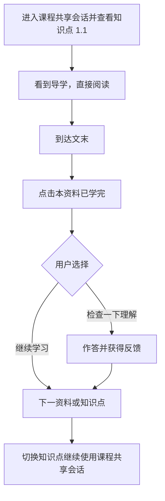

# 学习辅导 Agent 主设计

日期：2026-09-17。状态：用户已确认的产品与架构方向，待分阶段实施。本文件与[课程准备 Agent 主设计](2026-09-17-course-preparation-agent-design-cn.md)共同作为后续系统开发的主基线，不代表所述能力已经上线。

2026-10-20 用户确认更新：同一用户的一门课程共用一个学习 Agent 会话与上下文，切换知识点不再拆分聊天历史。当前知识点、资料版本、阅读位置仍作为每轮请求的独立快照；晚到的回答进入课程对话，保留原始引用。不同用户、不同课程继续隔离。已有知识点历史按时间合并，保留消息 ID、来源和答疑记录，长对话继续使用原有预算与摘要。左侧目录顶部不再展示学习进度块，资料完成事实仍保存。本更新替代下文所有按知识点隔离聊天窗口的旧要求。

2026-10-19 用户确认更新：支持在资源仍生成时进入课程。目录展示知识点生成状态，已完成资源可立即学习；同一准备任务的新增交付自动补入课堂，保持当前播放与学习记录。新增学习事件使用当前接收的课程清单版本，已排队事件保留原引用；已有资料发生修订时继续保留原有版本边界，不静默替换正在阅读的内容。

## 1. 定位与核心约束

学习辅导 Agent（下文简称学习 Agent）驻留在一门具体课程中，结合用户背景、课程学习记录和当前阅读上下文，辅助理解资料、解答问题、观察学习反馈并引导下一步。

本轮确定的核心约束：

1. 首次进入课程建立共享对话；切换知识点或资料沿用同一会话和上下文，刷新恢复课程历史。
2. 本课程对话共享用户全局偏好、课程学习事实和历史；长历史按上下文预算选取最近轮次并使用摘要。
3. 默认“安静陪学”：进入时引导，阅读时等待，结束时衔接，有问题时深入辅导。
4. 学习流程可以完全通过阅读和界面操作推进。用户不回复 Agent 不影响继续学习。
5. 阅读事实、完成标记、用户自评和理解证据分别记录；学完不等于掌握。
6. 持久化资源生成和修订交给课程准备 Agent，学习 Agent 负责需求理解与教学衔接。

当前会话边界以 2026-10-20 更新为准：课程内共享，课程间与用户间隔离。

## 2. 工作对象与职责

```text
课程：学习目标、路线版本、个人学习记录
  ├─ 知识点 1.1：目标、先修关系、共享课程会话
  │    ├─ 核心文档：资料版本、阅读位置
  │    ├─ 补充示例：可选
  │    └─ 检查练习：关联学习目标
  └─ 知识点 1.2：目标、先修关系、同一课程会话
```

知识点承担学习目标，资料承担具体学习内容，问答同时关联知识点和实际引用的资料版本。读完一份资料不必然完成知识点；可选资料未读也不必然阻止进入下一知识点。

学习 Agent 的工作范围是当前课程，当前焦点是一个知识点。它可以解释前后知识点的联系、回顾先修概念和建议下一步；各轮引用仍需校验其原知识点及资料归属。

Agent 负责解释、举例、提示、即时检查、分析困难与建议下一步。业务服务负责保存阅读位置、完成操作、练习结果和任务状态；模型的回复不能替代这些事实。

## 3. 上下文和记忆

| 层次 | 内容 | 使用方式 |
| --- | --- | --- |
| 用户全局背景 | 用户填写的基础、语言、表达偏好以及有来源的稳定偏好 | 各知识点可读取，支持更正与删除 |
| 当前课程摘要 | 路线、各节点的学习事实、自评、练习反馈、困难与未解决问题 | 选择与当前教学相关的摘要，保留来源、时间和版本 |
| 当前课程会话 | 全课程对话、当前问题及解决过程 | 按课程持久化和装配，长对话可摘要并保留原始历史 |
| 当前阅读上下文 | 资料 ID 与版本、章节/页码/段落、选中文字、相关正文 | 由页面与服务提供，校验用户访问范围和对象归属 |

“用户喜欢先看例子”可以是全局偏好；“尚未理解递归终止条件”应关联知识点和具体证据，不能无来源地上升为全局能力标签。

会话逻辑归属为“当前用户 + 当前课程”。知识点稳定标识记录在消息和答疑快照中，切换或重排节点不会新建会话。不同用户即使学习同一共享课程，也不共享个人对话和学习记录。

本课程历史跨知识点连续装配，超出上下文预算的历史通过摘要和授权检索补充。跨课程历史读取继续遵守[读取与记忆约定](2026-09-08-agent-access-memory-contract-cn.md)，全局偏好不意味着默认读取所有课程私聊。

当前请求优先于历史偏好。长期记忆的查看、更正、删除应传递到派生摘要与缓存；一次性要求不直接写为永久习惯。摘要只作为辅助信息，学习与任务事实仍需对应业务记录。

## 4. 学习状态模型

| 维度 | 示例 | 来源及边界 |
| --- | --- | --- |
| 阅读事实 | 已打开、第 5 页、到达文末、播放位置 | 系统事件；停留或滚动不能证明理解 |
| 完成标记 | 用户点击“本资料已学完” | 用户明确操作，服务持久化；可以与阅读事实分别展示 |
| 用户自评 | 我懂了、需要复习 | 用户表达，明确标为自评 |
| 理解证据 | 检查题结果、解释过程、错误原因 | 保存题目/资料版本、目标与证据来源；区分客观判定和模型分析 |
| 教学判断 | 某目标已有支持证据、仍有困难、尚未验证 | 基于上述事实形成可解释判断，不等同永久掌握结论 |

例如“核心资料已学完，理解尚未验证”是有效状态；“检查已有充分支持，可选补充资料未阅读”也是有效状态。

知识点学习进度由核心资料和相关活动投影，不要求读完所有可选材料。掌握判断单独呈现，不以观看百分比代替。具体展示枚举和判定规则后续细化。

模型提出的解释性追问只作为辅导记录；如要将回答计入理解证据，须保存问题、回答、评价依据与适用目标。模型评价不能伪装成确定性批改，未保存或未同步的回答不能显示为已验证结果。

## 5. 默认交互：安静陪学

学习流程由页面操作和业务记录推进；聊天流程辅助学习。正常阅读不依赖模型持续运行，也不要求用户回复开场消息。

### 5.1 首次进入知识点

显示简短导学，说明本节目标、先阅读哪份资料和应关注的问题。例如：

> 这一节学习函数调用与返回。先阅读文档，重点关注：内部函数结束后，程序会回到哪里。遇到不清楚的地方，可以选中文字问我。

导学不是必须回答的提问；用户可以直接开始阅读。同一知识点的快速切换、刷新或重复进入不能重复发送导学。导学可利用准备阶段的节点目标，具体采用模板或模型生成后续确定。

### 5.2 自主阅读

翻页、滚动和选择资料更新阅读状态与提问上下文。Agent 保持可用，不因每次操作都调用模型或发消息。

用户持续不回复、停留时间较长、鼠标不动，都不足以推断遇到困难。默认不设置按时间自动追问，不发“怎么还没看完”“看懂了吗”等催促消息。

### 5.3 用户主动提问

把问题绑定到发送时的知识点、资料版本和阅读位置。优先结合选中文字或当前段落回答，再按需要读取相关正文和课程摘要。可以直接解释、换例子、逐步提示或追问理解，不强迫每条问题都先做测试。

响应尚未返回时用户切换节点，结果保存并显示在共享课程会话中，消息仍保留发问时的知识点及资料引用。当前查看位置与发问时上下文分别记录；已有任务或引用不能误恢复为新的修改命令。

### 5.4 文末与资料学完

到达文末时提供“本资料已学完”操作。仅滚动到底记录到达文末，不自动写学完或掌握，不自动跳转。

点击学完后先保存完成事实，再提供下一步操作：

- **检查一下理解**：展示一道适合当前目标的简短检查，可点选答案，不要求文字聊天。
- **继续学习**：前往下一份必要资料，或下一知识点。

下一步推荐结合当前状态：有未解决问题时优先建议处理；缺少核心内容时建议阅读；已有足够检查证据时不重复出题。文末操作区和 Agent 操作卡如同时出现，必须使用同一事实与动作，不维护两套进度。

### 5.5 检查与继续

检查后给出有依据的反馈和一个明确建议：继续、补充解释或复习。答错不自动锁住后续课程，也不强制读完所有补充资料。

用户可以跳过检查、继续或暂停。跳过只意味着尚无这次检查证据，不能写成已掌握或不配合。直接从目录跳到下一知识点也允许；若前一资料未标记学完，则保留其阅读位置与学习中状态。

### 5.6 返回学习

恢复课程共享会话、当前资料和可靠的阅读位置。上次位置优先通过页面状态提示；有未解决问题时可简短指出，不每次返回都往聊天记录插入新消息。

## 6. 事件与主动消息规则

下列是语义事件，尚未规定 API 名称。程序决定是否触发和去重，Agent 决定合适的教学内容。

| 事件 | 系统处理 | 主动表达 |
| --- | --- | --- |
| 首次进入课程 | 建立共享会话，装配当前阅读上下文 | 一次简短导学 |
| 返回知识点 | 恢复会话与位置 | 默认页面恢复提示，必要时说明未解决问题 |
| 阅读、翻页、切换同节点资料 | 更新位置和当前上下文 | 默认不发消息 |
| 用户提问 | 保存发问上下文并响应 | 围绕问题辅导 |
| 到达文末 | 记录到达事实，显示操作 | 无需新增聊天消息 |
| 点击资料学完 | 保存标记，计算建议动作 | 检查或继续操作卡 |
| 提交理解检查 | 保存真实结果与证据 | 反馈及下一步建议 |
| 补充/修改资源任务完成 | 按原请求挂接结果，更新摘要 | 合适时机通知，不抢占当前页面 |

同一事件重试或刷新不重复产生消息。事件连续到达时合并建议；正在进行的用户对话优先，避免导学、学完提示、下一节建议同时堆积。

未读主动消息不触发持续提醒。后台任务通知与前台教学对话分开管理；新资源提示不自动改变当前节点或启动播放。

服务不可用时显示真实错误，保留对话和阅读位置，仍可使用已就绪资料及正常导航。回答失败不能阻塞“继续学习”，也不能用演示回复冒充真实结果。

## 7. 不聊天也能完成的标准路径



用户全程可以只阅读和点击按钮。未做检查时显示“资料已学完，理解尚未验证”。用户未点击学完就离开时只保存真实位置；系统不推测完成。

## 8. 调用课程准备 Agent

双方协议以[课程准备 Agent 的交接契约](2026-09-17-course-preparation-agent-design-cn.md#handoff-contract)为主定义。

| 用户需求 | 执行方与方式 |
| --- | --- |
| 解释当前段落、换一个例子 | 学习 Agent 直接辅导 |
| 问一道题检查理解 | 学习 Agent 发起即时检查；需要计入证据时由服务保存 |
| 生成一份补充讲义或可保存的练习集 | 提交局部准备任务 |
| 把当前资料改得更适合初学者 | 明确目标资料及版本，整理修改要求后提交修订任务 |
| 后续路线增加实践内容 | 形成用户明确请求范围内的课程调整任务 |

学习 Agent 负责说明“为什么需要、给谁使用、解决什么问题”，准备 Agent 负责研究、生成、修订和自检。只传必要背景、证据引用和目标对象，不默认传全部聊天。

用户请求对象明确时直接执行，无额外的大纲确认或保存审批。出现多个无法唯一定位的修改对象时不能猜测写入，可以在提交前用最小交互明确对象；这属于请求定位，不是准备流程中的审核关卡。自动建议本身不构成修改整门课程的授权。

任务运行时用户可以继续提问和学习。结果就绪时：

- 仍在原知识点：提示资源可用，用户可打开。
- 已切换知识点：记录原节点结果并通知，不自动切回。
- 正在交流：在合适边界提示，不打断当前问题。
- 失败或取消：显示真实状态及可执行的后续动作，已有资料继续可用。

## 9. 资料修改与学习连续性

修改产生新版本，旧版本与对话引用保留。共享课程的个人修订进入个人空间，不覆盖公共版本。

切换新版本后，阅读位置仅在可靠时映射；无法可靠映射时从对应章节或开头继续并说明。新资源就绪不自动替换用户正在阅读的页面。

学习证据继续关联原资料和题目版本。变更只重新评估受影响目标，不清空整门课程记录，也不把旧版完成标记无条件复制到新版。知识点会话继续保留，区分历史讨论所基于的版本。

## 10. 与现有实现的关系

本次源码观察表明，[学习服务](../../backend/src/app/self_learning/service.py)已有按用户、课程、知识点保存的会话，回答携带本节点最近六轮对话及本课程学习摘要；[真实前端入口](../../frontend/src/liveLearning/LiveApp.tsx)已接通部分学习记录和问答操作。详见[2026-09-14 联调记录](../acceptance/2026-09-14-live-learning-integration.md)。

这些是复用基础，不代表完整实现本设计。后续重点补齐：

- 可管理的用户全局偏好、课程证据摘要与上下文装配。
- 页码/段落/选中文字和资料版本定位，而非仅拼接节点资料正文。
- 独立会话下的课程级教学连续性；调整“仅回答当前知识点”的过窄限制。
- 导学、文末操作、理解检查、下一步建议和消息去重。
- 阅读事实、学完、自评、证据与教学判断的分离展示。
- 准备 Agent 的局部任务调用、通知、版本更新及冲突处理。

开发顺序建议：先明确学习状态和知识点会话归属，再打通不聊天的完整学习路径，接入阅读定位与答疑，随后完善主动介入和准备任务交接。具体实施计划另行编写。

## 11. 后续验收场景

1. 首次进入 1.1 有一次导学，刷新和往返不反复新建会话或发送开场。
2. 切到 1.2 使用独立上下文；回到 1.1 恢复原会话，同节点切资料保留对话。
3. 用户全程不聊天也能学完、跳过检查并继续；不把沉默判断为困难。
4. 翻页、停留或滚动到底不产生催促、已掌握结论或自动跳转。
5. 完成标记、自评与检查结果分别保存和展示；答错或跳过不锁住路线。
6. 选中文字提问可定位资料版本；切节点后迟到回答仍归属原会话。
7. 同一事件重放不重复通知；主动消息不打断正在进行的用户对话。
8. 补充资源任务执行期间可继续学习；任务完成不抢占当前页面。
9. 修订保留旧引用与学习证据，只更新受影响部分，不修改公共原版。
10. 其他用户的会话和学习记录不可读；全局偏好更正后不被旧摘要覆盖。
11. 模型失败时保留历史，已就绪资料、学习位置和继续入口仍可使用。

## 12. 待细化项

个人偏好字段、摘要更新时机、长会话压缩、检查题选择与评价规则、位置定位方式、事件去重实现、通知呈现、资源版本迁移细节和性能目标后续细化。默认保持知识点独立上下文、安静陪学和非聊天学习路径，不引入固定时间催促或强制问答关卡。
