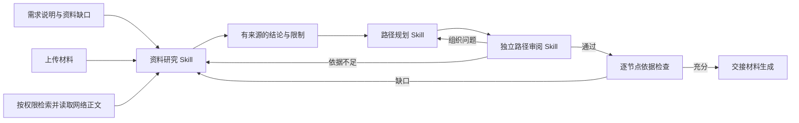

# 课程准备：Harness 资料研究与学习路径 Skills

> 2026-09-19 更新：research/plan 生产路径已改为[总控 Skill 的连续工具会话](2026-09-19-continuous-learning-path-harness.md)。本文记录此前的逐动作实现，其余独立阶段继续沿用。

资料研究、学习路径规划、路径独立审阅和节点依据检查统一通过 `HarnessPreparationAdapter` 执行。生产 `research_dependencies.agent_factory` 使用该适配器；`HarnessIntakeAdapter` 保留为兼容导入，指向同一个实现。

## 阶段与 Skill

| phase | 原生加载的 Skill | 阶段业务工具 |
| --- | --- | --- |
| input_document / intent | understand-learning-request | record_input_document / save_preparation_brief |
| research | research-learning-sources | search_sources、fetch_source、record_evidence_finding、finalize_research_summary |
| plan | plan-learning-path | save_course_plan |
| route_adjustment | plan-learning-path | save_route_adjustment |
| review | review-learning-path | submit_path_review |
| research_nodes | review-learning-path | assess_node_evidence |

研究工具表是增量汇总生产路径；实际挂载仍取决于阶段、来源范围和预算。`uploaded_only` 下不挂载搜索工具，来源适配器也拒绝网络读取。

Skill 文件位于 `backend/src/app/course_preparation/skills/`。每个 Skill 写清输入、工具选择、一次提交的含义、状态交接、引用方式、权限和失败处理。原研究、路径审阅、节点检查、路径调整提示词已迁入 Skills，删除重复规则来源；根角色只保留公共职责与信任边界。

## 运行方式

`workflow_skills.py` 按 phase 选择 Skill，计算 SHA-256。适配器将该快照写入隔离目录，禁用默认 Skill 目录，调用 DeepSeek Harness 原生 Skill 插件加载。上游模型请求前检查完整 Skill 正文确已注入，失败则阻止调用，不静默退回旧模型循环。模型调用账本包含 runtime、Skill 名称和摘要。

Harness 负责每个决策步的模型与 MCP 工具交互；SQL runner 继续负责持久状态与阶段转换。MCP 本轮接收一个动作，适配器返回后由既有业务代码校验参数并实际执行搜索、读取或保存，下一步从持久检查点得到真实结果。接收回执不被当作搜索结果或已读证据。

模型即使忽略 `parallel_tool_calls=false` 返回批量调用，也先逐项校验工具名、参数 JSON 和调用 ID，再交给原生 SDK。MCP 只接受第一个动作，其余不同动作明确返回 `DEFERRED_TO_NEXT_STEP`，未执行、未排队；下一检查点根据真实结果重新决定。已接收动作后强制 `tool_choice=none` 结束本轮，避免重复提交引起无效重试。每步最多 4 次模型调用及原有时间/总预算限制保持不变。

每轮仍创建隔离会话，长期任务通过数据库恢复，不依赖 Harness 临时会话历史。独立路径审阅去除生成器 trace 和自评，节点审阅只挂载当前节点证据工具。没有增加额外审阅层；沿用既有路径和节点检查。

课程材料制作与最终课程质量检查属于下一环节，未在此次迁移中改写。非 Harness 的独立适配器可内联同一份 Skill 用于兼容测试，生产这些阶段使用原生 Harness。

## 输入到输出

路径包含节点目标、先修关系、时间、活动、自测及需求/结论/来源关联。程序继续检查时间上限、ID 覆盖、来源匹配、权限、预算和修复次数。资料缺口不能作为降低用户目标的理由；不充分的路径由独立审阅退回或在修复上限内明确失败，不能冒充完整课程。
