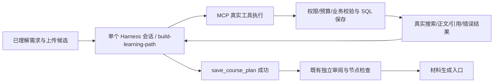

# 从已理解需求到学习路径：连续 Harness 会话

这一步采用总控 `build-learning-path` Skill。正常情况下，从已理解需求出发，读取附件、搜索网络、读取正文、保存结论、汇总和提交学习路径在同一 DeepSeek Harness 会话内完成。原有需求理解、独立路径审阅和逐节点依据检查仍在边界外执行。

本设计替代 2026-09-18 实现中研究和规划“每个动作退出 Harness，由外层执行后重新启动”的做法。原有阶段 Skills 与单步适配器保留兼容入口；生产 `ResearchStages._decision` 对 research/plan 调用 `run_learning_path`，新总控 Skill 不加载包含“提交一个动作后结束”规则的旧 Skills。

## 运行链路

`LearningPathTools` 复用原 `ResearchAgent._execute`、字段 schema 与引用校验，不另写一套搜索或知识整合后端。各工具返回所需增量信息，避免每次把全部历史状态重复加入会话：

- search_sources：真实候选 ID、标题、URL 和摘要。
- fetch_source：正文片段、服务端 citation_ref 和分页信息；上传材料由同一来源适配器读取。
- record_evidence_finding：已保存结论及回填后的原文引用、source_id。
- finalize_research_summary：汇总及限制。
- save_course_plan：结构校验错误，或成功保存标志。成功后强制结束模型工具调用，后续由独立审阅处理。

模型可在规划时继续研究。新增正文或结论后旧 summary 失效，必须重新汇总才能提交路径。获取候选本身不会使已保存结论失效。

## 控制与恢复

工具目录在会话开始时固定，但每次调用均根据最新状态重新判定可用性。uploaded_only 不挂载搜索工具，PolicySources 再次拒绝网络访问。预算耗尽、未知工具、未读引用和未汇总即提交路径均被程序拒绝；总控没有需求改写、独立审阅或资源生成工具。

MCP 调用串行执行，调用前预存动作计数，搜索/读取前保留原有计量，再保存成功结果或校验错误。即使模型返回一批工具调用，也先验证完整协议，再逐项检查实时状态；不能靠批量调用绕过阶段条件或预算。路径保存后剩余调用拒绝执行。

每个模型请求及工具执行检查租约/权限和记忆有效性，工具完成后再次检查，失效则阻止后续操作。MCP 无法直接传递 Python 异常，桥接器保留原始致命异常，适配器重新抛出给 runner，保留 ContextRebuilt/StaleLease 等已有恢复语义。

正常单会话最多 480 秒、60 次模型调用，受任务剩余时间与 SQL 总预算进一步约束；工具动作上限沿用 agent.max_calls。旧单动作阶段仍为 90 秒、4 次模型调用。Runner 心跳继续续租。发生进程中断后，从 SQL 已保存的正文、结论、汇总或已提交路径恢复，新建会话，不依赖临时 SDK 会话目录；中断不保证未完成的只读外部请求绝不重复，但已完成证据不会为恢复而全部重读。

路径校验失败直接返回会话供修正。实质审阅缺陷继续按既有规则退回研究/规划，新会话使用已保存数据与具体反馈；不取消独立审阅，也不把本环节结果当作课程已交付。
