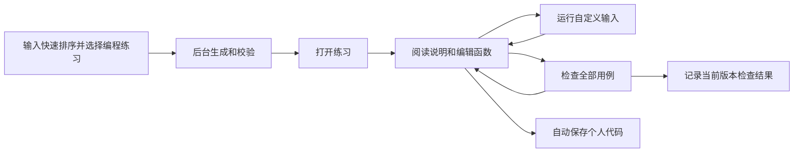

# Sandpack 算法练习接入设计

实施状态（2026-10-13）：首版源码已接入；真实模型、独立 PostgreSQL、官方 Sandpack 完整链路已验证。最终检查与部署边界以[验收记录](../acceptance/2026-10-13-sandpack-algorithm-practice/README.md)为准。原业务服务未部署、生产数据库未迁移。
日期：2026-10-13。状态：详细设计，尚未实现。首个交付样例为 JavaScript 快速排序单任务练习。

本方案实现“输入主题 → 生成练习材料 → 用户亲手编码 → 运行与检查 → 保存并继续”。界面为左侧任务目录加 Sandpack 工作区，不沿用实验的固定三栏。实施顺序见[接入计划](../superpowers/plans/2026-10-13-sandpack-algorithm-practice.md)。

## 1. 范围与产品决定

| 项目 | 首版决定 |
| --- | --- |
| 练习目标 | 实现快速排序函数，观察输入输出，并检查边界情况 |
| 语言和运行形态 | JavaScript ES module，同步纯函数，无用户外部依赖 |
| 任务数量 | `tasks` 使用数组，首版严格为一个任务；不为一个算法拆出强制步骤 |
| 函数约定 | `export function quickSort(array)`，有限数字数组输入，升序新数组输出，不修改输入，保留重复元素 |
| 学生可编辑范围 | `/src/algorithm.js`；其他文件由平台模板提供 |
| 交互 | 阅读任务、展开提示、编辑、自定义输入、运行一次、检查练习、停止、重置代码、下载代码 |
| 首版教学反馈 | 显示真实输入、输出、预期值、差异、异常和超时；不调用辅导 Agent |
| 结果边界 | 显示“本版本功能检查通过”，不等同于算法实现方式已确认或知识已掌握 |
| 暂不实施 | 多阶段应用项目、其他语言、算法逐帧动画、聊天、AI 自动修改学生代码、考试评分 |

本次只交付快速排序。首页自然语言可包含基础和表达偏好；非快速排序主题返回明确的能力范围说明，不偷偷改成快速排序，也不承诺任意算法可运行。

## 2. 与现有工程的衔接

以下是检查源码得到的现状，不是本方案已经完成的功能。

| 现有位置 | 已有能力 | 本次处理 |
| --- | --- | --- |
| `backend/src/app/practice/service.py` | MAIC-UI 提示词生成 HTML，Plan 强制 3～5 步，浏览器检查 | 保持模拟实验流程；新增 `app/pbl/`，不复用其 HTML/步骤协议 |
| `backend/src/app/api/practice.py` | 登录归属、创建任务、列表、实验详情 | 参考入口模式，新建 `/api/pbl` |
| `backend/src/app/services/platform_task_handlers.py` | `enqueue_platform_task` 入队、运行配置快照 | 复用任务机制，新增 `pbl_generate` handler |
| `backend/src/app/services/durable_job_runtime.py` | durable handler 注册 | 新增版本 1 的 PBL handler |
| `frontend/src/practice/PracticeHome.tsx`、`usePracticeHome.ts` | 首页输入、最近实验、轮询 | 首页增加“模拟实验 / 编程练习”选择，默认仍为现有模拟实验 |
| `frontend/src/liveLearning/LiveApp.tsx` | hash 页面路由 | 新增 `#/practice/code` 和 `#/practice/code/:exerciseId`，优先于旧 `/practice/:id` 匹配 |
| `frontend/src/jobs/jobResultTarget.ts` | 任务结果跳转 | 在要求 courseId/materialId 的分支之前识别 `pbl_exercise` |
| `backend/src/app/self_learning/store.py` | 用户命名空间存储 | 不直接用其无条件 `put` 保存可并发编辑工程；新增带版本比较的 SQL repository |
| `frontend/package.json` | React 18、Vite 6、Playwright；尚无 Sandpack | 新增并锁定 Sandpack 依赖 |

复用模型配置网关、登录、任务中心和主题样式；不要求创建一门 AI 课堂，也不调用课堂的整课研究和页面生成流程。既有设计中的用户隔离、真实状态、版本记录和无需聊天即可推进继续适用。

## 3. 用户流程和页面



桌面布局：

```text
┌────────────────┬────────────────────────────────────────────────┐
│ 返回  快速排序 │ 任务：实现快速排序                  保存状态   │
│                │ 目标／函数约定／示例    [教程] [提示]          │
│ 任务目录       ├────────────────────────┬───────────────────────┤
│ ● 实现快速排序 │ SandpackCodeEditor     │ SandpackPreview       │
│                │ algorithm.js 文件页签  │ 数组输入、执行按钮     │
│ 当前检查状态   │ 用户实际编写的代码      │ 实际结果、用例检查表   │
│                ├────────────────────────┴───────────────────────┤
│                │ 日志／错误／下载代码                          │
└────────────────┴────────────────────────────────────────────────┘
```

- 复用 `SandpackProvider`、`SandpackLayout`、`SandpackCodeEditor`、`SandpackPreview`。只有一个可编辑文件时使用文件页签，不增加第二个常驻文件树。
- 教程和提示是上方可展开内容，不建立固定右侧聊天栏。所有教学 Markdown 禁止原始 HTML 执行。
- 数组输入、运行/检查/停止按钮及结果表是我们提供的固定预览应用。它们不是模型生成的页面，也不是 Sandpack 自动提供的算法判断功能。
- 首次打开显示示例数组和“尚未运行”；不要把参考答案或初始代码自动执行结果显示成学生成果。
- 移动端目录折叠；编辑/结果可切换视图但保持同一个 Provider 和执行会话，切换不丢代码。
- `重置代码`保留可恢复的重置前草稿，按钮确认说明将恢复初始骨架。下载提供当前 `algorithm.js`，不触发外部公开发布。
- 原生“Open in CodeSandbox / 新窗口打开”首版关闭；统一使用平台保存和下载，避免误认为外部沙箱已保存到本系统。

## 4. 四类数据分别负责什么

| 数据对象 | 生成者 | 保存和用途 |
| --- | --- | --- |
| `GeneratedExerciseCandidate` | 模型 | 临时私有候选，含参考答案，必须先验证 |
| `ExerciseArtifact` | 后端装配器 | 发布后的不可变练习版本；描述教学材料、固定契约、初始工程和用例 |
| `Workspace` | 学生操作和业务服务 | 用户当前代码、自定义输入、当前任务、保存版本 |
| `RunRecord` | 浏览器执行器和业务服务 | 某份代码快照的一次运行/检查证据；标记 `browser_reported` |

模型不生成用户 ID、数据库 ID、运行域名、文件权限、依赖版本、任务完成状态或安全配置。后端控制这些字段。

### 4.1 用户创建请求

```json
{
  "topic": "我想练习快速排序，基础比较薄弱",
  "request_id": "550e8400-e29b-41d4-a716-446655440000"
}
```

语言、函数契约和单任务形态由首版能力配置补齐，不要求用户填写开发配置。`request_id` 由前端生成；同一次网络重传复用，已接收后再次提交使用新 ID。

### 4.2 模型生成协议

后端向模型提供当前主题、有效偏好、下面的固定函数契约、结构化输出 schema 及运行限制。模型返回严格 JSON：

```json
{
  "title": "实现快速排序",
  "summary": "通过编写和测试快速排序，理解分区与递归。",
  "contract": {
    "exportName": "quickSort",
    "parameterName": "array",
    "inputType": "finite_number_array",
    "outputType": "ascending_number_array",
    "mutatesInput": false,
    "returnsNewArray": true
  },
  "tasks": [{
    "id": "implement-sort",
    "title": "实现并验证快速排序",
    "objective": "正确处理乱序、重复元素和边界输入。",
    "instructionsMarkdown": "实现 quickSort(array)。返回升序新数组，并保持原数组不变。",
    "explanationMarkdown": "选择一个基准，将剩余元素分组，再递归处理子数组。先考虑递归何时结束。",
    "hints": [
      {"id": "base-case", "title": "何时停止递归", "body": "数组长度不超过 1 时，返回它的副本。"},
      {"id": "duplicates", "title": "不要丢掉重复元素", "body": "分组时明确等于基准值的元素放在哪里。"}
    ],
    "examples": [{"input": [3, 1, 2], "expected": [1, 2, 3], "explanation": "输出按数值升序排列。"}]
  }],
  "starterCode": "export function quickSort(array) {\n  // 请在这里实现快速排序\n  throw new Error('NOT_IMPLEMENTED');\n}\n",
  "testCases": [
    {"id": "mixed", "label": "普通乱序", "input": [4, 1, 3, 2], "expected": [1, 2, 3, 4]},
    {"id": "duplicates", "label": "重复元素", "input": [3, 1, 3, 2], "expected": [1, 2, 3, 3]},
    {"id": "negative", "label": "负数与零", "input": [0, -2, 5, -1], "expected": [-2, -1, 0, 5]},
    {"id": "empty", "label": "空数组", "input": [], "expected": []},
    {"id": "single", "label": "单元素", "input": [7], "expected": [7]},
    {"id": "sorted", "label": "已排序", "input": [1, 2, 3], "expected": [1, 2, 3]},
    {"id": "reversed", "label": "逆序", "input": [3, 2, 1], "expected": [1, 2, 3]}
  ],
  "referenceSolution": "export function quickSort(array) {\n  if (array.length <= 1) return array.slice();\n  const [pivot, ...rest] = array;\n  const left = rest.filter(value => value < pivot);\n  const right = rest.filter(value => value >= pivot);\n  return [...quickSort(left), pivot, ...quickSort(right)];\n}\n"
}
```

本示例定义字段，不要求模型逐字复述教学文案。模型可以追加有效用例和提示；不设置教程字数或提示条数配额。七类基础覆盖由程序保证，不以七条作为用例总数上限。

固定协议字段必须与服务端定义相符。示例、用例中的 `expected` 用可信数值排序器重新核对；不把模型的预期值直接当判题依据。模型初始骨架的函数体只允许注释和 `throw new Error('NOT_IMPLEMENTED')`，避免初始工程直接包含算法答案。学生实现与参考实现允许函数声明、局部辅助函数、递归和标准数组操作；不接受 import、动态 import、顶层执行语句、DOM/网络访问、异步函数和用户依赖。静态检查用于限定首版语法及给出反馈，不宣称其构成完整的恶意代码隔离。

`referenceSolution` 仅在私有候选和生成校验中使用；公开详情、Sandpack 文件、日志、下载以及用户检查记录不含该字段。显示完整参考答案不属于首版。

### 4.3 发布对象和个人状态

`ExerciseArtifact` 由后端补齐：`schemaVersion=1`、`exerciseId`、`artifactVersion=1`、`templateVersion=js-function-v1`、`runtimeKind=js_function`、`topic`、`contract`、`tasks`、`starterCode`、校验后的 `testCases`、`validationSummary`。每项任务由装配器补齐对应的 `testCaseIds`，首版指向全部用例。

`Workspace` 包含 `exerciseId`、`artifactVersion`、`revision`、`files`、`activeTaskId`、`customInputText`、`updatedAt`。`files` 首版只保存 `/src/algorithm.js`，不保存运行模板的副本；输入文本可以暂时不合法，以便恢复未完成输入。

`RunRecord` 包含 `runId`、`exerciseId`、`artifactVersion`、`templateVersion`、`taskId`、`codeHash`、不可变源码快照、`mode=sample|check`、实际输入、时间、逐例结果、终态、`evidenceSource=browser_reported`。检查结果可复核但不是考试级防篡改成绩。

统一代码哈希：对 UTF-8 编码的 `JSON.stringify([["/src/algorithm.js", code]])` 求 SHA-256；后端使用等价的无额外空格 JSON 序列化，并提供跨 Python/TypeScript 的哈希 fixture。练习版本和模板版本单独比较，不混入源码哈希。

## 5. 模型输入与生成工作流

生成是可恢复的业务流程，不是单个提示词直接产出一个网页。

| 阶段 | 输入 | 输出 | 通过条件 |
| --- | --- | --- | --- |
| `pbl_prepare` | 用户需求、支持范围、模型配置快照 | 明确的快速排序练习规格 | 主题在范围内，固定函数契约已确定 |
| `pbl_generate` | 规格、schema、生成规则 | 私有候选 | JSON 可解析、字段完整 |
| `pbl_validate` | 候选、可信基础用例、固定运行器 | 结构、语法、结果检查报告 | 固定契约一致、参考实现运行通过、骨架可打开 |
| `pbl_repair` | 具体错误、对应候选 | 修复候选 | 只修失败材料，不改运行模板或函数协议 |
| `pbl_publish` | 已验证候选 | 不可变公开 artifact | 保存后回读成功，任务未取消、仍拥有有效租约 |

第一版准备阶段采用范围识别加固定算法规格，不调用整门课程的研究链路。模型通过既有网关和用户运行配置快照调用，凭据不进入产物。

- 生成内容最多进行两次定向修复；传输错误恢复沿用 durable task 的有界策略。内容修复计数落库，进程重启不重置。
- 每阶段保存候选和检查结果；恢复优先复用仍适用于当前模板版本的结果。失败公开原因，私有候选不作为可学习材料交付。
- `ready` 表示材料已经就绪，与学生是否做过练习无关。
- 自动执行重试与用户主动重新生成分开。重试复用 `exercise_id` 的生成记录及已保存阶段，不覆盖现有个人工作区；用户再次创建得到新练习。
- 所有写入先检查当前生成 job/attempt 是否仍有效。旧任务迟到结果不得替换新尝试的候选或产物。

## 6. Sandpack 装配协议

拟使用 `@codesandbox/sandpack-react@2.20.0` 作为兼容性验证起点，并在 lockfile 固定依赖；官方当前仓库 manifest 声明支持 React 18。安装可用性、实际类型及网络可达性在 P0 验证，不能仅凭文档视为通过。

| 文件 | 来源 | 学生编辑 |
| --- | --- | --- |
| `/src/algorithm.js` | 保存的学生代码，首次为空间时采用 `starterCode` | 是 |
| `/src/index.js` | 平台固定预览界面与 bridge 初始化 | 否 |
| `/src/runner.js` | Worker 生命周期、调用、用例比较、错误归类 | 否 |
| `/src/worker-source.js` | 固定 Worker 引导代码 | 否 |
| `/src/cases.json` | 程序核对后的公共用例 | 否 |
| `/src/styles.css` | 平台固定算法输入与结果样式 | 否 |
| `/index.html`、`/package.json` | 完整的版本化 vanilla 模板 | 否 |

`assembleSandpackFiles(artifact, workspace)` 返回上述文件的完整映射，保存的有效工作区优先于初始骨架。`template="vanilla"`；不增加用户 npm 依赖。可见页签默认仅 `/src/algorithm.js`，默认激活该文件。

关键约束：`index.js` 不直接 import `/src/algorithm.js`。用户源码只在显式运行时作为字符串快照进入 Worker，避免每次编辑热更新就执行学生代码。Sandpack 可自动启动固定预览壳；“预览壳启动”和“执行学生算法”是两件事。

所有固定源文件以 `frontend/src/pbl/runtime/` 为唯一来源；后端生成检查通过 Node/Playwright 调用同一套源文件，避免前后端各维护一份执行器。宿主/Node 中的 `sourceValidation.ts` 只解析源码 AST，不执行源码；通过现有 tsx loader 加载。浏览器 harness 和预览内的运行器保持原生 JS 模块，配套 `.d.ts` 支持宿主类型检查。后端不直接在 Python/Node 主进程中执行模型生成的 JS。

## 7. 运行与消息协议

### 7.1 浏览器数据流

1. 预览壳加载，宿主通过 `SandpackPreview` 的 client/ref 定位实际 iframe，完成版本化握手。
2. 预览中点击“运行一次”或“检查练习”，向宿主发出操作意图。
3. 宿主读取此时 Sandpack 文件状态，冻结源码、哈希、输入及版本，分配 `runId`。
4. 宿主将快照交给预览运行器。预览创建新的 Worker，在 Worker 内把源码做成 Blob module 并导入，取 `quickSort` 导出函数。
5. 每个用例获得新复制的数组；记录调用后的参数、返回值以及 `result === argument`，从而判断输出、原数组修改和返回新数组的约束。
6. 预览运行器展示逐例结果并上报宿主；宿主将最终报告与源码快照保存。学生在运行期间继续编辑时，报告仍归属于原快照。

P0 必须验证：实际 iframe 窗口来源、消息通路、Blob module Worker、停止与重启。若实际环境无法支持，暂停业务集成并记录具体失败，调整运行隔离方案后重验；不退回宿主主线程 `eval`，也不伪造运行成功。

### 7.2 业务事件

所有事件使用 `channel="edu-pbl-v1"` 和握手生成的 `sessionId`。此协议由我们实现，不是 Sandpack 自带的消息类型。

| 事件 | 方向 | 主要字段 |
| --- | --- | --- |
| `runtime-ready` | 预览 → 宿主 | `templateVersion` |
| `run-intent` | 预览 → 宿主 | `mode`, `customInputText` |
| `run-request` | 宿主 → 预览 | `runId`, `codeHash`, `code`, `artifactVersion`, `taskId`, `mode`, `cases` |
| `run-started` | 预览 → 宿主 | `runId`, `codeHash` |
| `case-result` | 预览 → 宿主 | `runId`, `codeHash`, `caseId`, `status`, `actual`, `expected`, `inputAfter`, `returnedSameReference`, `error` |
| `run-finished` | 预览 → 宿主 | `runId`, `codeHash`, `status`, `results`, `durationMs` |
| `stop-request` | 双向控制 | `runId` |
| `input-changed` | 预览 → 宿主 | `customInputText`，只保存草稿，不执行 |

握手校验 `event.source` 是当前预览窗口、origin 与当前固定 bundler 配置相符，再建立 MessageChannel。后续消息通过专用端口收发并验证 schema、session/run ID。若运行环境实际有嵌套 iframe，P0 明确其窗口归属后调整适配器，不用放宽为任意窗口消息来绕过。

iframe 刷新时旧端口、session 和运行作废，旧消息丢弃。不要依赖 console 文本解析、DOM 文本猜测或自定义 Sandpack 内部事件名判断通过。

### 7.3 输入、执行和错误

- 输入使用 JSON 数组解析，例如 `[5, 2, 5, -1]`；拒绝字符串、对象、稀疏数组、NaN 和 Infinity，不执行输入表达式。
- 工程暂定允许源码 128 KiB、单次输入 1,000 个元素，作为可配置的浏览器执行边界；不限制教程正文篇幅。
- 每例从加载用户模块前开始计时，默认 2 秒；整次检查默认 15 秒。停止或超时由 Worker 外部调用 `terminate()`，不能用同一线程的计时器中断死循环。
- 每例使用独立 Worker，防止前一用例修改全局状态影响后一用例。全批次停止后不继续创建 Worker。
- 限制每次日志数量与序列化体积；渲染结果只用文本，不把错误内容拼成 HTML。循环引用、超大输出、不可克隆返回值均归为真实错误。
- 公共异常码：`NOT_IMPLEMENTED`、`INPUT_INVALID`、`SYNTAX_ERROR`、`EXPORT_MISSING`、`UNSUPPORTED_SOURCE`、`RUNTIME_ERROR`、`INVALID_RESULT`、`OUTPUT_MISMATCH`、`INPUT_MUTATED`、`RETURNED_INPUT`、`TIMEOUT`、`CANCELED`、`RUNTIME_UNAVAILABLE`。
- 停止、超时、完成和切页均清理 Worker、端口、Blob URL 和计时器。停止后可以修改并再次运行，无需整页刷新。

首版不使用 `SandpackTests` 作为唯一判题入口：统一执行器同时服务自定义输入、整组检查和生成验证，保证三者契约一致。后续需要 Jest 教学项目时再引入对应测试组件。

## 8. 检查结果和进度语义

基础测试覆盖：乱序、重复值、负数/零、空数组、单元素、升序、逆序；固定补充含两位数和小数的用例，避免字符串排序误通过。可增加固定 seed 的小规模用例，保存 seed 和实际输入以便重现。

单例通过要求同时满足：输出为无空槽的有限数字数组、元素和顺序与可信预期相同、原数组内容及索引完整性不变、返回对象不是输入数组本身。不能仅用会跳过空槽的 `Array.every` 验证数组。`sample` 只展示本次试运行，不置整项任务通过。

任务状态由事实推导：`not_started`、`in_progress`、`tests_passed`、`needs_recheck`。只有针对当前 artifact/template/codeHash 的完整 `check`、全部预期 case ID 各出现一次且通过，才能显示 `tests_passed`；缺失、重复、额外不匹配用例以及中途取消不能通过。

代码编辑后原报告保留并标记“针对旧代码”，当前状态为 `needs_recheck`。运行 A 过程中编辑到 B，A 的结果可以保存但不能标为 B 通过。重新检查失败不能抹掉历史通过记录，也不能继续给当前代码展示绿色通过状态。

使用内置排序可能通过功能用例。首版说明要求使用快速排序，对直接调用 `.sort()` / `.toSorted()` 提供静态提示，记录实现方式尚未验证；不宣称该提示能可靠识别所有替代算法，不用功能通过伪装成教学目标已掌握。

## 9. 存储、API 和任务接入

### 9.1 存储

新增 SQLAlchemy 表，使用现有 `DATABASE_URL` 与迁移机制；生产 PostgreSQL，单元测试可使用独立 SQLite，版本竞争必须另在隔离 PostgreSQL 验证。

| 表 | 关键数据和约束 |
| --- | --- |
| `pbl_exercises` | `id`, `owner`, `request_id`, `topic`, `generation_state`, `current_job_id`, `candidate_private`, `repair_count`, `artifact_public`, `artifact_version`, `template_version`, `validation_report`；`(owner, request_id)` 唯一 |
| `pbl_workspaces` | `(owner, exercise_id)` 唯一，`artifact_version`, `revision`, `files`, `active_task_id`, `custom_input_text`, `last_mutation_id` |
| `pbl_runs` | `(owner, exercise_id, run_id)` 唯一，代码快照/哈希、版本、模式、输入、结果、来源；创建后不可覆盖 |

公开详情采用字段白名单，不对数据库对象直接 `model_dump`。参考代码和生成候选不进入公开接口。

工作区更新使用 SQL `UPDATE ... WHERE owner=:owner AND exercise_id=:id AND revision=:expected`，同事务增加 revision；零行更新返回 409。不能使用进程内 RLock 加无条件 put 代替跨进程版本检查。初始空间使用唯一键创建，重复 GET 不重置。首版串行保存下仅保证最近一次 mutation 的响应丢失重传可幂等确认；更早的迟到 mutation 在 revision 不匹配时返回 409，不冒充已经重新应用。

### 9.2 API

| 接口 | 输入 | 输出及行为 |
| --- | --- | --- |
| `POST /api/pbl` | `topic`, `request_id` | 202，`exerciseId`, `jobId`, `status`；同请求同主题幂等，不同主题 409 |
| `GET /api/pbl` | 分页游标 | 本用户练习摘要、当前生成状态和对应 job ID |
| `GET /api/pbl/{id}` | 路径 ID | 当前 job、就绪时的公开 artifact；生成中不下发半成品 |
| `GET /api/pbl/{id}/workspace` | 路径 ID | 本用户工作区；已就绪且首次访问时幂等初始化 |
| `PUT /api/pbl/{id}/workspace` | `artifactVersion`, `expectedRevision`, `mutationId`, `files`, `activeTaskId`, `customInputText` | 新 revision；最近一次相同 mutation 重传返回成功，更早的过期请求或版本冲突 409 |
| `POST /api/pbl/{id}/runs` | `runId`, 版本、源码快照/哈希、模式、输入及结果 | 保存去重后的浏览器报告；服务端重算源码哈希并检查结果结构，不声称已服务端执行 |
| `GET /api/pbl/{id}/runs` | 分页游标 | 本用户历史运行，首屏显示最近一次，可继续加载 |

取消与失败重试优先复用 `/api/jobs/{jobId}/cancel` 和 `/api/jobs/{jobId}/retry`。任务增加 `JobKind.GENERATE_PBL`、`workflow_type=pbl_generate`、`scope_type=pbl`。命令保留稳定 `exercise_id`，不能用重试产生的新 job ID 当成新的练习 ID。

由于通用 durable 重试会创建新 job，新 handler 开始时通过条件更新认领 `current_job_id`，验证该 job 的 `retry_of_job_id` 指向当前 job，才恢复相同练习。旧 job 写入必须失败。并发重复重试只允许一个当前尝试；被淘汰 job 明确终止而不是写入共享产物。已经发布就绪的练习不通过重试改写。

用户身份取认证结果，跨用户读取/写入一律 404；未就绪获取工作区 409；不支持主题/字段 422；模型、数据库或 runtime 不可用给出可读错误和内部错误码。

任务入队与练习记录可能跨存储：使用确定性的初始 exercise/job ID、唯一请求键和可恢复的 enqueue 状态。若创建后入队失败，详情展示失败；同请求恢复必须先检查现存 durable task，禁止重复建立并行执行。发布使用 job/lease guard，任务完成后返回：

```json
{
  "saved": true,
  "result_ref": {"resource_type": "pbl_exercise", "exercise_id": "pbl_example"},
  "completion_message": "编程练习已就绪，可以开始实现算法"
}
```

### 9.3 自动保存

编辑后立即写入按 `owner/exerciseId/artifactVersion` 分区的本地 IndexedDB 草稿；800 ms 防抖向服务端保存，客户端串行提交。同一请求响应丢失时复用 mutationId，不把新编辑合并进旧请求体。

保存期间继续编辑：先确认旧 revision，再发送更新快照；不能用旧响应覆盖本地新内容。409 保留本地草稿并显示冲突，允许取服务器版本或由用户明确选择用当前草稿覆盖最新 revision，不静默丢弃任一份。

离线可继续编辑；若运行环境已经就绪可继续尝试运行，但不保证离线冷启动。未同步结果显示“本地已记录，待同步”。账号切换关闭运行会话，清除内存身份上下文；本地草稿按账户隔离。

## 10. 生成校验与发布验收

程序结构检查：字段完整、固定契约相符、任务 ID 唯一、用例 ID 唯一、有限数字、预期值正确、文件路径由模板决定、参考答案不会进入公开对象。

浏览器执行检查：同一套运行器中参考实现通过全部用例；骨架能打开且运行返回 `NOT_IMPLEMENTED`；返回原数组、错误排序、重复值丢失等负例被拒绝。骨架预期失败不能误判为材料生成失败。

验证脚本由 Node 启动 Playwright，在独立临时浏览器上下文加载固定本地 harness，通过 Worker 执行候选。禁止把候选代码交给 Node `eval`/shell；上下文不注入业务登录凭据、不开放非必要网络。生成检查保存模板版本、检查输入与输出和错误记录，失败候选只保留在私有记录。

本地 harness 检查覆盖运行器逻辑；不能替代 Sandpack 外部 bundler 的真实端到端检查。P0 和最终验收均需实际启动 Sandpack，验证其 iframe、CSP、资源加载和 Worker 能力。

## 11. 文件落点

| 范围 | 新增文件 | 修改现有文件 |
| --- | --- | --- |
| 后端协议与生成 | `backend/src/app/pbl/{schemas,contracts,generator,validation,service}.py` | 模型公共网关仅复用 |
| 存储 | `backend/src/app/pbl/{db_models,repository}.py`；`backend/src/alembic/versions/20261013_0038_pbl_practice.py` | `backend/src/app/database/__init__.py`；迁移编号以实施时实际 head 为准 |
| API 与任务 | `backend/src/app/api/pbl.py` | `bootstrap.py`、`services/job_store.py`、`services/durable_job_runtime.py` |
| 前端工作区 | `frontend/src/pbl/{types,api,assemble,protocol,runState}.ts`、`{PblWorkspace,PblDirectory,PblLesson,SandpackWorkspace}.tsx`、`usePblWorkspace.ts`、`pbl.css` | `frontend/package.json`、`pnpm-lock.yaml` |
| 前端运行器 | `frontend/src/pbl/runtime/{index,runner,worker-source}.js`、`styles.css`、`template.ts` | 无 |
| 保存与入口 | `frontend/src/pbl/{draftStore,usePblHome}.ts` | `practice/PracticeHome.tsx`、`liveLearning/LiveApp.tsx`、`jobs/jobPresentation.ts`、`jobs/jobResultTarget.ts` |
| 检查脚本 | `frontend/scripts/{validate-pbl.mjs,pbl-harness.html}` | 无 |
| 自动验证 | `backend/src/tests/pbl/`、`frontend/src/pbl/*.test.ts`、`frontend/tests/live-learning/pbl.spec.ts`、`frontend/playwright.pbl.config.ts` | 现有 practice 回归继续保留 |

新增模块须有必要的 Python `__init__.py`。不顺手重构旧实验和课程生成代码。当前工作区已有大量其他变更，实施时仅纳入本功能路径的实际修改。

## 12. 首版验收清单

1. 输入快速排序能生成且进入一个任务，不产生 3～5 个教学步骤。
2. 模型输出的说明、函数约定、代码骨架和测试一致；参考答案不泄漏。
3. 左侧目录加 Sandpack 主体，无聊天栏；桌面/窄屏可编辑和查看结果。
4. 用户输入数组、写错语法、缺导出、返回错误、修改原数组、返回原对象，均得到对应真实反馈。
5. 顶层循环、函数内循环、无限递归可以结束或停止，之后仍可编辑和重跑。
6. 七类基础用例与数值排序补充用例正确工作；实际通过状态只来自完整检查。
7. 编辑/刷新/离线恢复不会覆盖代码；多标签并发产生可恢复冲突。
8. 旧运行报告、旧保存响应、旧生成 attempt 均不能覆盖新状态。
9. 跨用户 API、本地草稿和工作区互相隔离；重复创建/保存/上报不产生重复成果。
10. 外部 bundler 不可达、参考校验失败、生成取消或恢复时显示真实状态；不把旧实验当新结果。
11. 旧模拟实验、课堂入口和后台任务中心回归通过。
12. 实际模型生成至少一份完整练习，并在实际 Sandpack 中由错误代码修正为正确代码、通过检查、刷新恢复；记录这一条真实链路的证据。

## 13. 技术验证项与后续扩展

P0 的关键验证项是 Sandpack 默认 bundler 在部署网络中的可达性，以及 iframe 内 Blob module Worker 与消息端口能否工作。默认先验证官方托管 bundler；不能把“npm 包开源”理解为没有外部运行依赖。必要时按官方文档评估独立 origin 自托管 bundler，不直接部署到带业务登录凭据的主站 origin。

Worker 用于运行隔离和可终止性，不保证抵御全部恶意耗尽内存行为。首版定位个人练习；浏览器报告不会被包装成可信考试评分。隐藏文件和只读标记属于教学界面约束，不是防篡改证明。

后续计算器可以在同一个 artifact 中增加 tasks，每项明确前置任务、操作输入和验收输出，工作区继续共用。新增 `runtimeKind=web_project` 和浏览器 DOM 交互检查时另做协议版本和执行设计；首版不提前实现多阶段引擎或假定函数检查器能验证 UI。

## 14. 官方依据

- [Sandpack 文件、模板、只读与展示配置](https://sandpack.codesandbox.io/docs/getting-started/usage)
- [Sandpack 组件与 Preview client/ref](https://sandpack.codesandbox.io/docs/advanced-usage/components)
- [Sandpack 文件状态与消息接口](https://sandpack.codesandbox.io/docs/advanced-usage/hooks)
- [Sandpack Client 和 bundler 配置](https://sandpack.codesandbox.io/docs/advanced-usage/client)
- [自托管 bundler](https://sandpack.codesandbox.io/docs/guides/hosting-the-bundler)
- [官方 React package manifest](https://github.com/codesandbox/sandpack/blob/main/sandpack-react/package.json)
- [Worker terminate](https://developer.mozilla.org/en-US/docs/Web/API/Worker/terminate)

查询日期为 2026-10-13。以上支持组件和浏览器能力说明；本项目的协议、状态、生成及验证规则为本设计决定。
