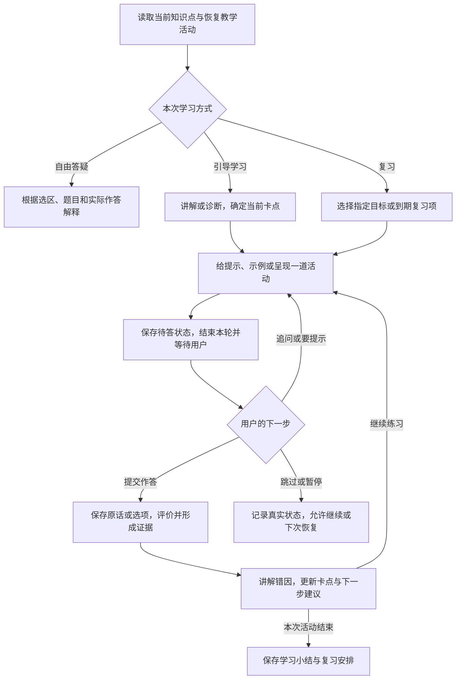

# 学习 Agent 教学工作流程接入

第一阶段将教学方法从根角色中拆出，接入已有学习答疑链路。课程、会话、权限、资料版本、工具调用和最终 JSON 协议继续使用原服务。后续工作流程范围和阶段 A 实现见本文后半部分；没有引入 DeepTutor 整套运行时。

## 对接方式

`/enter` 提供课程与当前知识点信息；`/agent-turns` 保存发问时的阅读快照。`ContextBuilder` 授权读取资料后，通过 `teaching_skills.py` 加载 `skills/teach-current-topic/SKILL.md`，再按资料类型加载 document、quiz、classroom 中的一份参考，和根角色一起写入系统消息。

核心流程是先识别课程、知识点和提问对象，再选择解释、比较、解题提示、完整解析或可跳过的检查。连续追问沿用当前知识点历史。正文与课程明显不符时指出缺口，不编造两者关系。目录名称本身含糊时也如实说明。

`learning_orientation.py` 把当前知识点目标纳入核心数据：最多三个，每个目标文本最多 180 字符，保留 objective_id 并标明截断。相邻目录仍是可选补充，避免挤占选区与问题。旧课程没有目标时返回空列表，不推测生成。

根角色保留权限、工具收据、观察与检查边界、JSON 协议；场景参考规定段落核验、习题指代、PPT 当前页与最近讲解位置的区别。PPT 保持结构化语义与讲稿输入，没有新增视觉能力。

## 版本与预算

每轮记录根角色 `learning-role-v2`，以及 Skill 的名称、模式和内容 SHA-256。结果与检查点保留相同版本；已存在的检查点继续使用原提示词，避免恢复时重做工具操作。新轮次加载当前文件。显式偏好更新导致上下文重建时，沿用现有重建机制并更新版本记录。

Skill 缺失或无效时以 `TEACHING_SKILL_UNAVAILABLE` 结束该次答疑，不静默跳过教学流程，也不阻塞资料阅读。文件路径由服务端固定映射，资料内容不能指定要加载的路径。

教学规则计入原预算：文档 64,000 UTF-8 字节、课堂 48,000 字节，装配时扣除工具定义并预留 8,000 字节。保留完整当前问题和选区，必要时缩短前后文。这里是字节约束，不是模型 Token 窗口；本阶段没有新增模型窗口元数据配置。使用 10,000 字符中文选区、接近 2,000 字符问题、冗长目标及全部工具验证容量。

## 验证与范围

自动回归覆盖三种规则加载、缺失文件、版本记录、检查点恢复、三轮追问、目标保留、选区预算及已有会话/工具/检查/摘要行为。

`backend/src/scripts/verify_teaching_skill_live.py` 在独立测试数据库和合成资料上调用真实模型，检查泛化段落、课程与知识点追问、直接解释、换例子及当前页与讲解位置不同的情形。需要显式设置 `LEARNING_LIVE_ACCEPTANCE=1` 与 `LEARNING_TEST_DATABASE_URL`。不写业务课程或对话。

结果见 [验收记录](../acceptance/2026-10-13-teaching-skill/verification.json)和[真实回答](../acceptance/2026-10-13-teaching-skill/live.json)。模型抽样不能保证所有回答质量；源码验证与业务后端是否重启生效分别记录。

下一阶段再完善习题专用定位字段、资料内检索与引用跳转；本阶段不将这些列为已完成。

## 本阶段补充验收（2026-10-13）

本轮使用独立数据库、合成课程和真实模型验收，未修改业务课程或学习记录。56 项后端回归通过；修正规则后，加载与预算相关 16 项复查通过。报告桌面/手机浏览器各 1 项、PPT 浏览器 1 项通过；浏览器使用隔离后端和模拟回答，真实模型回答另经 API 验证。

最终 9 个真实模型场景通过抽样检查：选段解释、连续换例子、同知识点换资料后承接历史、习题指代澄清、只给提示、完整解析、PPT 阅读页与讲解位置区分、10,000 字引用末尾读取、主动发起理解检查。额外接口检查确认：检查可跳过且不产生掌握证据，问答/跳过不标记阅读完成，返回原知识点恢复会话，不同知识点和用户的对话隔离。

初测发现模型会把含多道题的“这道题”擅自按第一题解释，并泄露其他题答案。已收紧 `references/quiz.md`：无法唯一定位时只询问题号，禁止按排列顺序猜题；同一反例复测改为先澄清。本次是提示规则修正，不等于已完成题目定位字段，也不保证所有模型都严格遵循。首轮脚本末尾另有会话字段名误用，修正为接口真实字段 `items` 后完整重跑，旧回答证据保留。

业务后端已于 17:13:45 UTC 重启，之前“后端待重启”的状态已过期。Skill 文本每个新轮次从本地加载，本次习题规则无需再次重启；已有检查点继续原规则。详见 [补充验收记录](../acceptance/2026-10-13-teaching-skill/expanded-verification.json)、[最终真实回答](../acceptance/2026-10-13-teaching-skill/expanded-live.json)和[初测反例](../acceptance/2026-10-13-teaching-skill/expanded-live-before.json)。本轮未重新覆盖业务旧错误历史干扰、复杂学科答案质量或 PPT 图片视觉识别。

## 第二阶段：题目定位、资料检索与来源跳转

本阶段已接入源码，尚未发布前端或重启业务后端。

- **问这题**：每道习题增加按钮。发问快照包含 `kind=quiz` 和零起始 `question_index`，服务端按资料 ID、版本和知识点权限核验，只提取指定题目。题目位置按版本绑定，因此重复题目 ID 不会导致串题；位置失效时拒绝，不改用第一题。
- **切题连续性**：保留本知识点历史，同时将本轮选定题目放到当前问题之前。真实复测曾发现模型沿用上一题，调整后在“第二题完整解释 → 第一题只要提示”的场景正确切换。规则降低误答风险，不能保证模型永不忽略上下文。当前不自动读取尚未提交的作答草稿。
- **当前文档检索**：无选区、无明确段落位置时，先按当前问题检索当前资料准确版本中的相关段落，再交给模型。已有选区优先；模型也可通过 `read_resource_excerpt(query=...)` 换关键词继续查找。首版使用本地关键词与中文双字片段匹配，未引入向量库或跨课程搜索；匹配不到时明确返回未命中。
- **来源跳转**：回答来源保留资料版本和服务端解析的位置。点击后在独立页面打开对应段落并高亮、对应习题或 PPT 页；段落指纹失效时提示无法定位。旧回答没有精确位置时只打开原版本，不猜测位置；原版本不可用时展示读取错误，不替换为最新版。

本阶段无需数据库迁移，复用阅读快照和引用中的 JSON 字段。业务生效需要部署配套前端并重启后端；仅更新 Skill 文件不能使新的定位协议生效。本轮使用隔离存储，未改动业务课程和对话，也未提交或推送代码。

验收记录见 [第二阶段验证](../acceptance/2026-10-13-teaching-navigation/verification.json)与[真实模型回答](../acceptance/2026-10-13-teaching-navigation/live.json)。历史错误会话、复杂长题、跨模态视觉、长期记忆扩展仍不属于本轮已验收范围。

## 第三阶段：教学连续性与可纠正记录

已接入源码，未部署业务服务。复用现有观察、摘要、记忆版本表，无需数据库迁移。

- **可查看的教学记录**：在课堂右侧展开“全局学习记忆”，可查看当前知识点的困难、待讨论问题和用户明确反馈有效的讲法。每项附原话和当时资料版本；不同用户、课程和知识点隔离，刷新或返回恢复原记录。没有用户反馈时，不把助手讲过的例子认定为有效。
- **纠正会影响后续回答**：用户可标记“已解决”或“不准确”。修改提升记忆版本，使旧摘要失效，阻止基于旧记录的在途回答保存；自动装配最近历史及重建摘要时排除对应旧问答。重复提交相同状态不重复提升版本。原始聊天仍保留，不自动标记阅读完成或掌握。最近纠正按修改时间优先读取。
- **长对话摘要**：沿用满 12 组成功问答、保留最近 4 组原文的后台摘要机制；新增讨论重点、困难、疑问、有效讲法分类及可查看的原话。引用助手回答的摘要一律视为历史讨论假设，不当成已核实事实。归纳文字仍由模型生成，来源有效不等于每句归纳都完全准确。
- **历史纠偏**：在当前问题前补充可信课程与知识点信息、最近教学记录状态。旧助手回复或摘要不得覆盖服务端目录和用户纠正；已有 3 轮错误“课程未知”历史的真实模型场景通过。跨知识点仅按需用课程摘要工具读取少量有来源记录，不合并其他节点全部聊天。

根角色版本升级为 `learning-role-v3`，摘要模板为 `learning-summary-v2`；已保存检查点继续原规则。未增加每次进课堂的模型调用，未自动写入全局偏好。教学记录与摘要受原有上下文字节预算约束，优先保留完整问题与选区；长选区时可去掉重复正文摘录。

真实模型验证覆盖旧历史冲突、记录困惑、用户纠正后回答、记下有效讲法以及长对话分类摘要；浏览器验证原话查看、切知识点隔离、纠正与刷新恢复。94 个不同后端用例通过，另有 2 项纠正复查通过；1 项浏览器流程、类型/lint/构建检查通过。详细结果见[第三阶段验收](../acceptance/2026-10-13-teaching-continuity/verification.json)。仍未实现任意文字编辑教学记录、自动读取作答草稿或 PPT 视觉。

此前建议先部署第二、三阶段。用户随后明确：目标是保留主要教学能力及其底层支撑，不能止于 Skill。后续范围以下方核对和接入方案为准；第二、三阶段部署仍是交付检查的一部分。

## 参考来源

参考 DeepTutor 的[阅读上下文](https://docs.deeptutor.info/explore/reading/)和[主题绑定与教学模式](https://docs.deeptutor.info/explore/mastery-path/)设计，针对本项目重新编写规则。保留本项目“安静陪学、检查可跳过”的要求，没有复制其强制掌握门槛或接入其平台服务。

## 范围纠正：完整教学工作流程与底层能力核对

2026-10-13，用户进一步明确：不迁移 DeepTutor 整个平台，但应尽可能保留教学相关功能，交付完整工作流程与支撑服务。前三阶段完成的是上下文、基础教学规则和连续性，不代表 DeepTutor 教学流程迁移完成。下列为源码核对与待实施方案，本轮没有实现或部署新增功能。

### 核对依据

读取上游 `main` 固定提交 `6cf793bd868ba5ecbe64722936d4be8fab5a01df`，核对教学循环、提示词、工具、待答题模型、教学策略及复习调度；本地只读检出位于 `/tmp/deeptutor-teaching-audit-20261013`。本轮未运行上游平台或验证其实际教学效果，不能把源码存在当成质量保证。

- [教学循环与提示词装配](https://github.com/HKUDS/DeepTutor/blob/6cf793bd868ba5ecbe64722936d4be8fab5a01df/deeptutor/capabilities/mastery/pipeline.py)、[中文教学流程](https://github.com/HKUDS/DeepTutor/blob/6cf793bd868ba5ecbe64722936d4be8fab5a01df/deeptutor/capabilities/mastery/prompts/zh/mastery_loop.yaml)。
- [模式及工具执行约束](https://github.com/HKUDS/DeepTutor/blob/6cf793bd868ba5ecbe64722936d4be8fab5a01df/deeptutor/capabilities/mastery/mode.py)、[教学工具实现](https://github.com/HKUDS/DeepTutor/blob/6cf793bd868ba5ecbe64722936d4be8fab5a01df/deeptutor/capabilities/mastery/tools.py)。
- [教学状态与待答题](https://github.com/HKUDS/DeepTutor/blob/6cf793bd868ba5ecbe64722936d4be8fab5a01df/deeptutor/learning/models.py)、[下一步与证据策略](https://github.com/HKUDS/DeepTutor/blob/6cf793bd868ba5ecbe64722936d4be8fab5a01df/deeptutor/learning/policy.py)、[复习调度](https://github.com/HKUDS/DeepTutor/blob/6cf793bd868ba5ecbe64722936d4be8fab5a01df/deeptutor/learning/scheduler.py)。

上游也支持推迟知识点、跳过题目、作废/纠正错误题目，以及区分学习者自述和系统评价。此前将其概括为“不能跳过的强制闯关”不准确。我们保留评估与推进建议，适配其导航约束，不应因此删去整套教学流程。

### 能力对照及保留决定

“已有”指本项目源码存在；不表示本轮重新通过业务验收。第二、三阶段仍按前述待部署状态管理。

| 能力 | DeepTutor 对应实现 | 我们目前的实际情况 | 接入决定 |
| --- | --- | --- | --- |
| 当前课程、知识点、资料与历史 | 每轮教学状态、资料清单、会话绑定 | 已有目录定位、阅读快照、版本、独立会话与摘要 | 复用并加入本轮教学活动和真实作答 |
| 专用教学循环 | 独立教学提示基底，复用通用循环引擎 | 已有独立 `LearningAgentRuntime`、工具循环和检查点；缺跨轮教学活动协议 | 在现有运行时扩展，不另建重复聊天系统 |
| 教学模式与策略 | outline/study/review；先诊断或先讲解 | Skill 按资料类型加载；没有持久的教学模式与策略 | 增加答疑、引导学习、复习；路线修改走准备 Agent |
| 按知识类型教与评 | memory/procedure/concept/design | 目标有文本和 `check_rule`，缺统一知识类型及对应活动策略 | 保留分类教学、复述检查、步骤练习和开放题评价 |
| 出题、等待、作答、接续教学 | 待答交互跨轮持久化，出题结束本轮，下一轮评价 | 已有检查题/作答表、卡片、批改；提交后刷新卡片，没有完整教学接续 | 必须接通，作为首个交付闭环 |
| 当前习题的个性化讲解 | 待答题、已提交原话、评价结果共同驱动 | “问这题”仅传题号与题干；草稿、具体作答和批改没有绑定进答疑 | 保留并补齐“只提示、讲解我的错因、完整解析” |
| 理解证据与教学判断 | 分类评价、作答证据、是否独立完成等 | 已有客观/模型批改、目标证据投影；缺提示使用记录与细粒度诊断 | 扩展证据，不用一次答对或用户说懂了替代整体掌握 |
| 自适应下一步 | 根据待答、目标、证据、复习项计算 | `next_actions` 主要根据未解决问题和未完成资料推荐 | 加入卡点、提示、换例子、再练及复习建议 |
| 无效题纠正 | 跳过、作废、纠正答案并重判 | 教学观察可解决/撤回；题目判分缺对应纠正链路 | 保留，修正证据与复习计划，同时保留原记录 |
| 错题与间隔复习 | 统一评价记录、错题资料、持久复习队列 | 有历史作答，无独立复习调度闭环 | 保留课程内错题、复习队列、到期与手动复习 |
| 长期连续性 | 资料/活动记忆、有来源摘要、偏好 | 已有会话、偏好；第三阶段补教学记录及摘要 | 复用，增加活动/作答来源，避免另建重复记忆体系 |
| 教材读取与引用 | 目录、搜索、读取、来源导航与标注工具 | 已有课程资料搜索、片段读取和精确引用跳转 | 保留；补多资料比较、目录读取和可保存批注 |
| 图片、原图练习与阅读扩展 | 视觉工具、原图活动及翻译等独立能力 | PPT 仅结构化内容与讲稿；实验由独立模块承接 | 作为后续扩展保留清单，不能声称已具备视觉能力 |
| 补充材料与课程修订 | 教学工具可构建/修改路线并读取来源 | 已有准备 Agent 适配，当前学习入口支持报告/习题补充与修订 | 复用并补教学证据交接；整课路线调整另补契约 |
| 失败与恢复 | 待答恢复、状态校验、工具结果约束 | 已有租约、幂等、检查点、权限和版本隔离 | 复用；新增活动恢复与模式切换竞态检查 |

本地主要依据：[工具注册](../../backend/src/app/self_learning/tools.py)、[检查服务](../../backend/src/app/self_learning/check_service.py)、[教学运行时](../../backend/src/app/self_learning/agent_runtime.py)、[阅读与答疑契约](../../backend/src/app/self_learning/turn_contracts.py)、[进度投影](../../backend/src/app/self_learning/projections.py)、[题目页面](../../frontend/src/liveLearning/Quiz.tsx)、[作答卡片](../../frontend/src/liveLearning/CheckCard.tsx)。

两个容易误判的细节：普通资料题转检查时目前 `objective_ids=[]`，不能据此声称已经形成目标级掌握证据；请求“再来一道”目前可能再次选中同一道符合题型的题，缺少根据作答历史去重和选题的策略。现有通用检查服务仍有用，但不能当成自适应教学已经完成。

### 应交付的完整流程

进入知识点时读取可信课程、目标、资料和学习状态，同时恢复教学模式、正在讨论的活动、待答题及最近有效作答。进入和翻页只读取状态，不自动发起模型对话。

用户自由答疑时直接解释；选择“引导学习”或明确要求带着学习后，根据目标类型、已有证据和用户要求，决定先讲、先诊断还是继续已有活动。引导不是每轮固定反问，也不要求用户先做完测试才看解析。

例如：用户第 2 题选了 B 后点“讲解我的错因”，Agent 读取这次已保存作答，指出哪一步与题意不符；用户要提示时只给下一步所需信息；再次提交后依据新作答调整讲解。刷新后仍恢复同一道题和提示进度，切到第 3 题不把第 2 题的答案套过去。这个完整场景才是接入验收，不以“模型能说出一段解析”替代。

### 底层对接方案（待实施）

1. **教学活动状态。** 在现有知识点会话上增加活动记录：目标、模式、教学策略、题目与版本、待答状态、提示级别、讲解记录、当前作答引用和状态修订号。复用现有题目、作答与轮次表，以外键/引用连接，不把所有事实塞进聊天摘要。数据库变更需要迁移与旧会话兼容；旧会话默认自由答疑。
2. **每轮教学快照。** `ContextBuilder` 装配活动状态和相关作答；已提交内容由服务端按 `attempt_id` 校验读取。草稿仅在用户主动问当前草稿时传入，标记“未提交”，不形成批改或掌握证据。加入明确 `question_index → check_id → attempt_id` 关联；旧题仅能可靠定位时映射，不能只靠题干相似度猜测。
3. **教学工具与执行协议。** 扩展当前 `LearningTools`，提供读取教学状态/作答、切换模式、发起/恢复活动、请求提示、跳过、反馈与纠错等能力。出题成功后持久化待答并结束本轮，不能让模型自行模拟学生回答。提交答案生成幂等事件；在引导活动内接续一次教学反馈，普通练习维持自主操作。失败可重试，已保存作答不重写、不重复出题。
4. **教学决策。** 复用模型判断讲法，程序维护活动合法状态、模式工具约束和证据。明确区分讲过、提示下完成、独立完成、尚未验证。根据知识类型选择概念复述、辨析、步骤或开放任务；分级提示是本项目需补的策略，不能因上游有教学提示词就声称已有完整实现。
5. **评价与纠错。** 复用 `CheckService` 客观判分/模型评价，扩展评价依据、相关目标、提示使用、错误步骤、来源与版本。模型评价保留不确定性。无效题或错误答案键纠正后以新事件重算有效证据，失效旧摘要与复习建议；不直接删历史，也不擅改共享教材。
6. **复习与下一步。** 新增可持久化的课程内复习队列，保留原因、到期时间、关联作答、策略版本。复用上游调度思路及适合拆出的纯函数，结合我们的证据模型适配；不直接把上游分数当作真实掌握概率。自由继续、手动复习、暂停恢复都可用；没有用户请求不增加催促通知。
7. **页面与准备 Agent。** 当前对话增加轻量模式入口；题目提供“提示/解释我的答案/完整解析”，展示真实反馈及下一步。待答卡、复习入口与对话引用同一活动记录。需要补充资料时把目标、卡点和证据引用交给现有准备 Agent，结果仍挂回原知识点。教学状态不重复维护课程目录或任务系统。
8. **预算与恢复。** 教学状态保留紧凑必需字段，详细作答和资料按工具读取；新增规则和工具 schema 都计入现有预算，再跑最大选区与长对话验收，不能以要求用户缩短选区来掩盖超限。按用户/课程/知识点隔离，活动修订号防止旧轮次覆盖切题、切模式和用户纠正。

Skill 负责角色和教学策略；活动服务负责跨轮状态；工具执行真实读写；评价服务产生有来源证据；复习服务安排后续；前端让学生操作和恢复。六者都接通才构成教学工作流程。

### 实施顺序与完成标准

| 阶段 | 必须交付 | 关键验收 |
| --- | --- | --- |
| A：作答与教学活动贯通 | 当前题/草稿/已提交作答关联，持久活动、状态查询、答案后的教学接续 | 问“我为什么错”读取实际作答；刷新恢复；切题不串；重复提交只处理一次 |
| B：完整引导教学 | 模式、先讲/先诊断、按知识类型活动、分级提示、反馈和自适应下一步 | 连续多轮“提示→回答→错因→再试”；允许追问、完整解析、跳过；不自问自答 |
| C：证据纠错与复习 | 目标映射、错题、无效题修正、复习队列与小结 | 有帮助作答与独立作答区分；纠错后重新计算；跨日恢复并实际复习 |
| D：保留扩展与业务交付 | 多资料比较/批注、准备任务交接、配套前后端部署 | 报告/习题/PPT 三类真实业务流程；引用可追溯，资源任务回原节点 |

图片查看、原图练习、阅读翻译与朗读等扩展单列后续能力，先复用已有媒体/实验模块评估，不从功能清单中静默删除；此前确认的 PPT JSON＋讲稿方案继续有效。DeepTutor 的 IM 渠道、独立 CLI、社区插件市场和整套知识库管理不属于本次课堂教学接入目标；课程研究与生成由现有准备 Agent 承接。

实际复用上游代码时固定提交，保留许可证和来源说明，优先移植可独立测试的规则、数据契约、提示词与恢复场景，并适配本项目存储/权限；不默认重写一份缩水逻辑，也不引入另一套身份、课程或记忆事实源。每个阶段分别报告源码完成、自动验证、真实模型抽样和业务部署状态。前三阶段原有测试证明不了这些新增流程，本轮仅完成核对和方案修订。

## 阶段 A：实际作答与后续辅导（源码已实现，待部署）

用户确认开始实现后，先打通版本化习题的完整作答辅导流程：选题/引用草稿 → 提问 → 提交答案 → 批改 → 自动接续一次讲解 → 再试或继续阅读。它包含服务、存储、后台执行和页面操作；尚不等于阶段 B 的完整引导模式与阶段 C 的复习系统。

### 学生看到的行为

- 每题提供“问这题、给我提示、解释我的答案、完整解析”。草稿由用户点击后引用，显示为未提交；已提交作答引用准确的那次记录，不能混用其他题、用户或资料版本。未修改的历史版本题目按确定的题号映射兼容。
- 可为每道题开启“作答后继续辅导”。开启本身不调用模型；下一次成功批改的答案触发一次当前知识点内的讲解。普通练习和跳过不会自动开始对话；关闭影响后续提交，之前已经请求的辅导继续处理。
- “再试一次”保存新作答，不覆盖旧答案。刷新恢复该题辅导设置、已提交答案与辅导结果；本浏览器草稿按用户和题目隔离保存，仍不算已提交记录。
- 正在引用的草稿提交成功后，后续提问自动关联已保存的这次作答，避免仍按旧草稿解释；已经发送的提问保持发送时快照。
- 简答题评价失败时保留答案，可重试评价；评价成功后接续辅导。答疑模型失败不回滚作答，可从该题点击“重试本次辅导”，复用原答疑轮次。切知识点后结果仍保存在原知识点，不抢占当前页面。

### 具体对接

`ReadingSnapshot.practice` 只传检查题 ID、作答 ID，或互斥的未提交草稿。`TeachingActivityService.resolve` 校验本人权限、课程/知识点、资料版本和题目位置，从数据库读取原题、真实答案与评价。`ContextBuilder` 将这些内容放在当前问题附近；即使检查题来源是报告，也按习题规则辅导。题干与选区重复时只传一份，保持原文和草稿完整。

新增 `learning_teaching_activities` 保存每题的开启状态和修订号；`learning_teaching_feedback` 保存每次作答的持久辅导请求。活动阶段由保存的答案及反馈状态计算，区分等待作答、评价未完成、辅导处理中/成功/失败，不靠模型自报。

批改结果与辅导请求在同一数据库事务提交。后台工作线程把请求送入已有 `TurnService`，请求 ID 由作答 ID 稳定生成：重复提交、多进程竞争或“已接收但未写回回执”的中断不会重复创建对话。当前知识点正在答疑时排队等待；来源失效则明确失败，不能偷偷使用新版本。后续答疑沿用原租约、检查点、来源和用户隔离机制。

API 复用 `/checks/{id}` 返回活动状态，新增 `PUT /checks/{id}/teaching`，要求 `expected_revision` 防止过期页面覆盖设置。未安装新表时不显示自动辅导开关，已有练习仍可使用。

### 验证与上线要求

验收覆盖 SQLite/PostgreSQL、迁移升降级、作答关联与拒绝串题、草稿不落为答案、重复提交、崩溃恢复、正在答疑时延后接续、评价失败重试、来源失效、长题/长草稿和原有最大报告选区。浏览器覆盖引用草稿、引用已提交答案、自动辅导、切题、刷新和失败重试；真实模型抽样覆盖草稿提示、错误答案讲解、切题后正确答案讲解。

初测发现两类实现问题并修复：不能按错误提示文字猜测是否有在途答疑，改查实际运行记录；习题规则加入通用 Skill 会挤占长报告选区，改为仅习题加载。真实模型初测还会根据单个选项编造学生思路，已修正自动请求与规则，最终抽样改为只解释答案及依据。抽样不能保证所有学科和模型的教学质量。

最终按用例去重、以修复后结果为准，共 69 项后端验证通过；7 项前端单测、3 项浏览器流程通过，新增失败重试与提交后追问的浏览器复查通过。3 个真实模型场景完成语义抽查。详细验证及限制见[阶段 A 验收](../acceptance/2026-10-13-teaching-activities/verification.json)。全仓默认 TypeScript 检查仍报告其他模块的类型与测试导入错误；本轮使用学习模块专用配置、相关 lint、单测和正式构建验证，不宣称全仓类型检查通过。

上线需在实际部署流程中执行 Alembic 迁移 `20261013_0037`，配套发布前端、重启后端；沿用已配置的答疑和检查功能开关。本轮没有迁移业务库、部署、提交或推送。构建产物为 `/tmp/edu-ai-teaching-activities-dist`。

剩余范围：本阶段针对版本化检查/习题；旧版未开启检查服务的练习仍只传题干。尚未新增跨题引导模式、持久分级提示、按知识类型活动策略、目标映射补齐、题目纠错重算、错题复习调度和多资料批注。上述项目仍按 B—D 阶段继续，不能把本阶段闭环描述成完整 DeepTutor 功能已经迁移。
