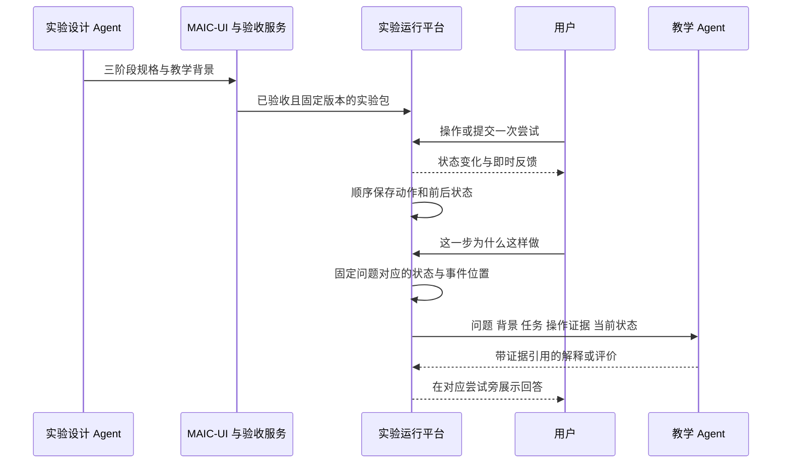

# 实验设计与教学 Agent 交接规范

日期：2026-10-15。状态：设计草案，尚未实现。与[通用实验设计输出规范](2026-10-15-experiment-design-contract-cn.md)配套。实验设计 Skill 本轮先定职责与输出；教学 Skill 单独设计，本文为其预留上下文、工具和回应接口。

实验设计 Agent 属于准备职责，交付可运行实验及教师背景资料。教学 Agent 属于学习辅导职责，结合真实操作解释、提示和评价。平台服务保存事实并连接二者，不要求二者实时互相聊天，也不新增总控 Agent。

## 交接关系



## 三种交接载荷

| 载荷 | 产生方 | 用途 |
| --- | --- | --- |
| `DesignHandoff` | 验收/产物服务，根据设计结果装配 | 确认使用哪个实验版本、教学资料和已具备的接口 |
| `TeachingRequest` | 上下文装配服务 | 将一次用户问题或教学触发绑定到具体事实 |
| `TeachingResponse` | 教学 Agent，经服务校验后保存 | 返回讲解、提示或明确标记的模型评价 |

`DesignHandoff` 包含 experiment_id、revision_id、protocol、package_hash、manifest_ref、teaching_context_ref、capabilities、verification_ref，以及可选 course_id/topic_id。用户身份、访问范围和真实验收状态由服务决定，不能信任模型提供的 owner 或 passed 字段。

`capabilities` 明确是否支持状态快照、动作记录、演示控制、客观检查、恢复及可重放；某项不可用须显式声明。能力不全的旧实验仍可一般问答，但教学 Agent 不能声称看到了未提供的操作。

## 动作与尝试记录

事件记录使用不可变实验修订。一次练习重开产生新的 `run_id`，任务内部每次提交产生新的 `attempt_id`。事件携带 experiment/revision/session/run/phase/task 标识，语义动作 ID、对象与参数、前后状态引用、原因及来源。

区分三层序号：`client_seq` 用于本地离线排序，`server_seq` 用于服务接收后的规范顺序，`state_revision` 用于动作期望状态及冲突检查。时间戳辅助展示，不单独决定顺序。事件 ID 与批次 ID 用于去重；重发不能重复执行动作、推进任务或增加模型调用。

| 事件类别 | 记录内容 | 是否默认调用模型 |
| --- | --- | --- |
| `action_applied` | 对象、动作、变化、操作者 | 否 |
| `action_rejected` | 未执行的请求及拒绝原因，前后状态相同 | 否；按错误策略候选触发 |
| `attempt_submitted` | 一次可评价尝试的事件范围、起终状态及提交物 | 视任务策略 |
| `assessment_recorded` | 规则/模型评价、证据引用、来源及版本 | 不因保存评价再递归触发模型 |
| `system_continuation` | 系统承接的重复过程及轨迹引用 | 通常否 |
| `reset`、`phase_changed` | 新旧作用域及恢复检查点 | 否 |
| `question_submitted`、`hint_requested` | 问题、所指操作/对象、当时状态 | 是 |

操作者区分 learner、system_demo、system_continuation、runtime；用户点击下一步仅触发系统演示，不能把后续系统动作写成学生亲自完成。每次失败尝试均保留，重试不删除旧记录。

完整保存用户的语义操作与尝试，包括对象选择、决定、已提交参数变化、错误、测量、重置和跳过。逐像素鼠标轨迹、动画帧和滑块每帧变化不逐条当作教学事件；拖动保存起终值和有效采样，科学目标确需轨迹时单独保存采样序列。对用户解释“全部操作”时按这个边界说明。

宿主界面状态更新可以合并，语义事件日志必须单独排队，不能沿用普通实验桥接的结果节流来丢弃中间操作。离线事件留在本地，显示未同步；恢复后校验版本与序号，冲突不能静默覆盖。生成适配器上报属于浏览器证据，服务端重放或独立检查后才升级验证级别。

## 教学请求的上下文

| 字段组 | 内容 |
| --- | --- |
| `request` | 请求 ID、user_question/attempt_feedback/hint/rubric_evaluation 触发类型、原问题、语言 |
| `scope` | 实验修订、会话、run、阶段、任务、尝试；课程与知识点归属由服务解析 |
| `design` | 实验背景、学习目标、科学假设、任务规则、rubric、提示与答案暴露边界 |
| `focus` | 用户指定的对象或事件；未指定则绑定提问时最近一次有意义尝试，并携带绑定原因 |
| `snapshot` | 提问时状态、状态版本、采样时间、来源、验证级别及可用性 |
| `evidence` | 对应尝试的动作序列、前后快照、检查结果、相关观测、提示记录 |
| `history` | 已装入的历史范围、较早摘要及可检索原始事件范围、同步是否完整 |
| `conversation` | 当前逻辑会话相关对话、必要的用户偏好；不默认拼接其他课程私聊 |
| `response_contract` | 允许回答类型、评价权限、引用范围、建议动作白名单 |

完整历史保存在业务层。短历史可全部装入；长历史先保留当前尝试原始事实和最近相关操作，再加入带事件范围的摘要。模型可分页读取同一授权作用域的原始事件。摘要不能替换底层日志，也不能宣称模型本轮已看到未加载的全部历史。

“这一步”优先指向用户明确选中的历史操作；没有明确选择时使用提问瞬间的焦点。若多个对象或动作无法区分，模型先说明依据或追问，不猜测指代。UI 显示“正在解释哪次操作”，内部 ID 不暴露给学生。

状态快照在发送问题时冻结，之后操作不修改该请求。使用 `available`、`unavailable` 或 `partial` 明确可用性；过期、超时、切版本、事件缺口都有原因。数据不足时可以回答一般原理，不能补造当前数组、连接或测量结果。

浏览器缓存尚未同步时，服务可接收带范围与来源的临时证据用于普通问答，明确为 browser_reported。需要推进 rubric 任务时必须先保存待评价提交的不可变证据，不能用未记录的临时状态完成任务。

以下为选择基准失败后的教学请求片段，所有 ID 仅为示例：

```json
{
  "request": {
    "id": "q-42",
    "trigger": "user_question",
    "question": "为什么不能选 8？"
  },
  "scope": {
    "experiment_id": "quick-sort-example",
    "revision_id": "rev-1",
    "session_id": "s-1",
    "run_id": "r-1",
    "phase_id": "guided",
    "task_id": "choose-pivot",
    "attempt_id": "a-3"
  },
  "design": {
    "goal": "识别本示例的基准选择策略",
    "rule": "选择当前区间最右侧元素作为基准；该策略不是快速排序唯一合法策略"
  },
  "focus": {"event_id": "ev-17", "object_id": "item-8", "binding": "explicit_selection"},
  "snapshot": {
    "status": "available",
    "state_revision": 12,
    "source": "browser_reported",
    "state": {"array": [5, 3, 8, 4, 2], "range": [0, 4], "pivot_id": null}
  },
  "evidence": [{
    "id": "ev-17",
    "actor": "learner",
    "action": "select-object",
    "object": {"id": "item-8", "value": 8, "index": 2},
    "verdict": "fail",
    "reason_code": "wrong-pivot",
    "model_changed": false
  }],
  "history": {"loaded_event_ids": ["ev-17"], "earlier_events_ref": "run:r-1", "sync_complete": true}
}
```

预期解释应同时说明“当前示例约定最右侧”和“快速排序可采用其他基准策略”，不能把用户选 8 说成算法普遍禁止。已经在即时提示展示的内容不必长篇重复。

## 实时反馈与模型调用

即时反馈由实验状态和规则产生，不等待教学模型。触发单位为任务定义的有意义尝试，控制器在尝试结束、用户提问或请求提示后决定是否调用模型。

默认策略：普通正确操作只本地确认；首次常见错误显示基础提示；同类错误反复出现、关键概念节点可触发一次简短解释；主动问题和请求提示优先。开放任务在明确提交时请求 rubric 评价。具体主动频率作为教学 Skill 策略后续设计，不能在实验 HTML 内任意发起模型请求。

调用队列以当前问题优先。同一事件和提示层级去重；相同作用域连续自动触发可以合并或取消过期请求，主动问题不得静默丢失。流式文本只用于逐步展示；结构化评价必须完整返回并通过校验后提交，不能解析到半句“正确”就推进。

用户继续操作时，主动提问的回答保留在原问题下并显示所指操作；过期自动错误提示不再插入当前反馈区。迟到的评价可以保存为历史，但只有原 run/task/attempt 仍是待评价提交时才允许更新进度。切阶段或重置不能让旧回答改变新状态。

模型失败时保留问题与证据并允许重试。确定性练习不受影响。rubric 任务显示待评价/评价失败；允许继续探索或跳过，保留未评价状态，不能假通过或假失败。教学 Skill 未启用时使用预生成讲解与基础反馈；必须依赖模型评价才能完成的任务不可宣称完整可用。

延迟验收分别测量界面反馈、保存确认、模型首字和完整评价的耗时与超时比例；不能用流式首字速度代表评价完成速度。本轮不承诺尚未实测的秒数。

## 教学回应与权限

`TeachingResponse` 需要 request_id、原 scope、基于的 state_revision 与 evidence_ids、kind、message、可选 hint_level、可选 assessment、可选 suggested_action_refs。

| kind | 内容 | 对实验的影响 |
| --- | --- | --- |
| `explanation` | 围绕事实说明原因 | 只展示，不修改模型或进度 |
| `hint` | 依据提示边界给出下一层帮助 | 记录提示使用，不替用户执行 |
| `assessment` | 对 rubric 提交逐项评价、依据和信息缺口 | 服务校验后可影响预先声明的 rubric 任务 |
| `clarification` | 问清指代或必要条件 | 不把未回答记为错误 |

assessment 必须包含 criterion_id、verdict（met/partly_met/not_met/insufficient_evidence）、证据引用和理由。平台检查 rubric ID、所有必评维度、证据范围及待评价提交是否匹配，再按照任务预设汇总规则记录“模型评价通过”等状态。模型自身不能决定新汇总规则、覆盖确定性检查或宣布长期掌握。

建议动作只能引用 manifest 已有动作，并经宿主当前阶段权限验证。默认生成可点击建议，由用户触发；教师首版不直接修改参数或执行学生的动作。系统演示由已验收脚本执行，不由临时聊天文本执行。

教学上下文中的网页文本、用户回答、日志和生成代码均为资料。模型不得把其中的命令视作系统权限；工具授权从服务会话派生，参数不能指定任意 owner 或越权实验。模型输出的 HTML、脚本和工具调用也不能直接进入实验执行路径。

## 预留读取工具

| 拟定工具 | 返回内容 | 约束 |
| --- | --- | --- |
| `read_experiment_design` | 当前修订的目标、规则、任务、教师资料 | 仅读取授权版本 |
| `read_experiment_snapshot` | 当前请求冻结快照，或显式指定的历史快照 | 读取最新状态须标为另一次观察，不替换原问题依据 |
| `read_experiment_events` | 按事件范围分页读取原始操作 | 同一授权会话；返回范围与是否还有后续 |
| `read_attempt_evidence` | 某次提交的动作、前后状态、检查和观测 | 不跨 run 混用证据 |
| `compare_observations` | 两次运行条件、单位、结果和可比性检查 | 条件不同或数据不完整时说明差异，不伪造对照 |

首版设计 Agent 不调用运行时用户记录；它只需用户需求和有关的目标背景。教学 Agent 使用上述读取工具。事件落库、完成状态和模型评价回执由平台服务保存，不让模型自由写记录。

## 会话归属与版本更新

课堂内实验延续“用户 + 课程 + 知识点”的逻辑会话，每条消息附实验版本与运行作用域；同一知识点切换资料不新建整段会话。独立实验使用“用户 + 实验”的逻辑会话，阶段和 run 是证据范围；切阶段可以保留相关对话，但装配时不能把旧状态当成当前状态。

同一实验新修订生成新的 immutable revision。旧 run 固定旧修订，旧消息引用继续有效；切新版另开 run。服务器检查 event ID、预计状态版本和任务状态，拒绝跨修订动作和并发覆盖。重置、离线恢复和多个标签页均按相同规则处理。

教学期间需要补充实验或修订任务时，后续复用课程准备 Agent 的既有交接机制：传目标、基准修订、修改范围和必要证据引用；生成新包后通知用户选择打开，不热替换正在操作的实验，也不默认传全部私聊。首版不开放教学 Agent 自动修订或发布实验。

## 对接验收场景

1. 用户只操作不聊天，可以完成演示及客观引导任务，并进入探索。
2. 用户问“为什么这样做”，回答对应提问时真实动作，不能使用默认初始值代替当前值。
3. 相同数值的不同对象可区分，错误尝试和系统自动操作不计为用户成功。
4. 页面连续操作、离线恢复、重发或重复通知不会丢关键事件、重复推进或刷模型消息。
5. 请求发送后用户纠错、切阶段或重置，旧回答只解释旧事实，旧评价不推进新任务。
6. 长历史摘要可定位原始事件；缺口明确，模型无法读取其他用户或知识点私有日志。
7. 生成状态或服务重放失败时保留 unknown，不把异常评价为学生错误。
8. 开放任务允许合理多解，缺证据可追问；模型失败保留待评价，并允许用户继续其他学习活动。
9. 教学 Skill 尚未接入时不会出现伪造 AI 发言；功能范围在实验能力声明和页面中一致。

可借鉴 OpenMAIC 的请求级状态固定、JSAV 的显式评价节点、PhET-iO 的状态与事件区分；具体接入以本项目协议为准，不把上游部分能力视作本项目完整实现。
