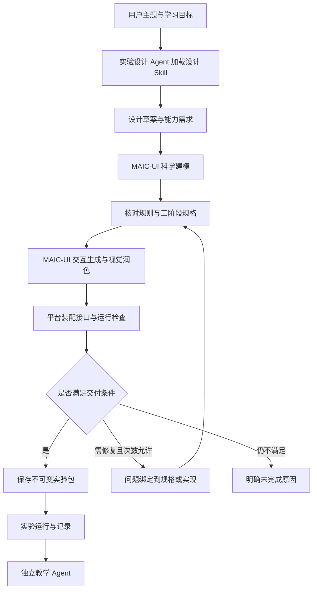

# 通用实验设计输出规范

日期：2026-10-15。状态：设计草案，供后续编写实验设计 Skill 和实现接入使用；本文不代表能力已经上线。

保留 MAIC-UI 的原生科学建模、交互生成和视觉润色能力。实验设计 Agent 负责生成三阶段教学规格，MAIC-UI 按规格制作可运行实验，平台负责阶段控制、操作记录、即时校验及上下文装配。运行时教学由独立教学 Agent 承担，接口见[实验 Agent 交接规范](2026-10-15-experiment-agent-handoff-cn.md)。两个 Agent 是业务职责，不要求新建两个独立服务。

本规范取代[四阶段实施计划](2026-10-14-experiment-teaching-phases-plan-cn.md)中面向未来通用实验的四阶段安排、固定手动两轮和逐实验手写规则作为唯一接入方式的要求。已发布冒泡原型保持原样；旧 v2 分步方案仍暂停。课程准备与学习辅导的角色、知识点会话及事实边界继续遵守两份主设计。

## 教学范围与阶段

| 阶段 | 用户体验 | 生成时准备 | 运行时处理 |
| --- | --- | --- | --- |
| `demonstrate` 原理演示 | 主要只有下一步，可回看和重播；系统执行动作并讲解 | 固定起点、动作序列、高亮、变化前后讲解、关键结果断言 | 逐步执行、等待动画完成、展示对应讲解；不开放任意参数 |
| `guided` 引导练习 | 系统给任务，用户尝试，正确后推进，错误时提示重试 | 小任务、允许操作、提交边界、判定依据、基础反馈、错误恢复 | 即时响应、规则检查；必要时请求教学 Agent 解释或评价 |
| `explore` 自由探索 | 开放实验完整能力，可选探索任务 | 可用参数范围、控件、观察建议、可选任务和重置方式 | 执行用户操作、记录结果、按需问答；不把每次尝试判成对错 |

三个阶段是默认模板。设计必须声明适用性：`standard` 使用默认模板，`adapted` 调整某阶段内容并说明原因，`unsupported` 当前环境无法可靠实现。开放探究可先演示工具和测量方式，避免提前揭示待发现结论；不能为凑阶段编造唯一答案。性能测试是适用实验中的探索任务，不再强制作为独立阶段。

引导练习覆盖少量有区分度的关键操作。快速排序可练基准、一次分区中的代表判断、子区间和停止条件；重复扫描或剩余递归可由系统承接，明确标记为系统演示，不计为用户完成。

正常推荐顺序是演示、练习、探索。阶段切换与任务完成分开记录；用户可回看或直接探索，跳过不写成完成。自动推进仅指当前引导任务成功后进入下一任务，不自动替用户操作，也不自动切走整个阶段。

## 职责与生成流程



设计 Agent 先声明科学假设、算法变体、目标与步骤，科学建模结果随后补全公式、约束、适用条件及来源。冲突必须在生成交互前解决。前端实际动作和任务判定共同引用同一份规格，避免三个阶段各生成一套相互矛盾的算法。

MAIC-UI 保留自身生成与视觉能力。平台适配层传入规范、运行接口和资源约束；原有 `key_steps` 可作为投影输入，但不能替代完整教学规格。视觉润色后重新验证动作、对象标识和状态上报是否仍然存在。

重试只修复受影响部分并受项目既有重试策略约束。格式通过、页面可打开和科学正确性是不同检查结果，不能互相替代。

## 交付包结构

协议拟命名为 `edu-experiment/1`，与已有 `guidance_version=2` 和独立冒泡原型显式区分。字段名是本次设计的接口约定，尚未生成可执行 JSON Schema 或修改数据库。

```text
experiment-package/
  manifest.json          三阶段教学规格与能力声明
  runtime.html           MAIC-UI 生成的完整交互页面
  runtime-adapter.js     可选的实验特定状态与动作实现
  teaching-context.json  教学背景、规则、误区和评价依据
  verification.json     平台验收服务生成的检查回执
```

以上是逻辑组成，可以按现有产物存储方式保存，不要求实际文件夹。`runtime-adapter.js` 只有在通用运行能力不够时提供；它与 HTML 均在实验沙箱运行，不能在后端直接执行模型输出代码。敏感凭据、模型调用和数据持久化由宿主服务处理。

| manifest 字段 | 必须表达的内容 |
| --- | --- |
| `protocol` | 固定为本协议版本 |
| `identity` | 平台分配的实验 ID、不可变修订 ID、包内容摘要；草案阶段为空，由服务装配 |
| `provenance` | MAIC-UI 固定提交、设计 Skill 版本、模型/生成配置引用、生成时间；服务填写 |
| `subject` | 主题、语言、适用基础、前置知识 |
| `objectives` | 稳定目标 ID、用户应表现出的能力、对应任务与证据类型 |
| `applicability` | standard/adapted/unsupported、调整或不能实现的原因 |
| `scientific_model` | 公式/机制、假设、单位、算法变体、边界、来源或说明依据 |
| `state_contract` | 实验事实、视图状态、测量结果的结构及字段说明 |
| `object_contract` | 实验对象的稳定身份、类型、可读名称和位置关系 |
| `action_contracts` | 可执行动作、参数结构、先决条件、运行结束信号及可用阶段 |
| `phases` | 有序的三个阶段及演示、任务和探索配置 |
| `assessment_contracts` | 规则检查与模型评价的具体依据、证据要求及结果语义 |
| `teaching_context_ref` | 指向相同修订的教学资料 |
| `validation_cases` | 正确、错误、等价、边界及恢复场景 |
| `artifacts` | HTML/适配器/资料引用与内容摘要，由装配服务校核 |

所有引用必须在同一修订内解析成功。生成模型可以提出草案字段，不能自写“已验收”或把验收回执当作自己的输出。示例固定数据与可变参数分开声明；每次随机化保存种子及实际生成数据，不只保存种子。

## 实验状态与可操作对象

`state_contract` 至少区分以下三类：

| 类别 | 示例 | 约束 |
| --- | --- | --- |
| `model` 实验事实 | 数组、基准、连接图、初速度、当前位移 | 动作和绘图共用；不能从高亮颜色反推权威事实 |
| `view` 视图状态 | 当前选择、放大位置、高亮、动画进度 | 不自动计入算法/物理结果；重绘不能重复执行动作 |
| `measurements` 已完成观测 | 本次运行比较次数、停车距离、实验条件 | 绑定 run ID、输入与结束状态；调参后保留为历史结果，不能冒充新参数结果 |

每个字段说明类型、含义、单位、有效范围；不确定值显式标为未知，不填预期答案。浮点容差由任务说明，随机模拟说明种子、采样量及统计口径。

对象使用稳定 ID。排序中的两个相同数值是不同对象，交换后 ID 不变；位置是独立属性。图中的节点、连线及器件也必须可定位。教学上下文使用名称和关系，不能只给模型 DOM 坐标或按钮点击事件。

阶段进度、完成记录和模型评价由宿主保存，不放进生成页面可任意改写的实验事实。当前状态快照与操作历史各自保存，快照不替代历史。

## 实验页面运行接口

宿主提供协议桥接 SDK，生成页面注册适配器。实际函数名称可在实现时映射，但下列输入、结果和职责不能省略。生成 HTML 可以包含有学科特色的点击、拖动和连线界面，不要求统一为通用按钮；所有语义操作必须经过已注册动作入口。

| 接口 | 输入 | 输出或完成信号 |
| --- | --- | --- |
| `describeCapabilities` | 初始化请求 | 协议版本、包摘要、实际支持的动作、状态 schema 与恢复能力 |
| `initialize` | 阶段配置、实际初始数据、随机种子或轨迹引用 | 初始化后的状态及可操作对象清单 |
| `setInteractionPolicy` | 阶段、任务、动作白名单和参数范围 | 策略已应用回执；不可只隐藏按钮而继续接受禁用动作 |
| `applyAction` | command_id、动作 ID、对象/参数、期望状态版本 | accepted/rejected/error、前后状态或引用、完成事件；耗时动作区分已接受和已完成 |
| `getSnapshot` | request_id、要求的状态版本 | 状态、来源、版本、当前是否运行中及最新已完成观测 |
| `restoreCheckpoint` | 检查点或保存状态、目标 run | 恢复完成的状态；取消旧动画和旧运行，不能留下后台回调 |
| `evaluateAttempt` | 判定 ID、提交物、事件范围、前后状态 | pass/fail/unknown、原因代码与证据；只负责确定性判定，不调用模型 |
| `subscribeEvents` | 宿主订阅与恢复游标 | 顺序语义事件、动作完成/失败、状态变更、事件缺口说明 |

SDK 处理协议校验、消息来源绑定、重复命令和宿主事件转发；适配器负责领域状态与可观察变化。宿主保存阶段、任务和进度，页面根据宿主策略启闭操作，不再私自维护另一份教学进度。绘图只读已提交模型状态。

提交一次尝试时，宿主先等待该尝试相关动作到达结束信号，再固定证据并评价；页面运行异常不算完成。需要执行后才能判断的任务可以保留试验结果后评价，恢复策略在任务中预先声明。动作是否成功执行与学生决策是否正确是两个结果，不能用一个 success 字段代替。

握手时实际能力必须覆盖 manifest 所需能力；缺少接口或包摘要不匹配则不启用新协议。消息大小、执行时间和网络访问由运行环境限制。具体限制值在接入测试后固化为部署配置，不由生成页面自行扩大。

## 演示规格

每个 `demo_step` 包含 `id`、目标引用、`start_checkpoint`、`commands`、`focus_objects`、`narration_before`、`narration_after`、`expected_assertions` 和 `end_condition`。

一次下一步触发一个能讲清楚的过程单元，允许包含少量连贯动作。执行期间不能重复启动同一步；动画完成或明确运行终止后展示结果讲解。预生成讲解绑定固定演示输入，变量文本用有类型的状态引用填值，不执行文本表达式。运行结果不符合断言时停止该段并提示异常，不能继续展示假定成功的讲解。

回看通过检查点恢复及必要的确定性重放完成，不能仅翻动文字而保留后续状态。非确定性演示保存已验证轨迹或固定实际样本。用户触发“下一步”属于观看导航，内部演示命令标记为 `system_demo`，不计作练习证据。

## 引导任务规格

一个任务可以允许多次尝试；一次尝试可以包含多个动作。反馈边界定义为“用户围绕一个小目标完成一次可评价的尝试”，不是每次 DOM 事件，也不强制是整个实验结束。

| task 字段 | 作用 |
| --- | --- |
| `id`、`objective_refs` | 任务身份及学习目标 |
| `prompt`、`rule_refs` | 用户要做什么，以及本任务采用的规则 |
| `entry` | 进入时使用检查点或继承上一任务的哪部分状态 |
| `allowed_actions`、`editable_parameters` | 当前可用动作及可调范围，宿主与适配器同时检查 |
| `submission` | 什么时候构成一次尝试，不能靠通用空闲计时猜测 |
| `assessment_ref` | 客观检查、模型评价或仅观察记录 |
| `immediate_feedback` | 成功确认、错误类别对应的简短提示、无法判断提示 |
| `recovery` | reject_before_apply、restore_checkpoint 或 allow_correction |
| `progression` | 成功后目标任务、需保留的成功反馈、跳过/查看演示的去向 |
| `hint_policy` | 允许提示的深度和答案暴露边界，具体措辞交教学 Skill |
| `system_continuation` | 可选的重复过程承接，列明动作及结果断言 |

`submission` 支持四种明确边界：`on_action`（选择基准）、`explicit_submit`（检查连线）、`run_completed`（完成一次测量）、`answer_submitted`（提交解释）。滑块拖动只即时更新画面；是否松开即构成尝试由任务明确声明。时间相关实验必须等待有效观测窗口或用户确认测量，不能把松开鼠标当作实验完成。

可明确判断的正确尝试立即推进任务状态；界面保留上题的成功反馈并标注所对应任务。动画未完成时不切换新任务操作区。用户可回看反馈，不因自动推进丢失解释。模型讲解不在这个关键路径上。

非法对象或未开放动作在执行前拒绝。可恢复的错误尝试仍记录下来；若恢复检查点，同时记录错误后状态与恢复事件，不能抹掉错误轨迹。若允许用户继续修正，则不隐式恢复。提示、查看演示、跳过和自动承接分别记录，完成不等于无帮助完成。

以下是快速排序任务片段，不是完整 manifest，也不是全局固定基准策略：

```json
{
  "id": "choose-pivot",
  "objective_refs": ["identify-pivot-policy"],
  "prompt": "本实验采用区间最右侧元素作为基准。请选择本轮基准。",
  "rule_refs": ["rightmost-pivot"],
  "entry": {"checkpoint": "guided-partition-start"},
  "allowed_actions": ["select-object"],
  "editable_parameters": [],
  "submission": {"kind": "on_action", "action_id": "select-object"},
  "assessment_ref": "check-pivot-selection",
  "immediate_feedback": {
    "pass": "选择正确，本轮按最右侧元素作为基准。",
    "wrong-pivot": "这不是当前区间最右侧的元素，请重新选择。",
    "unknown": "当前选择暂时无法检查，请重试。"
  },
  "recovery": {"mode": "reject_before_apply"},
  "progression": {"on_pass": "classify-element", "retain_feedback": true},
  "hint_policy": {"max_level": 3, "reveal_answer_on_request": true},
  "system_continuation": null
}
```

对应起始状态可为 `[5,3,8,4,2]`，正确对象是最右侧值为 2 的元素。任务后续选择少量代表判断及子区间识别，不要求完整手操所有递归。

## 判定规范

每条 assessment 声明 `id`、`mode`、所需输入/证据、检查实现引用、结果代码与恢复建议。`mode` 为 `deterministic`、`rubric` 或 `observation`。

确定性检查结果为 `pass`、`fail` 或 `unknown`；另有 `invalid_action` 表示不符合操作契约。结果必须含规则版本、证据引用、原因代码和来源。返回未知不能当作学生答错。任务通过、整个实验完成和掌握结论分别记录。

默认检查优先组合有限的规则原语：类型化字段相等、集合关系、数值范围与容差、顺序约束、图连接关系、前后状态不变量。字段通过结构化路径引用，不用自然语言条件或任意字符串 eval。

原语不能表达的实验允许使用生成或复用的领域适配器，提供 `applyAction` 和 `evaluateAttempt` 等接口，并绑定实现摘要与版本。这样新增实验可以生成适配实现，不强制开发者逐个添加硬编码主题分支。生成实现必须在隔离运行器中验证；沙箱内自报 pass 不自动成为服务端验证结果。服务保存 `verification_level`：browser_reported、host_checked 或 independently_replayed，教学模型可见其事实强度。

模型评价的 rubric 包含评价维度、可接受的多种路径、所需观测和信息不足条件。评价为 met、partly_met、not_met、insufficient_evidence，明确标记为模型评价。只有预先声明采用 rubric 的任务可以由该评价影响任务进度，细则见交接规范；模型不能覆盖确定性失败。

自由探索默认 `observation`：记录条件与结果，不因为偏离推荐操作就报错。探索任务可选择客观条件或 rubric，但不强制评价所有行为。

## 为教学 Agent 准备的背景

`teaching-context.json` 包含目标、原理、规则及适用条件、任务意图、误区、提示边界、结果解释依据，以及对象/动作/状态字段的人类可读说明。数据引用同一份 scientific_model 与任务规格，避免复制出第二套规则。

它不预填用户表现、不生成虚构对话，也不提前断言用户完成。已知正确答案可以作为教师资料供提示策略使用；前端显示层不直接把教师资料全部展示给学生。生成 HTML 无法提供考试级答案保密，本规范定位为学习实验。

教学 Skill 的预留位置建议为 `backend/src/app/self_learning/skills/teach-experiment/`；设计 Skill 建议为 `backend/src/app/practice/skills/design-experiment/`。本轮仅约定职责和接口，不创建或加载这两份 Skill。

## 接入与兼容

当前复用入口为 `backend/src/app/practice/service.py`、`native.py`、`native_runtime.py` 和 `frontend/src/practice/Practice.tsx`。旧普通实验桥接只有参数/结果上报，后续新增协议化状态与事件通道。旧 v2 中的快排/摩擦固定分支不能被视作通用能力。

新协议按 `protocol` 显式加载。历史 HTML 可继续原模式运行；缺少事件接口时明确能力不足，不从按钮文案推断操作历史，不自动宣称兼容三阶段。升级生成新修订，旧会话与证据固定旧修订，不替换用户进行中的实验。

## 后续验收门槛

1. 规格结构、引用、对象和动作均能解析；不存在自然语言占位的完成条件。
2. 每个演示步骤可执行、可回看，实际状态和预生成讲解一致；重复下一步不重复执行。
3. 引导任务可达，至少检查正确、错误、等价方案、重试及必要边界；跳过与系统代做不记成用户完成。
4. 探索参数在声明范围内有效，重置和阶段切换不会污染练习证据。
5. 任意一条反馈能定位到尝试及其前后状态；动画帧不刷聊天，关键语义动作不会被界面节流丢掉。
6. 验收包含独立于生成答案的断言或参考计算；模型自检和同一实现自报成功不能证明科学正确。
7. 使用算法、连续物理模拟、随机统计三种样例验证规格通用性；新主题不得要求修改共享外壳中的主题判断分支。
8. 实验沙箱无模型密钥或外部写权限，越权动作被拒绝；桌面、手机与键盘操作可完成核心任务。
9. 模型不可用时演示、确定性练习和探索仍可操作，开放任务保留待评价状态。

后续先将本文整理为设计 Skill、机器可校验 schema 和实例，再接入 MAIC-UI。状态字段大小、运行预算、持久化表及延迟指标需在原型测量后定值，不将未测试的数字作为性能承诺。
