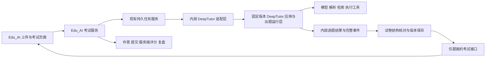

# DeepTutor 模拟考试迁移评估

评估日期：2026-10-16。范围：用户上传资料与要求，系统识别参考试卷并生成相似的新卷；保留 DeepTutor 的核心逻辑，尽量避免过度裁剪。本文保留实施前的源码评估与离线验证基线。

后续进展：已按[迁移计划](2026-10-16-deeptutor-migration-plan-cn.md)完成 M1 与 M2 主体接入，尚未上线；最新结果及 MinerU/仿卷质量未完成项见[M2 验收记录](../acceptance/2026-10-16-deeptutor-migration-m2/README.md)。下文原始测试结果不回写为补丁后的结果。

**建议采用固定版本的 DeepTutor 独立服务，保留完整出题能力及其依赖运行层，通过适配层接入 Edu_AI。** 首轮保留上游完整源码和依赖基线，重点修改输入与输出边界、试卷结构表达和考试业务约束。只有运行、回归和实际依赖证据充分后，才考虑缩小部署依赖。

DeepTutor 已具备值得复用的逐题仿写、资料探索、工具调用、生成修复、历史练习与讲解能力；它当前的交付对象主要是学习测验。我们仍需补上完整试卷校验、用户要求贯穿、作答版本、答案隔离和考试提交评分。不能把它已有的事件回放误认为逐题断点续生成，也不能把格式修复视为答案正确性验证。

## 评估基线

| 项目 | 已核实内容 |
| --- | --- |
| 仓库 | [HKUDS/DeepTutor](https://github.com/HKUDS/DeepTutor) |
| 版本 | [v1.6.14](https://github.com/HKUDS/DeepTutor/releases/tag/v1.6.14)，提交 `6cf793bd868ba5ecbe64722936d4be8fab5a01df` |
| 最近提交 | 2026-10-08 03:34:42 UTC；2026-10-16 用远端 HEAD 再核对，仍为上述提交 |
| Star | 约 41.4k，沿用 2026-10-15 页面快照，本次未刷新；不能代表仿卷质量 |
| 许可证文件 | Apache-2.0；集成时保留上游 LICENSE、THIRD_PARTY_NOTICES 和改动记录，依赖清单另行核对 |
| 技术适配 | 上游 Python 支持范围为 `>=3.11,<3.15`，本次验证使用 Python 3.12.14；Edu_AI 后端同属 Python/FastAPI，前端已有 React 体系 |
| 已检查 | 出题 capability、pipeline、mimic_source、抽题器、提示、工具运行层、应用与任务服务、历史加载、评分接口、测验前端及对应测试 |

需求基线见[前轮项目调研](2026-10-15-mock-exam-reference-research-cn.md)。已确定同题型、同题量及对应排列；逐题考点可参考原题。严格等难、分值、时长、考点强制逐一一致尚未确定，下面的数据模型为这些能力预留字段，不将其当作已确认的硬约束。

## 上游真实执行链路

```text
DeepTutorApp / TurnApplicationService
  → 请求准备、用户工作区、模型选择、任务与事件持久化
  → TurnEngine → ChatOrchestrator → DeepQuestionCapability
      普通资料模式
        → Explore：探索资料、检索与工具调用，读取历史练习
        → Plan：生成逐题模板
        → Quiz：按模板逐题运行推理和工具循环
      参考试卷模式
        → 文档解析 → question_extractor → mimic_source
        → templates_override → Quiz
  → 每题标准化与格式检查 → 有问题时修复
  → 逐题事件、完整结果、用量与运行记录
```

仿卷模式跳过 Explore/Plan 是上游明确设计：原卷已提供逐题模板，避免再由自由规划改变结构。迁移应保留这条路径，在它前面补齐原卷分析；如需额外检索，沿用逐题工具能力或增加有边界的资料准备步骤。普通资料模式仍保留完整 Explore → Plan → Quiz。

当前 `AgentCoordinator` 是兼容外观，内部也调用 `QuestionPipeline`。其构造参数中的 `api_key`、`base_url` 只保存为兼容属性，不能据此认为已覆盖实际模型配置。新集成优先经过应用层/能力层；只有需要明确控制逐题恢复时，才由适配器调用管线内部扩展点。

依据：[应用外观][facade]、[应用服务][appservice]、[能力入口][capability]、[出题管线][pipeline]、[兼容协调器][coordinator]。

## 保留边界

“保留”包括行为、上下文、提示、工具协议、错误处理、事件以及测试。只保留若干出题文件会丢失大量隐含依赖。

| 能力 | 迁移处理 | 保留原因与边界 |
| --- | --- | --- |
| `DeepQuestionCapability` 与 `QuestionPipeline` | 整体保留，集中维护必要补丁 | 保留普通出题与参考卷两条路径，避免变成一次性模型请求 |
| Explore/Plan/逐题 Quiz | 保留原有阶段与逐题顺序 | 后续题读取已生成题目，具有避重上下文；第一阶段不贸然并行化所有题 |
| THINK/TOOL/FINISH 协议与 `runtime/agentic` | 保留 | 原生工具调用、协议纠错、终止条件、调用预算与异常反馈依赖此层 |
| 工具组合、注册与运行上下文 | 保留，接我们的工具适配器 | 保留 RAG、资料读取、计算/执行验证等能力；根据实际授权与配置挂载 |
| 工具结果摘要、来源信息、用量统计 | 保留 | 长资料处理、依据追踪与成本分析需要这些数据；详细内部事件仅供服务端保存 |
| JSON 解析、标准化、单题修复 | 保留并扩展题型 | 保留格式修复与推理耗尽后的降低推理强度重试；新增题型同步修改校验和提示 |
| 中英文提示、模型适配与多模态接口 | 保留 | 不把模型供应商、语言或图题支持写死；具体提供方能力需实际验证 |
| 文档解析服务与原卷抽题路径 | 保留接口与原生路径；增加 Edu_AI 解析适配 | 对照验证后复用现有 MinerU 产物，避免反复解析同一文件 |
| 练习历史、题库、错题与追问讲解 | 保留能力，衔接考试后的复盘 | 历史信息不能覆盖本次原卷结构；考试中不直接开放包含答案的讲解路径 |
| 应用服务、会话存储、事件回放与取消 | 首轮保留 | 复用已有任务生命周期；业务考试版本与作答记录由 Edu_AI 管理 |
| 测验展示、公式/代码渲染、图片作答、AI 反馈 | 复用交互与可移植组件，接现有前端 | 上游页面依赖 Next.js、上下文和自身 API，不能整页直接搬到 Vite |
| 其他能力与入口 | 源码保留，首轮不在考试入口挂载 | DeepResearch、其他学习模块、独立登录站点和 IM 入口不必同时接入产品 |

资料范围也属于本次要求：若用户限定仅依据上传资料，保留工具机制，但工具可用范围必须遵守这一约束。执行工具需要真实可用的运行环境；不能把工具名出现在提示里视为已完成接入。

依据：[共享工具组合][toolcomposition]、[工具运行绑定][toolruntime]、[历史读取][history]、[前端测验][quizviewer]、[AI 评判接口][judge]。

## 必须补齐的差异

下表区分源代码已存在的行为和迁移建议。前三类输入完整性、题型结构与答案隔离直接影响用户的核心目标，应在首版处理。

| 已核实行为 | 对模拟考试的影响 | 建议修改 |
| --- | --- | --- |
| capability 的 `max_questions` 默认 10，`0` 也会被 `or 10` 转为 10；抽题提示只使用 Markdown 前 15,000 字符 | 10 道选择＋5 道填空可能少题；改题数参数仍无法消除正文截断 | 仿卷默认处理完整卷，按页/题组分段抽取并合并跨页题；记录未处理范围，不以缩短试卷代替完成 |
| 普通 Plan 数量不足时提示后继续，完成统计以实际模板为基准；相同 topic 会被去重 | “成功”可能意味着题数少于用户要求 | 将用户要求/原卷结构冻结为独立目标；校验实际总数、题型数量、顺序，补齐缺项 |
| 仿卷逐题提示包含原题与参考答案，但没有直接拼入用户要求、对话上下文或文本资料；相关内容虽传入 run，仿卷会跳过使用它们的 Explore/Plan | 用户的算法约定、内容限制、补充教材可能未稳定进入生成上下文 | 增加本次要求与资料依据块，贯穿逐题生成和修复；保留用户原文，并区分硬约束与偏好 |
| `templates_override=[]` 在 `run` 中被转为 `None` | 空抽题结果会进入普通出题分支，掩盖仿卷失败 | 区分未提供模板和提供了空模板；后者报告解析不完整，保留原文件供修复 |
| `choice` 仅接受 A–D 四选项、单个答案；填空提示限定一个空；未知题型降为 `written` | 多选、五选项、多空、复合题会失真 | 扩展结构化题型、选项、空位、子题及答案模型；无法映射时保留原类型与未解决状态 |
| 模板只有题号、topic、type、difficulty、source、原题和原答案；topic 是原题前 240 字符 | 不是独立的考点/能力分析，也缺少分区和子题层级 | 增加原题稳定 ID、原始编号/位置、考点、任务动作、分区与层级；原始证据和模型推断分开保存 |
| 抽题器输出 `images`，但 `mimic_source` 未将其绑定到逐题模板；只上传 PDF 不等同于逐题收到图像附件 | 图题可能缺图、错图或只看到文件名 | 关联图片/表格/公式与页码、题号；将需要的图像真正传入逐题模型，并保留生成题资产 |
| mimic 优先取第一个 PDF；纯文本附件回退到 custom 提示路径 | 多文件、混合教材与试卷、非 PDF 参考卷没有统一的结构保障 | 增加资料角色识别；明确主模板、知识材料和答案册，避免默默取第一份 |
| 格式修复后仍可产生带 issues 的尽力结果；单题事件仍会输出 | 部分不合格题目可能出现在学习界面 | 保存草稿和问题定位，定向重试；仅在已确认的整卷条件满足后转为可考试 |
| 逐题 `qa_pair`、最终结果以及仿卷总结带正确答案/解析；前端 QuizViewer 也持有答案并进行部分本地判定 | 单纯隐藏答案按钮无法实现考试答案隔离 | 后端分别输出题面视图和答案视图；生成日志、回放、题库、追问与评分接口遵循同一展示状态 |
| 现有 AI judge 接受客户端给出的题目、参考答案和解析，输出自然语言评判 | 适合学习反馈，不能直接作为可信的考试计分接口 | 按已发布版本从服务端读取评分依据；客观题确定性计分，主观题按评分点输出结构化得分并附反馈 |
| 运行服务可回放事件，但 worker 丢失时会将任务记为 failed 并要求重试 | 已生成十题后中断，不保证自动从第十一题接续 | 增加按试卷版本/原题 ID 保存的生成检查点；重试加载已成功题及其顺序与避重上下文 |

特别注意：上游填空提示要求“恰好一个空”，程序校验实际只检查空白标记是否存在，不能将提示约定描述为完整校验。上游单题校验主要检查字段和格式，不独立证明答案正确；算法题改参数后仍需重新求解，条件合适时调用执行工具核查。

以上依据：[抽题器][extractor]、[仿卷模板转换][mimic]、[出题管线][pipeline]、[中文提示][prompts]、[前端题目载荷][quiztypes]、[任务丢失处理][recovery]。用户要求缺失、空模板分流和事件携带答案另有[离线复现结果](../acceptance/2026-10-16-deeptutor-assessment/behavior-probes.json)。

## 推荐接入方式



| 方案 | 保留程度与代价 | 判断 |
| --- | --- | --- |
| 固定上游源码的独立内部服务 | 运行层保留最完整；新增一套进程、数据目录和桥接协议 | **首选**。便于对照上游行为、追踪补丁、升级或回滚，也隔离依赖冲突 |
| 将完整 Python 包嵌入 Edu_AI 进程 | 可保留代码，但模型上下文、工作区、全局单例、存储、依赖版本与生命周期需细查 | 可以作为后续选项；不应因同为 Python 就假设能直接安全嵌入 |
| 仅复制 pipeline 或提示词 | 文件较少，但需重新补齐模型、工具、事件、上下文、存储等能力 | 不符合本次尽量完整保留的目标 |

部署依赖也需要保留基线。上游默认包包含模型 SDK、文档处理、LlamaIndex/向量检索、MCP、数据库和 Web 服务依赖；GraphRAG、部分解析引擎、Manim 等另有可选依赖。第一阶段应在独立环境按上游包定义锁定依赖，再根据实际调用路径决定可选安装，不能照文件夹名称删除看似无关的包。本次应用层测试就经由阅读模块间接依赖 `defusedxml`，说明只看出题文件的 import 不足以确定部署清单。

运行上仍需要可用模型、文档解析和所启用的检索/执行工具；纯外部模型与云解析路径不要求为了出题额外部署本地大模型。单进程原型可评估上游内存协调器；多 worker 部署应验证其 Redis 协调、工作区存储和租约行为。本次没有完成完整依赖安装或 Redis 集成测试。

### 内部服务边界

建议新增内部桥接服务，调用已有 `DeepTutorApp.start_turn`、`stream_turn(after_seq)`、`cancel_turn` 等方法。**这些 Python 方法已存在，面向 Edu_AI 的内部 HTTP/事件协议需要新建**；不能把这一方案说成已有可直接调用的考试 REST API。

Edu_AI 负责用户身份、文件所有权、创建请求、试卷版本、考试状态和作答事实。DeepTutor 保留生成 turn、工作区与工具产物、内部日志。保存 `generation_id ↔ session_id/turn_id ↔ blueprint_version/exam_version` 映射；两套系统不分别判定考试是否提交或是否及格。

外层任务使用固定提交标识处理重复请求；收到 turn ID 后记录并订阅已有任务。连接中断先按序号回放，不直接重新启动生成。需要重试时区分“网络订阅重连”“上游 worker 失败”和“某题重做”，避免重复计费与覆盖已完成试卷。上游已有幂等提交逻辑，但该桥接后的故障场景仍需验证。

### 需要实现的适配点

| 适配点 | 接现有系统的位置 | 具体约束 |
| --- | --- | --- |
| 身份与工作区 | Edu_AI 身份与资源权限 → DeepTutor CurrentUser/UserScope | 每次请求绑定真实归属，禁止落入默认管理员工作区；工作区和文件路径由服务端解析 |
| 模型选择 | `runtime_config_resolver.py` → DeepTutor 模型目录/配置解析 | 保留提供方能力检测与调用参数；任务绑定本次配置快照，不在并发请求中改全局配置 |
| 文档解析 | `course_preparation/adapters/documents.py`、`integrations/pdf/mineru_cloud.py` | 转换正文、源文件哈希、页信息、图表和解析缺陷；核对与上游解析产物等价后复用缓存 |
| 检索与执行 | DeepTutor tool registry/runtime → 我们可用的资料检索与执行环境 | 保持真实工具返回、来源 ID、调用失败反馈；原生工具可作为过渡实现保留 |
| 任务与进度 | `durable_task_executor.py`、现有任务记录 | 保存映射、心跳、取消与重连；用户只接收阶段/数量/状态，内部完整事件保留在服务端 |
| 题目与答案 | DeepTutor QuizPair → 新考试领域模型 | 原始结果原样留档，同时保存规范化题面、服务端答案、评分点及来源映射 |
| 历史与复盘 | DeepTutor history/question notebook → Edu_AI 已提交作答 | 保留未答/错答区分；以服务端评分为准，按题目稳定 ID 关联 |
| 前端 | `PracticeHome.tsx` 的 ExamHome、现有公式与代码组件 | 增加上传/要求、生成进度、答题卡、保存与提交、复盘；适配上游可移植展示逻辑 |

上游有 `set_scoped_llm_config`，但应用执行器也会通过 `activate_llm_selection` 建立本轮配置。模型适配必须接到实际解析/执行链路，不能仅在外层调用一次 setter 就认为配置始终有效。相关来源：[模型配置][llmconfig]、[执行器][executor]。

### 与现有测评模块的关系

现有 [`assessment`](../../backend/src/app/assessment/service.py) 有版本、答卷、提交、解析揭示等逻辑，[客观题评分策略](../../backend/src/app/assessment/policies.py)已经区分单选、多选、判断和结构化填空，可优先复用纯规则与数据设计。

其业务服务与 `/api/courses/{course_id}/learning/tasks/{task_id}/assessment` 路由依赖教师、课程和学习任务。个人模拟考试不应创建虚假课程任务来迁就接口。建议新增独立考试领域服务，按实际边界抽取通用评分/版本逻辑；原有课程测评继续使用原业务流程。

现有 `assessment/generator.py` 是课程补题器，`assessment/extractors.py` 主要处理内部题目结构；它们不能替代 DeepTutor 的原卷解析与逐题仿写。考试首页当前仍是占位状态。

## 新增试卷结构契约

建议增加 `ExamBlueprint`，位于解析和逐题生成之间。它保存本次必须保持的结构，作为完成判定基准；原始模板和生成结果仍保留。

```text
ExamBlueprint
  source_files / source_hashes / parser_version
  user_requirements / constraints / blueprint_version
  sections[]
  items[]
    source_question_id / original_number / order / section_id / parent_id
    question_type / option_count / blank_slots / subitems
    reference_question / optional_reference_answer
    source_spans / asset_refs
    knowledge_points / cognitive_task / inferred_difficulty
    explicit_points（原卷有才记录）
  extraction_coverage / unresolved_items
```

例如第一题原本是“按指定枢轴手算快速排序一次划分”，新题应保持对应任务动作并更换合法输入。不能只匹配“快速排序”关键词，就改成问平均复杂度。考点锁定强度、难度调整及分值时长沿用规则，留在后续产品设计中确定。

发布时至少满足：应有题目与实际题目一一对应；题型、题量、顺序符合本次约定；题面所需资产可访问；题目和答案结构完整；未解决项可见且没有被静默删除。对答案的质量核查应与程序结构检查分开，优先定向修复具体问题，避免增加无明确目标的多轮模型审阅。

## 实施顺序与验收

| 阶段 | 产物 | 进入下一阶段的条件 |
| --- | --- | --- |
| 1 上游基线 | 固定完整源码、许可证/通知、Python 3.12 独立环境、依赖锁和运行配置；建立补丁目录 | 核心测试通过；普通资料与参考卷各有真实模型样本；记录用量、耗时和原始结果 |
| 2 内部服务与薄适配 | 启动/订阅/取消、身份/模型/文件/工具绑定、任务映射、服务端事件保存 | 两个用户并发互不串资料；刷新不重复生成；提供方配置真实生效；重启状态可解释 |
| 3 完整仿卷能力 | 资料角色识别、分段抽题、ExamBlueprint、题型扩展、用户要求贯穿、逐题检查点 | 15 题参考卷完整生成 15 题；长卷尾题、跨页题、图题、多选/多空覆盖；空模板明确失败 |
| 4 模拟考试闭环 | 版本冻结、题面接口、作答保存、提交、服务端评分、解析与追问复盘 | 生成/回放/题库/追问等考试中接口均不泄露答案；提交幂等；重试生成不影响旧答卷 |

建议准备覆盖性样本：纯教材；10 选择＋5 填空；超过 15,000 字符且尾部有独特题目的长卷；扫描公式/图题；跨页题；多选与多空；含小问的大题；教材＋试卷＋答案册；无答案原卷；两份参考卷；空解析；中途取消及 worker 丢失。真实样本应核对原卷清单，不仅检查最终 JSON 能否解析。

第一阶段保留上游逐题顺序和迭代预算。普通出题包含探索、规划和逐题循环，仿卷包含解析/抽题与逐题循环，另有工具摘要、格式修复等额外调用；不能按“一张卷一次模型请求”估算成本。本次没有足够真实生成数据给出可靠耗时或费用，也不据源码行数承诺工期。

## 本次验证与证据边界

本次只新增评估与验证资料，没有修改 Edu_AI 业务代码，也没有启动或部署 DeepTutor 服务。

- 出题、仿卷模板转换、提示、抽题文件读取、StreamBus、工具运行层、评判接口以及内存协调/事件日志：**207 项上游测试通过**，包含初轮的 68 项出题相关测试，不能重复累加。
- 等待用户输入的任务恢复：**4 项通过**。应用任务服务：**6 项通过、1 项失败**，已完整运行结束。三个不重叠分组合计 **217 项通过、1 项失败**，见[验证记录](../acceptance/2026-10-16-deeptutor-assessment/verification.json)。
- 应用层“首次提交失败后重试”的用例在本环境复现失败：完成事件缺少预期的 `user_message_id`。同一会话及不重复插入用户消息的前置断言已通过，不能扩大描述成整个幂等机制失效；应在固定依赖的基线环境复查并修复相应事件契约。
- 三个离线行为探针确认：仿卷逐题提示未直接包含用户要求；空模板回退普通模式；逐题事件包含正确答案。
- 测试运行于临时 Python 3.12 环境，继承现有环境的只读依赖并在临时 venv 补装缺失项；不是全量锁依赖的干净容器安装验证。运行数据使用独立临时目录，模型/网络生成边界使用上游测试替身。
- 未做真实模型生成、真实 MinerU 文档解析、真实 RAG/执行工具调用、前端构建、端到端考试或并发部署验收。上述测试证明局部程序行为，不能证明最终出题质量或完整服务可部署。

完整运行记录、探针和复现方式位于[证据目录](../acceptance/2026-10-16-deeptutor-assessment/README.md)。

[facade]: https://github.com/HKUDS/DeepTutor/blob/6cf793bd868ba5ecbe64722936d4be8fab5a01df/deeptutor/app/facade.py
[appservice]: https://github.com/HKUDS/DeepTutor/blob/6cf793bd868ba5ecbe64722936d4be8fab5a01df/deeptutor/app/service.py
[capability]: https://github.com/HKUDS/DeepTutor/blob/6cf793bd868ba5ecbe64722936d4be8fab5a01df/deeptutor/agents/question/capability.py
[pipeline]: https://github.com/HKUDS/DeepTutor/blob/6cf793bd868ba5ecbe64722936d4be8fab5a01df/deeptutor/agents/question/pipeline.py
[coordinator]: https://github.com/HKUDS/DeepTutor/blob/6cf793bd868ba5ecbe64722936d4be8fab5a01df/deeptutor/agents/question/coordinator.py
[toolcomposition]: https://github.com/HKUDS/DeepTutor/blob/6cf793bd868ba5ecbe64722936d4be8fab5a01df/deeptutor/agents/_shared/tool_composition.py
[toolruntime]: https://github.com/HKUDS/DeepTutor/blob/6cf793bd868ba5ecbe64722936d4be8fab5a01df/deeptutor/agents/_shared/tool_runtime.py
[history]: https://github.com/HKUDS/DeepTutor/blob/6cf793bd868ba5ecbe64722936d4be8fab5a01df/deeptutor/agents/question/history.py
[quizviewer]: https://github.com/HKUDS/DeepTutor/blob/6cf793bd868ba5ecbe64722936d4be8fab5a01df/web/components/quiz/QuizViewer.tsx
[judge]: https://github.com/HKUDS/DeepTutor/blob/6cf793bd868ba5ecbe64722936d4be8fab5a01df/deeptutor/api/routers/quiz_judge.py
[extractor]: https://github.com/HKUDS/DeepTutor/blob/6cf793bd868ba5ecbe64722936d4be8fab5a01df/deeptutor/tools/question/question_extractor.py
[mimic]: https://github.com/HKUDS/DeepTutor/blob/6cf793bd868ba5ecbe64722936d4be8fab5a01df/deeptutor/agents/question/mimic_source.py
[prompts]: https://github.com/HKUDS/DeepTutor/blob/6cf793bd868ba5ecbe64722936d4be8fab5a01df/deeptutor/agents/question/prompts/zh/pipeline.yaml
[quiztypes]: https://github.com/HKUDS/DeepTutor/blob/6cf793bd868ba5ecbe64722936d4be8fab5a01df/web/lib/quiz-types.ts
[recovery]: https://github.com/HKUDS/DeepTutor/blob/6cf793bd868ba5ecbe64722936d4be8fab5a01df/deeptutor/runtime/coordination/recovery.py
[llmconfig]: https://github.com/HKUDS/DeepTutor/blob/6cf793bd868ba5ecbe64722936d4be8fab5a01df/deeptutor/services/llm/config.py
[executor]: https://github.com/HKUDS/DeepTutor/blob/6cf793bd868ba5ecbe64722936d4be8fab5a01df/deeptutor/services/session/turns/executor.py
