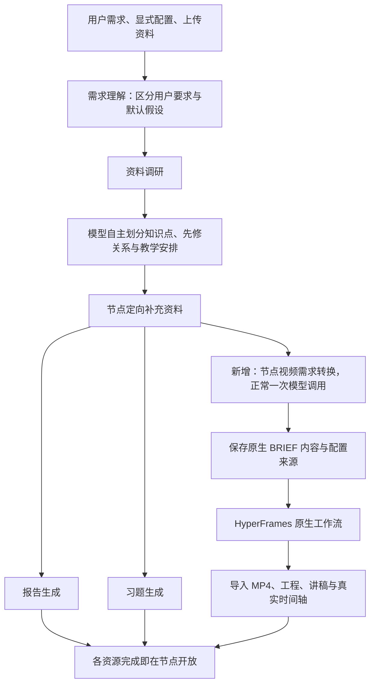

# 教学需求到 HyperFrames 原生简报的改造计划

日期：2026-10-19。状态：用户已批准两部分一并实施；代码、前端发布包、并发对照与约五分钟样片验证完成。主后端重启被 systemd 权限拒绝，生产生成服务与新前端尚待发布。详见[实施与验收记录](../acceptance/2026-10-19-hyperframes-teaching-brief/implementation.md)。

## 1. 用户确定的方向

- 平台继续负责需求理解、资料调研、学习路径和节点教学安排。
- 推荐按知识点及先修关系划分路径，节点数由模型根据需求决定；不固定四个，不用视频场景数代替学习节点数。用户明确指定数量时优先遵守。
- 教学安排与视频制作之间新增一次模型调用，将节点教学需求转成 HyperFrames 原生简报格式。
- 本次用户明确说明优先；缺失内容采用默认设置或模型判断。教学视频默认目标约 5 分钟，是内容规划参考，不是硬性截断或交付门槛。
- HyperFrames 保留原生路由、设计、讲稿、分镜、音频、动画、组装与渲染能力。
- 每节点报告和习题、视频可选开关、资源逐项开放、取消与断点恢复继续有效。

## 2. 审计结论与旧配置处理

| 项目 | 代码依据与实际状态 | 新配置/处理方式 |
| --- | --- | --- |
| 固定四个节点 | `research_contracts.py` 的 `ResearchBrief.node_count` 默认空，`CoursePath.nodes` 只要求至少一个；`research_agent.py` 只核对用户明确指定数量。上次四节点是模型选择 | 保留可变数组；需求、规划、审阅指令明确按知识点自主决定数量，未指定时不把推断数量写成用户约束 |
| 仅视频默认一个节点 | `skills/plan-learning-path/SKILL.md` 仍有“未要求多视频时保留一个节点”和活动占位说明 | 从课程规划规则移除；独立生成一条视频、补充已有单节点的范围约束仍保留，不能把单视频请求扩成整课 |
| 不传递教学安排 | `skills/generate-ai-classroom/SKILL.md` 明确不将平台活动、自测带入视频；`workflow.creation_brief` 只选取部分教学字段 | 改为传完整教学上下文，新增转换层决定哪些内容在视频演示、哪些留给报告/习题；自测不机械变成视频内部题目 |
| 未设视频时长 | `teaching_context.py` 总是将 `resource_target_minutes` 设为空；`workflow.py` 无默认目标。上次四份 REQUEST 都为空 | 新视频配置独立设默认目标 5 分钟，记录来源 default；有用户说明时覆盖，不借用整节点学习时间 |
| 总课时默认 60 分钟 | `understand-learning-request/SKILL.md` 允许无输入时假设 60 分钟 | 作为整课学习预算的默认提示保留并披露，不变成 60 分钟成片或固定节点数；显式课程时间优先。默认 5 分钟不盖过用户更短的整体时间安排 |
| 旧时长修复逻辑 | `quality.py` 的失败分支仍调用 `duration_reallocation.py`，只对特定历史 `RESOURCE_DURATION_EXCEEDED`、origins 等条件起作用；当前常规时长汇总已是 advisory | 新视频简报不从报告/习题耗时相减得到视频时长，不进入旧时长压缩修复；旧字段仅供历史任务解释/恢复，不能宣称它造成了这批短视频 |
| 独立课堂旧参数 | `GenerateClassroomRequest` 仍接受 `scene_count`、`teaching_style`、旧枚举 voice；`classroom_service.py` 保存这些字段，而 `hyperframes_classroom.py` 没有完整转交 scene_count/teaching_style | 新入口统一视频配置；旧客户端显式参数转换成简报要求，不静默丢弃。场景数量与节点数分开，教学方式作为描述而非固定课件模板 |
| 音色默认不一致 | 前端 `classroom.ts` 默认 alloy，API 默认 vivian；当前实际 TTS 配置与这两组旧名称不同 | 未明确选音色时使用已配置 TTS 默认音色，不将旧默认值伪装成用户选择。兼容映射只使用提供方实际支持的音色；无法映射的显式选择如实反馈，不静默忽略。不在本次规划中改动已修复的语音服务 |
| 旧课堂服务配置 | RuntimeSettings 仍展示课堂服务地址/密钥，`runtime_config.py` 对 classroom 探测 `/api/health`；新生成入口调用本地 HyperFrames 模块 | 新界面移除独立课堂 HTTP 服务配置，说明模型和语音沿用平台配置；历史记录保留迁移兼容，不把旧地址冒充新的模型地址。执行前复核所有消费者 |
| OpenMAIC 生成/逐页映射文件 | 主 `adapters/classroom.py` 已直接走 HyperFrames；旧 `openmaic_native.py`、`classroom_mapping.py` 还在，后者引用前者。检索未发现它们进入当前新生成主链路 | 隔离或移除失效生成入口及其旧测试，保留有消费者的旧内容读取/定位兼容。不能全局删除 openmaic 字样破坏历史课程 |
| 短片文件格式依赖 | `workflow_import.py` 使用 faceless storyboard parser、特定 SCRIPT 标题和 audio_meta 格式 | 对 general-video 原生结构做实测与兼容导入，保持视频、字幕、讲稿和时间轴提问定位，不强迫通用工作流使用短片私有脚本 |
| 独立习题数量 | 每节点一套 quiz 是当前用户要求，不是视频内部题数 | 保留报告与习题独立生成；不将 quiz 数量、报告章节数绑定视频场景数 |

说明：上表为实施前审计与处理方向；下文保留设计依据。现已完成对应配置、入口与提示词改造，历史数据保留；运行进程是否加载，以验收目录的 deployment.json 为准。

## 3. 新流程

转换层设在每个视频子任务开始处，各节点可并发；不增加整课串行等待阶段，不阻塞报告和习题。关闭视频时不调用此层。单资源修订只处理指定资源。

## 4. 新配置语义与优先级

统一入口建议为 `video_preferences`（落地时按现有 API 命名风格确定），供课程准备、独立课堂、补充与修订共用。服务端集中定义默认值，不在多个前端硬编码 5。

| 配置 | 默认/来源 | 规则 |
| --- | --- | --- |
| 目标视频分钟数 `target_minutes` | 5，来源 default | 用户明确的本视频时长优先；未指定时围绕 5 分钟安排，模型可根据内容与明确总预算调整并说明原因；不设硬性 4–6 分钟验收区间 |
| 时长约束类型 | target | 区分“约 5 分钟”和用户明确“最多/必须精确”的要求，不能把建议误当硬限制 |
| 语言、受众、深度 | 用户要求 → 有效偏好 → 需求模型推断 | 推断和默认均记录来源，不写成用户事实 |
| 讲解方式、案例、重点和排除项 | 用户要求优先，缺失由模型安排 | 由教学内容决定，不固定每节必须有同一组环节 |
| 配音 | 显式选择优先，否则教学视频默认讲解配音 | 音色使用现有有效 TTS 配置；用户要求无配音时贯穿到简报和实际音频行为 |
| 画幅 | 用户要求优先，否则适配当前播放器的横屏 16:9 | 原生纵屏等能力仍可用 |
| 工作流 | 原生路由规则决定 | 常规约 5 分钟教学片推荐 general-video；用户明确短片、幻灯片、已有视频编辑等仍按交付类型路由，不强制全部 general-video |
| 节点数、场景数 | 无默认固定数量 | 节点由课程模型决定，场景由 HyperFrames 决定；用户明确要求分别传递 |

优先级：本次明确结构化设置 → 本次用户明确文本 → 有效个人偏好 → 平台默认 → 未覆盖部分的模型判断。重要区别：前端自动填入的默认值不算用户显式设置，必须保留来源标记或在用户未修改前不提交为 override。

教学预算（整课、节点）与媒体时长分开保存。用户只要求整课 10 分钟时，由模型统筹节点和视频长度；默认 5 分钟不能机械应用到每节点后违反原需求。无显式总预算时，不因为历史默认 60 而凑固定数量的节点。

## 5. 新增模型调用的职责与原生文件

输入：原始需求、显式覆盖及来源、完整节点教学上下文（目标、活动、自测、先修、学习预算）、研究证据、附件/素材引用、报告与习题的职责边界、有效视频配置及既有版本修改要求。

输出：遵循已安装 HyperFrames 的 `skills/hyperframes/references/brief-format.md` 和 `brief-contract.md` 的 BRIEF Markdown，加一份轻量决策记录，用于记录配置来源、节点身份、目标覆盖要求和采用的默认假设。决策记录不成为新的自定义渲染协议。

原生简报包含规范 frontmatter：workflow、flow、storyboard、message、audience、language、length、aspect 等，以及 Intent、Assets、Customizations、Notes。常规默认示意为 `workflow: general-video`、`flow: automation`、`storyboard: no`、`length: 300s`；实际字段与枚举按固定上游版本契约生成。

- “视频应完整演示某个例子/解释边界”等写进简报，不在这层生成讲稿、分镜、动画代码或固定场景表。
- 教学活动按职责转译：教师示范进入视频要求，学习者独立练习留给 quiz/学习活动，详细资料留给 report；不能一律丢弃，也不能全部塞进视频。
- 此调用不重新检索，不做一轮独立内容审查，不要求人工确认。
- 原生 `BRIEF.md` 必须在 `hyperframes init` 之后写入项目目录。初始化前先在宿主检查点保存简报文本，初始化后原样落盘，避免非空目录令 init 失败。
- 原生宿主读取已准备简报，不再做第二轮需求访谈或另写一份冲突简报。保留其后续原生创作及因用户修改而更新简报的能力。
- 必要的格式/身份/显式要求检查由程序完成；格式错误最多定向修正一次，禁止无限修复或增加泛化检查链。
- 复用现有模型配置、计量、超时、取消和错误报告，不增加独立模型服务。

## 6. 持久化、恢复与兼容

- 增加简报版本、输入摘要、配置来源、生成简报、简报摘要和生成时间；在模型调用完成后立即保存检查点。
- 相同有效输入重试复用简报；资料或用户要求变化才重做对应简报，并生成新的资源版本。
- 落地方案：原生工作流 identity 使用带 teaching-brief-v2 标记的确定性输入摘要；检查点保存已采用的简报与简报摘要。先确定工作目录再调用模型，避免随机输出改变重试目录；取消后恢复沿用已存简报。
- 已有任务已经创建 BRIEF/STORYBOARD 时继续原工程，不因发布新默认 5 分钟而重写旧任务、重配音或重渲染。
- 旧请求缺少新字段仍可读取；新策略只在新任务或用户明确重做时应用。不要给旧序列化规格补默认字段造成原摘要改变。
- 旧 `duration_minutes` 转为新视频目标；旧 scene_count、teaching_style 仅在明确提供时转为简报要求；仅供兼容的过时默认不得盖过自然语言要求。
- 当前播放器外层 `classroom` / `hyperframes/v1` 接口尽量保持；通用工作流导入在内部适配，保证 scene/segment 身份与问答位置可追踪。

## 7. 实施顺序与涉及模块

1. **配置与需求契约**：调整 `schemas.py`、`research_contracts.py`、`teaching_context.py`、`generation_context.py`、相关请求/资源规格与配置快照；统一默认及来源语义。同步 understand/build/plan/review learning path 指令，清理仅视频旧规则。
2. **简报转换层**：在 `integrations/hyperframes/` 新增简报契约与生成模块；在 `generate_content/generate_native` 的合适边界接入共享网关和检查点；更新 `generate-ai-classroom`、宿主指令与进度事件。
3. **原生工作流交接**：初始化后写 BRIEF；保留完整上游，通用工作流用原生工具及已有 run_workers，不套用 faceless 专用准备脚本；依其自身角色契约批量分配场景。
4. **导入与问答定位**：适配 general-video 的讲稿、字幕、音频和原生 composition 时间；不得用“整个视频一个空讲稿片段”冒充完整定位成功。
5. **入口与遗留清理**：课程、独立课堂、聊天工具、局部补充统一配置；调整前端时长提示与音色默认，移除旧独立课堂服务设置；隔离已无调用的旧生成代码，保留历史内容读取。
6. **验证与发布**：完成下述集中验证；发布服务与前端，确认新任务加载新策略，保留旧任务恢复能力。

## 8. 验证范围与完成标准

- 不指定节点数时由模型合理拆分，不断言具体个数；明确两节点时保留两个；已有单节点补充不扩大范围。
- 未指定视频时长：简报目标约 5 分钟且来源是 default；明确 2/8 分钟、无配音、指定语言等优先；总学习预算与视频目标不混用。
- 完整教学活动和资料传到转换层，视频/报告/习题职责可核对；三者能并行和分别交付。
- 正常每视频只调用一次转换模型；重试命中检查点，取消与恢复不中途改目标；旧任务已有 BRIEF 不自动迁移。
- 一条真实约 5 分钟 general-video 全链路：MP4 可播放、配音正常、字幕和时间轴存在、暂停提问能定位；保存输入、简报、工程、成片及各阶段耗时。
- 用同一教学需求与上一版对照内容覆盖和耗时，区分新增转换调用、原生准备、场景、排队与渲染。视频加长会增加渲染量，未实测前不承诺总时间下降。
- 集中跑相关契约、恢复、导入与前端验证；失败只修复具体问题，不增加多轮审片和装饰性检查。

交付已形成：代码、旧配置处理清单、实际样片与阶段耗时、前端验证课程。服务重启和新前端上线尚待完成，详见验收记录。

## 9. 并发审计与提升顺序

2026-10-19 对运行进程与调度代码核对：

- 每门课程最多 4 个 pending/running 资源子任务（`COURSE_PREPARATION_RESOURCE_CONCURRENCY=4`），视频、报告、习题共享名额。不是每节点各有 4 个，也不是全服务器只有 4 个。
- `production_stages.py` 按节点顺序提交，节点内先视频，再其他资源；空位会继续提交后续节点，无需等待前一节点全部完成。并发名额包含排队任务，不等于全部已经执行。
- 主后端 PID 2589661 配置 3 个通用 worker、2 个控制 worker；补充进程 PID 2588978 命令行覆盖为 5 个通用 worker、0 个专用控制 worker。因此两进程共 8 个通用执行 worker，其他业务也共享；补充池无类型隔离时也可领取控制任务。
- 场景任务默认每视频 4 并发、每进程合计 8 并发。所谓 GLOBAL_SLOTS 是 Python 进程内信号量，不是跨进程全站限额。每条视频渲染为 2 worker，配音步骤默认最多 8 路。
- 上次手工追踪视频的场景阶段约 8 分 58 秒，最长场景排队约 4 分 56 秒；这是可优化等待的证据，不能据此把全部排队时间视为必然可省的课程总时间。
- 调查时机器可见 40 个逻辑 CPU、约 250 GiB 内存且有较大空闲，但属于检查时快照，不代表生成高峰余量，也不能推断模型服务的并发吞吐。

拟按顺序验证，不能一次把所有参数放大后无法归因：

1. 每课程资源并发从 4 调至 8 做对照，先利用已有执行池；按视频/轻量资源分配名额并轮转节点，避免多节点长视频占满后阻塞报告、习题。前几个节点优先交付，其余不无限排队压入执行池。
2. 新增简报转换作为各视频的独立前置步骤并行执行，报告与习题不等待它；模型请求等待不能长期独占稀缺的渲染配额。
3. 对约 5 分钟通用流程使用原生 2–3 场景一组的派发方式减少重复上下文；在实际模型吞吐允许时再测试每视频场景并发 4→6、每进程 8→12。分组与加并发是两个变量，应分别观察。
4. 渲染单独对同一工程测试 2→4 worker；CPU、内存和模型 API 的限额分别控制，必要时增加跨进程渲染调度，不能把进程内信号量当作全机容量控制。
5. 保留真正依赖：教学简报先于讲稿、配音测量先于精确时间安排、场景完成先于最终合成；不将这些步骤强行全并发。已完成资源仍立即开放。

对照指标：首份资源可用时间、首节点三类资源齐备时间、全部视频完成时间、整课完成时间、各队列等待、模型错误/重试、渲染 CPU/内存。无实测前不承诺倍数提升。本节保留实施前基线。现采用配置为：每课程资源 8、其中视频最多 4、单视频场景任务 6、每进程场景任务总计 8、渲染 4 worker。每进程 12 未经多视频负载验证，因此未采用；生产进程待重启后加载。
