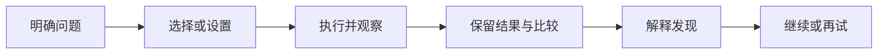
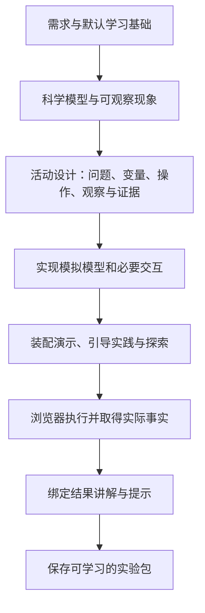

# 模拟实验的任务组织与界面重设计方案

状态：历史设计提案，未实施。用户后续认为独立引导实践的交互与实现过于复杂，最新方向已收敛为[原理演示与自由探索两阶段方案](2026-10-20-experiment-two-stage-design-cn.md)。下文保留讨论依据，不作为当前实施范围。

核心调整：围绕一个可回答的问题生成实验活动，让用户始终知道“现在研究什么、接下来做什么、看哪个结果”。实验的操作复杂度随活动逐步开放。算法判断、物理测量和连接搭建采用不同的活动过程，共用任务展示、记录和对话能力。

## 1 当前实现为什么容易让用户迷失

以下结论来自当前源码与已有验收样本；历史样本用于说明具体设计问题，不代表已逐一检查当前用户账号的全部实验。

| 观察 | 对学习者的影响 | 需要改变的层 |
| --- | --- | --- |
| 当前生成流程先生成完整自由探索 HTML，再设计动作和任务 | 教学任务容易围绕已有按钮组织，一开始就暴露过多参数与指标 | 生成顺序 |
| `PlannedTask` 主要是 title、initial、interaction、completion 四个文本字段 | 宿主无法稳定识别当前可调变量、主要观察量、测量是否结束及下一步入口 | 活动数据 |
| `pagesRuntime` 对练习中的 fail 恢复操作前状态，对 pass 自动进入下一任务 | 错误预测可能与无效操作混淆；刚测得的结果可能在下一任务初始化时消失 | 运行语义 |
| 当前说明常写“观察变化”“探索规律”，任务全文默认折叠 | 用户看到模拟器，却缺少眼前明确的小目标 | 界面与教学文字 |
| 历史摩擦力样本一次要求尝试五档摩擦系数、四档初速度，再同时改变两者并推导公式 | 第一次操作就承担调参、记录、读图、控制变量和推导等多项任务 | 目标与任务粒度 |
| 三个页面通过“沿用原算法”的提示分别生成 | 页面可运行不等于三阶段的计算、初始条件和状态含义完全一致 | 模拟模型与页面组织 |

现有能力值得保留：真实动作记录、冻结问答上下文、保存恢复、最终讲解依据实际执行事实生成。重设计应建立在这些能力上。

此前设计文档已经提过控制变量、运行后观测和保留结果，但这些要求没有完整落入当前动作契约与通用运行流程。本次重点是把它们变成宿主能执行的明确活动状态。

源码依据：

- [当前生成流程](../../backend/src/app/practice/pages/generation.py)
- [动作与讲解结构](../../backend/src/app/practice/pages/narration.py)
- [练习运行与恢复](../../frontend/src/practice/experiment/pagesRuntime.ts)
- [页面布局](../../frontend/src/practice/experiment/Experiment.tsx)
- [已有教学阶段设计](2026-10-14-experiment-teaching-phases-plan-cn.md)

## 2 用户路径与开放程度

保留三个容易理解的入口：**看演示、引导实践、自由探索**。入口不是必须依次通关的三道关卡；默认进入适合新手的活动，有基础的用户可以直接探索。

引导实践内部按目标组织小活动。例如摩擦实验显示：

1. 比较两种路面的停车距离。
2. 比较两种初速度的停车距离。
3. 自己设计一次有效对照。

这些是同一个实验中的问题，不需要再增加一层“阶段页面”。任务数量由学习目标决定，不为所有实验固定题数或要求遍历所有功能。

一个活动默认遵循：

这条流程描述学习逻辑，界面不机械地增加六个“下一步”。适用时才展示预测、运行、记录或比较；一次点击就能完成的判断任务保持简洁。

引导分三层逐步减少：

- **第一次做**：提供起始场景，突出当前相关控件和一个观察量；给出简短操作指引。
- **换条件再做**：用户选择新的有效条件，系统协助保持对照条件和记录数据。
- **自己设计**：用户决定改变什么、保持什么、怎样比较，系统检查实验是否支持其结论。

自由探索入口始终可用，提供可选问题卡，例如“能让它滑得更远吗”“怎样得到一组有效对照”。不强迫用户先聊天或答题，也不把自由探索变成另一套通关任务。

## 3 按活动类型组织操作

| 活动类型 | 用户承担的思考 | 系统承担的过程 | 完成依据 |
| --- | --- | --- | --- |
| 决策执行，例如排序 | 选择对象、判断交换与否、判断结束条件 | 执行本次已确认动作并展示变化 | 目标所需决策与过程证据 |
| 变量探究，例如滑动摩擦 | 确定对照条件、预测、比较测量、解释规律 | 连续模拟、停止检测、自动记录与对照展示 | 有效测量、可比条件及用户作答分别记录 |
| 搭建诊断，例如简单电路 | 连接对象、预测作用、查找问题 | 仿真测试、显示可观察结果 | 连接与测试事实，必要的诊断证据 |

首轮只实现前两类，搭建诊断用于检查接口是否过度依赖排序。活动类型不按学科名称写死，一个算法实验也可以有“比较输入规模”的变量探究活动。

重要区别：

- 排序中“应交换却选择不交换”可以撤销本次错误动作。
- 物理实验中“结果与预测不同”是有效观察，必须保留测量。
- 同时改变两个变量的一次运行可以保留，但不能用于完成要求单变量对照的任务。
- 点击运行、完成测量、完成任务、形成理解是不同事实，界面分别表达。

## 4 摩擦实验的完整样板

### 4.1 先说明研究对象

建议入门样板使用“水平面上滑动的物块”。若继续使用小车图形，应明确为“车轮锁止后滑行的简化模型”。自由滚动的小车不能直接套用恒定滑动摩擦模型。

当前样板假设：水平面、仅考虑恒定滑动摩擦、忽略空气阻力，g = 9.8 m/s²，运动停止后不反向加速。场景旁保留一句模型说明，详细推导放入原理折叠区。

首个活动只回答：**相同初速度下，摩擦系数增大，停车距离会怎样变化？**

### 4.2 一次完成一个明确动作

| 时刻 | 页面明确告诉用户的事 | 可见操作 | 页面反馈 |
| --- | --- | --- | --- |
| 尚未运行 | 先测一次作为对照：初速度 4 m/s，摩擦系数 0.2 | 主按钮“开始第一次测量” | 一个物体、一条轨道、停车位置刻度 |
| 运行中 | 观察它停在哪里 | 暂停、取消本次测量 | 简洁运行状态；无需反复点时间步 |
| 第一次停止 | 已记录第一次距离。保持初速度，只改变摩擦系数再试一次 | 摩擦系数控件；初速度显示“本次对照保持不变” | 保留第一次停车位置和结果 |
| 第二次准备 | 选择不同的摩擦系数，可先预测会更远还是更近 | 一个待调变量；可选预测；“测量并比较” | 明确显示本次变化与固定条件 |
| 第二次停止 | 两次结果已可比较 | “更远／更近／基本相同”；“再测一次” | 两个停车位置和两行实测结果 |
| 形成发现 | 根据自己的两次记录说明方向 | “继续研究初速度”或“换个条件再试” | 反馈引用实际参数、距离和差异 |

用户不必输入指定的“标准摩擦系数”才能通过。只要在模型允许范围内选择不同值、保持其余条件并完成有效测量，就形成可比较证据。

预测可以选择“不确定，先看看”。预测错误时保留原预测和实验结果，帮助对照；不清空记录、不让用户重跑来获得“正确预测”。观察问题答错后提示查看哪两项数据，允许重答或继续，不能把测量标成失败。

### 4.3 数据显示与科学含义

默认显示一个主要指标：停车距离。运动轨迹上保留基线停车点，用户可以直接比较。速度曲线、停车时间、受力箭头和公式作为按需展开的观察方式，在后续活动需要时再突出显示。

下面仅为实现核对示例，正式页面必须使用运行结果填表，不预填理论答案：

| 测量 | 初速度 | 动摩擦系数 | 停车距离 |
| --- | --- | --- | --- |
| 第一次 | 4 m/s | 0.2 | 约 4.082 m |
| 第二次 | 4 m/s | 0.4 | 约 2.041 m |

在上述模型中，停车距离为 `v₀² / (2μg)`；两次示例结果已按该模型复算。两次测量支持比较这两个条件，不能仅凭两个点声称已经证明完整函数关系。学习平方或反比关系时另设进阶活动，增加合适取值与分析。

模拟器按模型产生结果，教学文案使用“观察／检验模型预测”，不把程序计算一致性描述为对现实定律的独立实验证明。

## 5 冒泡排序也按目标收敛

冒泡排序保留手动判断的优势，但避免把每个练习都变成重复完成整套排序。

- **看演示**：采用最小但非平凡的数组，完整演示所选算法到真实终止。
- **判断交换**：学习目标是相邻比较规则；提供足够的代表情形，包含不交换与相等情形。
- **理解一轮的作用**：用户完成一轮并指出哪个位置已确定；反馈明确“本轮完成”，不宣称整个排序完成。
- **完整手动排序**：作为单独、明确命名的活动；若目标要求完整执行，必须保存完整必要过程，不能自动代做后假称用户完成。
- **自主探究**：比较有序、逆序或含重复值的输入；此时目标是比较过程指标，可以由系统运行并记录计数。

这使“练比较规则”“练完整执行”“探究效率”拥有各自的任务和完成依据，而不会混在一个含糊的“亲手试一次”里。

## 6 界面布局

延续用户已经确定的三栏关系：左侧导航，中间实验与任务，右侧仅 AI 对话。

| 左侧 | 中间主要工作区 | 右侧 |
| --- | --- | --- |
| 三个学习入口 | 当前问题与一句操作指引 | AI 对话 |
| 本入口的简短活动列表 | 实验图形，突出本次观察对象 | 可引用当前活动和某次测量 |
| 活动完成与待观察状态 | 紧贴图形的必要控件和主操作 | 不承载必读步骤、任务推进按钮 |
| 次级记录管理 | 操作后的简短反馈 | 需要帮助时展开提示或解释 |
|  | 当前两次结果的紧凑对照 |  |
|  | 完整数据、背景与公式折叠区 |  |

具体规则：

1. 当前问题和下一项操作不能藏在“查看完整任务”里；展开区只放补充说明。
2. 相关参数与主按钮放在图形旁或紧贴下方。实验讲解与前进、回看操作继续紧贴图形，数据增长不能把它们隔开。
3. 主按钮按当前活动状态命名，如“开始测量”“测量并比较”“确认判断”“查看本次发现”，避免所有流程都写“下一步”。
4. 同一活动展示一个主要推进动作；暂停、重试、跳过等是次级操作。完成后保留结果，由用户选择继续，不自动切走实验现场。
5. 初级对照活动突出一个待调变量，固定条件显示值和保持原因；自由探索可以开放全部实际支持的参数。
6. 首屏只展示完成当前问题必需的指标。长数据表进入记录区；当前基线与本次结果保留紧凑摘要。
7. 手机保留“实验／AI 对话”切换；问题、图形和主要动作在常见屏高下可同时查看。复杂图形提供明确缩放或平移，不能靠统一裁切掩盖对象和坐标。
8. 不靠颜色单独区分基线、本次、未测量或失败；保留文字和单位。输入支持键盘及明确标签。

正式布局由宿主和生成页面约定的区域共同完成。现有 iframe 内插占位、父页面绝对定位讲解的方案仅作为已上线兼容桥接；新版应定义图形、控件、观测、参考区域的固定接口，避免继续根据 canvas、SVG 或数学公式猜测页面结构。

## 7 生成流程与职责

推荐流程：

先写清楚学习问题和活动过程，再实现能够完成这些活动的模拟器。自由探索使用同一模型开放更多条件，不再作为所有教学任务必须依附的第一个完整页面。

**操作前指引与操作后讲解分开。** 设计阶段写“用户要做什么、关注什么”，不预测尚未运行的结果。结果讲解继续绑定实际动作、测量与判定事实，保留现有先执行后讲解的优点。

### 7.1 最小活动结构

新增活动结构表达下列信息；字段名在实现时固化，不要求生成复杂规则语言：

| 信息 | 用途 |
| --- | --- |
| 学习问题与可观察目标 | 定义当前活动到底要回答什么 |
| 活动类型 | 选择决策执行、变量探究等运行方式 |
| 起始场景 | 明确首次进入和重做的初始条件 |
| 当前可调变量与固定条件 | 控制界面开放程度及对照有效性 |
| 主要观察量及单位 | 驱动首屏指标与记录 |
| 主要操作及运行状态 | 明确准备、运行、待观察和完成时的入口 |
| 测量结束条件 | 区分自然停止、取消、超时或尚未完成 |
| 所需证据与对照规则 | 判定任务条件是否满足 |
| 反馈与恢复方式 | 按活动区分撤销错误动作、保留结果和允许修正 |
| 继续方式与帮助层级 | 保留结果、用户显式继续、逐级提示 |

首版采用少量明确组件与运行状态，不设计任意表达式执行器，不让模型输出跨整包的复杂引用网络。活动里的控件、观察量和动作必须能映射到实际页面能力。

### 7.2 共享与生成的边界

- 宿主负责活动导航、任务卡、主操作、提示层级、紧凑结果对照、记录、保存与对话。
- 生成模块负责学科模型、图形表达、对象交互、状态与测量计算。
- 同一个实验的三种入口共用同一计算与状态含义。优先收敛为一个模拟运行包加不同活动配置；过渡期保留三页时，必须复用同一份模型代码，不只提示模型“沿用算法”。
- 参数和结果通过稳定标识、类型和单位交接。页面绘图、测量记录和解释读取同一份实际状态。

### 7.3 运行与结果记录

把目前单一 pending/pass/fail 的职责拆开：

1. **操作执行**：是否有效、是否已启动、是否完成。
2. **测量记录**：本次运行的输入、结果、单位、结束原因和有效性。
3. **任务证据**：是否已有满足条件的操作或可比测量。
4. **理解表达**：用户的预测、观察回答或解释，及对应反馈。

一次完整测量绑定当时参数和 run ID。改参数后显示“新条件尚未测量”，旧结果继续保留为历史，不能自动换上新参数标签。取消和未完成运行不得填成零距离。

不把滑块移动或动画采样直接当成答错，也不要求一次异步动画锁住整条操作通道；运行、暂停、取消和完成各自有明确事件。保存中断后可以恢复已完成测量，未结束的运行显示为中断，不伪造完成结果。

### 7.4 AI 的作用

右侧 AI 回答问题、解释两次结果、帮助制定下一次对照。正常实验步骤由活动界面完成，不依赖每一步模型请求。

上下文补充当前学习问题、开放变量、固定条件、主要观察量、选中的测量与用户预测。用户问“我现在应该做什么”时，AI 能引用当前可执行动作，而不是只复述物理公式。

提示按“提醒观察点 → 指出相关操作或数据 → 给一个具体示例”展开。提供帮助不自动替用户调参或写入完成；查看示例、独立完成和未验证理解分别记录。

## 8 实施顺序

| 批次 | 交付 | 完成标准 |
| --- | --- | --- |
| 第一批：摩擦力样板 | 一个明确的路面对照活动；任务卡、一个可调变量、运行到停止、两次结果对照、保留结果与显式继续 | 初次使用者不打开聊天，也能说出研究问题、执行测量并找到差异 |
| 第二批：生成活动结构 | 将新活动设计接入 science 后、完整页面前；实现任务状态、运行结束与测量记录；冒泡排序使用同一外壳适配 | 新生成的算法和物理样本都能形成明确活动，不为两个主题各写一套宿主 |
| 第三批：共享模型与泛化 | 收敛三阶段模型复用；扩展自由探索问题卡和多次比较；加入一个不同主题检验抽象 | 更换主题不依赖修改共享宿主核心，旧实验仍可读取 |

首批布局原型使用真实状态和运行过程验证，不只画静态效果图。第二批用真实生成的多个输入验证活动组织，避免固定样板正确就声称通用生成已解决。

涉及的主要模块：

- `backend/src/app/practice/pages/generation.py`：调整生成顺序与可恢复阶段。
- `pages/narration.py`、`pages/contracts.py`：活动结构与操作前指引；结果讲解仍与实际事实绑定。
- `skills/design-experiment/`：按活动类型编排、逐步开放和结果保留规则。
- `frontend/src/practice/experiment/`：活动外壳、运行状态、测量对照与区域契约。
- `experiment/facts.py`、`state_evidence.py` 及教学上下文：观测、预测、对照有效性与来源。

新版实验使用显式内容协议版本；不能原地解释旧记录为新活动证据。已有实验需要按新方案重生成或明确迁移才获得完整新流程，单改前端不能补出缺失的任务组织。

## 9 验证是否解决了问题

### 学习体验

请首次接触主题的用户在无聊天帮助下完成第一项活动，观察：

- 能否准确说出“这一轮要研究什么”。
- 能否找到下一项操作，而不是遍历所有控件。
- 能否指出哪项保持不变、哪项改变了。
- 能否找到两次结果，并说出观察到的区别。
- 预测错误后是否仍能理解如何继续。

记录首次有效操作的时间、迷失位置、求助原因和是否能解释结果。点击数、页面停留或任务通过率不能单独代表理解改善。与当前版用同类学习者、相同任务做比较，取得基线后再定数值目标。

### 功能与生成

- 连续运行到真实结束后才形成完整测量；暂停、取消和重做有独立状态。
- 合法但不符合预测的结果仍保留；改变两个变量的记录不会冒充有效单变量对照。
- 调参、刷新和阶段切换不串改旧测量，重复完成事件不重复追加记录。
- 物理样板的结果与明确模型在合理容差内一致；算法的动作规则和实际完成范围一致。
- 活动中的可调参数、主要操作和观察量都在实际页面中存在并生效。
- 桌面与手机能看到当前问题、实验图形与主操作，长表格不推远关键操作。
- 模型问答不可用时，基础活动仍能完成；帮助不伪造用户的操作或理解。

采用针对本次变更的结构与浏览器运行检查，沿用局部失败修复。不新增一层通用模型审阅流程，也不把基本运行检查说成全面科学认证。

## 10 教学设计参考与本项目取舍

PhET 的活动设计指南强调明确而有限的学习目标、简短提示、用结果表支持比较，并提醒过细的程序式指令可能限制探究。[PhET 活动设计指南](https://phet.colorado.edu/files/guides/TeacherGuide_ActivityDesign_en.pdf)

本项目面向可能缺少教师陪同的初学者，因此建议在首次活动提供更多操作定位，随后逐步减少提示，并始终保留直接探索入口。这是针对本产品场景的设计选择，需要通过上述用户观察验证，不能把“引导越多越有效”当作普遍结论。
