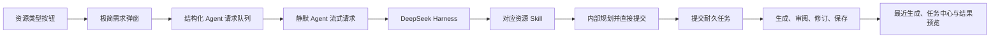

# 生成工厂统一接入 Agent 与极简需求输入：设计文档

日期：2026-09-10｜状态：已实施；功能定向与浏览器自动化通过，真实模型扩展验收记录见配套文档。

配套文档：[实施计划](../plans/2026-09-10-generation-factory-agent-entry-implementation-cn.md)、[验收标准](../../acceptance/2026-09-10-generation-factory-agent-entry-acceptance-cn.md)。

## 1. 背景

教师和学生当前可以从两处发起教学资源生成：中间对话区由 Agent 理解意图并调用资源 Skill，右侧生成工厂则通过每种资源的专用表单调用 direct API。两条路径最终都能创建后台任务，但交互规则、内容组织、独立审阅、任务恢复和用户后续修改并不完全一致。同一种资源可能因为入口不同而得到不同的生成与质量保证。

当前生成工厂还要求用户逐项填写受众、风格、数量、难度、篇幅、课时和其他结构化字段。多数信息本来就可以从一句自然语言需求中提取；大量表单增加了理解和操作成本，也让前端字段与 Agent 的资源契约长期重复维护。

## 2. 用户目标

1. 保留生成工厂中清晰可见的资源类型按钮，让用户能快速选择要创建的资源。
2. 按钮只作为 Agent 流程的快捷入口，不再形成独立生成流程。
3. 点击按钮后只需用自然语言描述需求，例如“生成一份面向大一学生的数组随机访问教学报告，语言通俗，包含原理、示例和常见误区”。
4. Agent 从描述中提取受众、数量、难度、风格、篇幅、课时、媒体和交互等约束，缺失信息可以合理默认，只有会实质改变结果时才追问。
5. 生成工厂采用静默直达规则：内部仍按资源类型规划和审阅，但不把输入或方案写进对话，也不等待大纲确认；普通对话继续遵守各资源原有的确认规则。

## 3. 核心决策

### 3.1 按钮确定目标类型，模型理解具体要求

资源按钮提供可信的目标类型提示。前端发送规范化的 `action_hint=generate.<resource_type>`：

| 前端按钮 | 规范资源类型 | action_hint |
| --- | --- | --- |
| 教学报告 | `report` | `generate.report` |
| 教案 | `lesson_plan` | `generate.lesson_plan` |
| 教学博客 | `blog` | `generate.blog` |
| 习题 | `quiz` | `generate.quiz` |
| 闪卡 | `flashcard` | `generate.flashcard` |
| 思维导图 | `graph` | `generate.graph` |
| 互动游戏 | `game` | `generate.game` |
| AI 课堂 | `classroom` | `generate.classroom` |

按钮已明确资源类型，因此 Agent 不再重复猜测目标类型。`action_hint` 不是生成授权，也不覆盖用户当前文本：用户在弹窗中写“先讨论结构，不要生成”时，否定和暂停仍优先；用户明确改成另一种资源时，以当前文字为准并由 Agent 处理切换。

### 3.2 自然语言是需求事实源

用户实际输入的文字是受众、数量、难度、风格、篇幅、课时和其他内容要求的事实源。前端不把旧表单默认值伪装成用户已确认要求，也不在不可见字段中补写模型应自行判断的内容。

浅色示例使用真正的 placeholder 或独立示例文本实现：

- placeholder 不作为 input value；
- 用户没有输入时不能提交；
- placeholder、帮助文案和默认示例不得进入网络请求、会话历史或工作记忆；
- 可以提供“使用这个示例”操作，但只有用户主动点击后才把示例写入输入框。

### 3.3 资料范围保留为必要设置

资料来源涉及权限、检索范围和证据边界，不能仅由自然语言猜测。弹窗保留一个默认折叠的“资料范围”区：

- 当前已选文档非空时，默认使用这些文档；
- 没有选中文档时，沿用当前对话的 RAG 设置：已开启则使用课程资料自动检索，未开启则不使用知识库；
- Web 设置沿用当前对话开关；
- 用户展开后可以在“不使用知识库、课程资料、指定文档”之间调整；
- 指定文档必须继续经过服务端 owner、course、ready 状态校验；
- 资料设置作为结构化请求上下文传递，不能拼进用户文字后再靠模型反向解析。

## 4. 目标交互

### 4.1 弹窗结构

点击任一资源按钮后打开紧凑弹窗：

```text
创建教学报告                                      ×

描述你想生成的内容
┌──────────────────────────────────────────────┐
│ 例如：生成一份面向大一学生的数组随机访问教学 │
│ 报告，语言通俗，包含原理、示例和常见误区。   │
└──────────────────────────────────────────────┘

› 资料范围：已选择 2 份文档

                               [取消] [交给 AI]
```

弹窗只默认展示资源类型、输入标签、自然语言文本框、资料范围摘要和操作按钮。不得继续默认铺开旧的逐字段配置表单。

### 4.2 各资源示例

| 资源 | 浅色示例 |
| --- | --- |
| 报告 | 生成一份面向大一学生的数组随机访问教学报告，语言通俗，包含原理、示例和常见误区，约 1500 字。 |
| 教案 | 为高中一年级设计一节 40 分钟的函数单调性教案，安排小组探究和形成性评价。 |
| 博客 | 写一篇面向零基础读者的递归入门博客，用生活类比和两个代码示例，语气轻松。 |
| 习题 | 围绕二叉树遍历生成 8 道中等难度习题，包含单选、判断和简答，并给出逐题解析。 |
| 闪卡 | 生成 12 张操作系统进程与线程闪卡，每张只考一个概念，答案简洁。 |
| 思维导图 | 生成一张细胞呼吸思维导图，按阶段组织，标明发生场所、输入、输出和关键条件。 |
| 游戏 | 设计一个英语不规则动词配对游戏，面向初一学生，共 10 组，完成后给出反馈。 |
| AI 课堂 | 创建一个 15 分钟的牛顿第二定律 AI 课堂，包含演示和一道互动检测题，不需要外部配图。 |

示例只帮助用户理解表达方式，不规定产物结构，也不能被后台当作默认需求。

### 4.3 提交后的行为

1. 前端验证需求不为空，并生成稳定的客户端请求 ID。
2. 生成工厂把带有 `entry_mode=generation_factory` 的结构化 Agent 请求放入共享队列。
3. ChatPanel 使用独立的静默提交函数消费请求，不绑定当前会话 ID，也不插入用户或 AI 消息。
4. 后端在开始模型规划前持久化真实的 `preparing` 任务并立即返回任务 ID，刷新页面后仍可恢复。
5. 后端 Agent 从原文提取要求；需要内部方案的资源在同一轮完成规划并直接提交，不向用户展示大纲或等待确认。正式生成复用 `preparing` 任务 ID，不创建第二条记录。
6. 请求进入耐久任务后，由生成工厂“最近生成”和全局任务中心展示进度与最终结果；普通聊天保持可用。
7. 后端不把工厂请求写入对话历史或 Agent 长期记忆。失败时恢复对应工厂草稿，避免丢失原始需求。



## 5. 前端状态与接口

### 5.1 共享队列对象

用结构化对象替代只能携带字符串的 `queuedMessage`：

```ts
type AgentGenerationResourceType =
  | "report"
  | "lesson_plan"
  | "blog"
  | "quiz"
  | "flashcard"
  | "graph"
  | "game"
  | "classroom";

type QueuedAgentRequest = {
  requestId: string;
  text: string;
  resourceType: AgentGenerationResourceType;
  actionHint: `generate.${AgentGenerationResourceType}`;
  entryMode: "generation_factory";
  ownerUserId: string;
  courseId: string;
  scopeType: "course" | "knowledge_point";
  scopeId?: string;
  sourceMode: "none" | "course_auto" | "selected_documents";
  selectedDocumentIds: string[];
  allowRag: boolean;
  allowWeb: boolean;
};
```

消费前必须核对 owner、course 和 scope 与当前页面一致。账号、课程或知识点已切换时，不能把旧请求发送到新工作区；应保留用户文字并显示可恢复错误。

### 5.2 ChatPanel 发送覆盖

普通聊天继续由 `handleSendMessage` 处理。生成工厂请求由独立的静默提交函数处理，使用队列中不可变的资源类型和资料快照，不调用 `addMessage`、不切换当前 conversation，也不占用聊天加载状态。

`buildChatReplyPayload` 显式传递 `action_hint` 与 `entry_mode=generation_factory`。请求仍走 Chat V2 Agent stream，但 `conversation_id` 留空，由后端创建仅用于本次执行和任务幂等的内部标识。

### 5.3 生成工厂职责

生成工厂继续负责：

- 展示允许使用的资源按钮；
- 收集自然语言需求和必要资料范围；
- 展示最近任务和资源；
- 打开生成结果预览。

生成工厂不再负责：

- 拼装每种资源的 direct API payload；
- 决定是否先确认方案；
- 直接创建后台任务；
- 独立维护一套生成失败重试语义。

## 6. 后端路由与 Agent 边界

1. Chat V2 接口接受全部八类 `generate.*` action hint，并使用明确 allowlist 拒绝未知值。
2. Harness 对这些提示统一可用，根角色将按钮目标视为本轮可信上下文。
3. 模型仍负责从用户文字提取数量、受众、风格、课时等要求，并按 `edu-report` 或 `edu-resources` Skill 决定工具调用。
4. `generation_factory` 模式允许报告、教案和课堂在同一轮内部生成方案并提交；`conversation` 模式仍要求先展示方案、等待后续确认。
5. 工厂模式结果不写入会话存储或长期记忆；任务、来源、权限、幂等、失败恢复和独立审阅仍复用现有 Agent 与业务服务。
6. 质量审阅策略由资源生成命令显式表达，不继续依赖入口或 `harness_outline_id` 的偶然存在来判断。
7. direct API 暂时保留给兼容调用方；生成工厂和学生生成工厂停止调用。删除 direct API 需另行盘点外部使用者，不属于本次切换的前置条件。

## 7. 分资源交互规则

| 类型 | Agent 默认行为 |
| --- | --- |
| 报告 | 内部组织并生成大纲，同一轮直接提交完整报告任务；不展示大纲。 |
| 教案 | 内部生成包含课时、师生活动与评价的方案，同一轮直接提交。 |
| 博客 | 信息充分时直接提交；需要结构时内部规划后同一轮提交。 |
| 习题 | 信息充分时直接提交；用户只要方案时停在方案。 |
| 闪卡 | 信息充分时直接提交。 |
| 思维导图 | 信息充分时直接提交。 |
| 互动游戏 | 主题明确时由 Agent 选择适合玩法并直接提交；实质歧义才追问。 |
| AI 课堂 | 内部生成逐场景方案并核对总时长、语音与外部配图设置，同一轮直接提交。 |

## 8. 错误、并发与恢复

- 空输入：弹窗内提示“请描述要生成的内容”，不发送请求。
- 无课程：保留输入，提示先进入课程。
- 资料无权限或未就绪：服务端返回稳定错误；弹窗或对话给出可操作说明，不改为无资料生成。
- 请求排队：最多保留一个尚未开始的生成工厂请求；开始后独立后台执行，不等待普通聊天结束。
- 重复点击：相同 request ID 只消费一次；按钮提交后进入 busy 状态。
- 刷新：已经形成会话消息或任务的请求依赖现有持久化恢复；尚未消费的弹窗草稿按用户、课程、scope、资源类型保存。
- 切换账号或课程：清除不属于新身份/范围的排队请求和草稿展示，不跨身份发送。
- 信息确实不足：本次静默请求返回可恢复失败并保留草稿，用户补充后重新提交。
- Agent 准备阶段：提交后立即在任务中心显示“准备中”；规划成功后同一任务转为“排队中”，规划失败则同一任务转为失败。
- 模型提供方不可用：使用 `PROVIDER_UNAVAILABLE` 标记，任务保留可重试入口，并提示检查额度或配置。
- 后台失败：通过任务中心和 Agent 查询/重试流程处理，不由生成工厂另建第二个任务。

## 9. 可访问性与响应式

- 弹窗有 `dialog`、`aria-modal`、明确标题和输入标签。
- 打开时焦点进入文本框；Escape 关闭后焦点返回原资源按钮。
- placeholder 不能代替标签，错误信息使用 `role=alert`。
- 浅色示例仍满足普通辅助文字的对比度要求；不能仅靠颜色表示含义。
- 1024px 及以上为紧凑居中弹窗；窄屏接近全宽，底部操作按钮保持可见，不产生横向滚动。
- 遵循 `prefers-reduced-motion`。

## 10. 数据与兼容性

- 不新增数据库表。
- 会话、任务、资源版本和审阅记录沿用现有存储。
- Zustand 持久化状态读取时容忍旧版 `queuedMessage`；迁移完成后不再写入旧字段。
- 旧的逐资源 definitions、forms 和 `useGenerationSubmission` 只有在确认无其他调用方后删除；第一阶段先断开生成工厂调用，避免同时扩大回归面。
- 已有 direct 任务和资源不迁移、不重建。

## 11. 非目标

- 不删除所有 direct API。
- 不改变普通对话入口中的大纲/方案确认规则。
- 不让前端通过关键词解析用户要求。
- 不在弹窗增加模型生成的结构化字段确认页。
- 不改变已有资源预览、下载、版本修改和课程发布规则。
- 不把 placeholder 或默认示例当作用户授权。

## 12. 完成定义

只有以下条件同时成立才算完成：八类按钮均走带 `generation_factory` 模式的 Chat V2 Agent 流；提交内容不出现在聊天或会话历史；报告、教案和课堂无需用户确认内部方案即可直接创建；极简弹窗、资料范围与权限正确；所有生成结果使用统一质量门槛；重复提交、切换范围和失败恢复可验证；配套验收文档中的自动化证据完成。
